# Reserve bank

Ready-to-post pieces, grouped by series. Pick by **id**; nothing here is in Zernio until Aadi asks for it.
**121 pieces across 9 series.**
Pieces marked *to confirm* rest on an insight Aadi has not yet confirmed.

## A question to ask yourself

Money-habits and protection prompts, framed as questions, never advice. Insurance and super appear only as questions.

### `ask-yourself/one-income` — If one income stopped tomorrow, how long could you hold the house? · *to confirm*

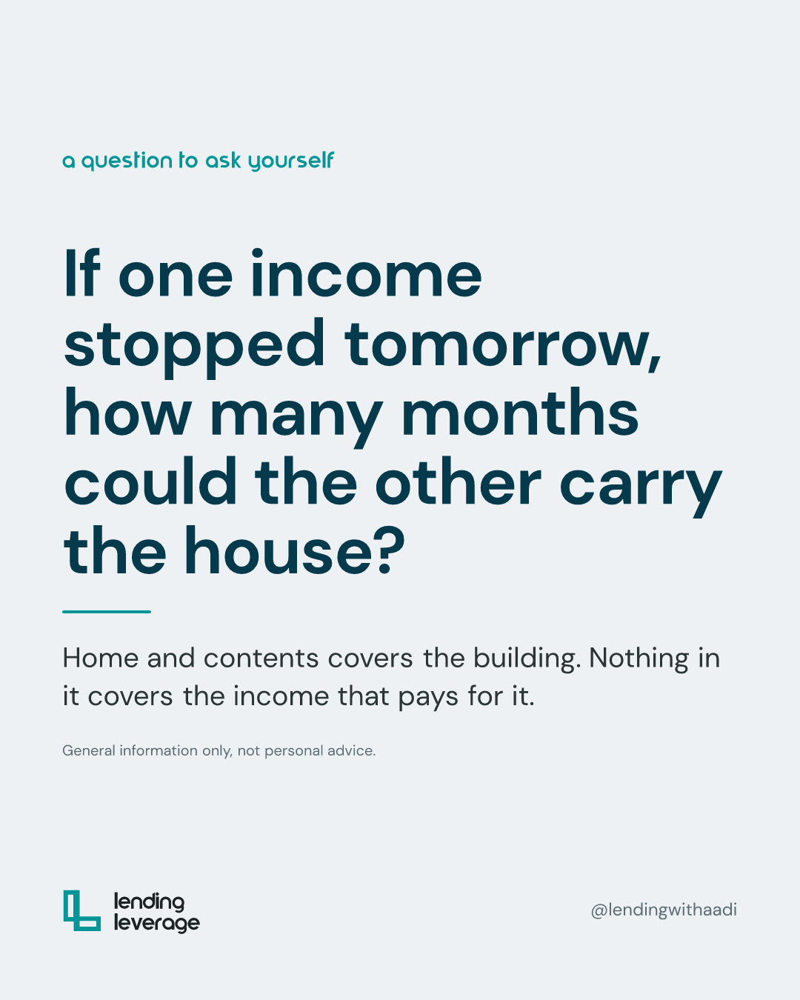

question · insights: could_one_income_carry_the_mortgage, protection_conversation_after_approval

LinkedIn caption

If one income stopped tomorrow, how long could you hold the house?  
  
It's the question we ask every household with a mortgage, and most people haven't sat with it. Not 'do we have some cover', but how many months, specifically, could the remaining income carry the repayments and the family.  
  
Home and contents insurance covers the building. Nothing in it covers the income that pays for the building.  
  
We're not insurance advisers and we don't pretend to be. We raise it after approval as a proper step, not a line buried in a proposal, and we'd rather point you to someone qualified than tick a box. If you'd rather not, that's your call.  
  
But ask yourself the question. Write down the number of months. Then ask whether the cover you have matches the mortgage you have.  
  
General information only, not personal advice.

Instagram caption

If one income stopped tomorrow, how long could you hold the house?  
  
Not 'do we have some cover'. How many months, specifically, could the other income carry the repayments and the family?  
  
Home and contents covers the building. Nothing in it covers the income that pays for the building. We're not insurance advisers, so we raise it as a question after approval and point people to someone who is.  
  
What's your number, in months?  
  
General information only, not personal advice.  
  
#askyourself #moneyhabits #homeloan #mortgagebroker #lendingleverage

### `ask-yourself/know-your-rate` — Most people are wrong about their own interest rate. Check yours. · *to confirm*

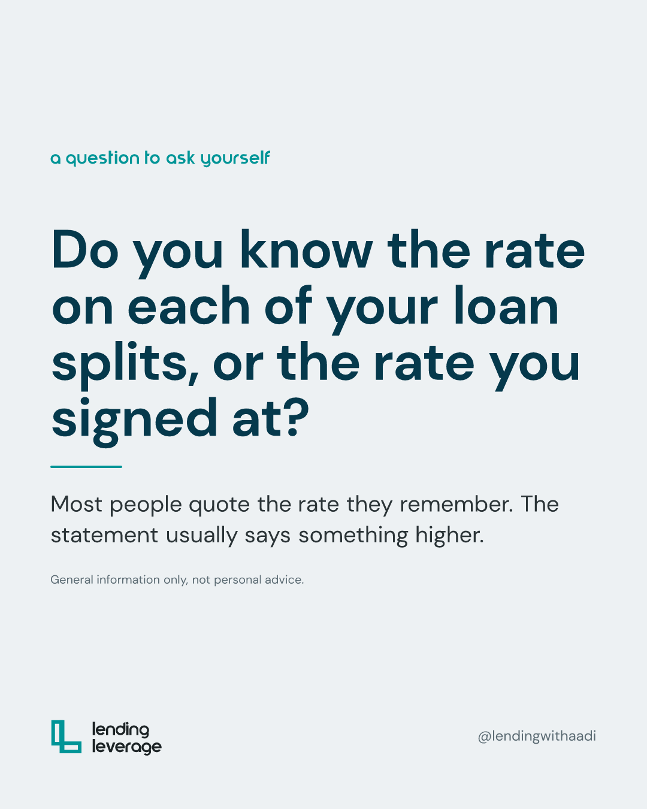

question · insights: you_probably_dont_know_your_own_rate, open_banking_makes_rate_reviews_effortless

LinkedIn caption

Most people are wrong about their own interest rate. Check yours.  
  
When we ask a new client what rate they're on, the answer is usually confident and usually too low. People remember the rate they signed at. Lenders move it, the discount for new customers quietly doesn't apply to old ones, a split rolled off fixed and nobody noticed.  
  
The statement doesn't lie. It shows the real current rate on each split, whether a split is still interest-only, and whether the offset is actually linked and doing anything.  
  
So, a question. Right now, without looking: what's the rate on each of your loans? Then look. If the two numbers don't match, that gap is the start of a useful conversation.  
  
Ask yourself. Then check.  
  
General information only, not personal advice.

Instagram caption

Most people are wrong about their own interest rate. Check yours.  
  
Ask someone their home loan rate and you'll get a confident answer, usually the rate they signed at. Lenders move it. Splits roll off fixed. Nobody notices.  
  
The statement shows the real current rate on each split, whether any are still interest-only, and whether the offset is actually linked.  
  
Without looking: what rate are you paying? Now go and look. Do they match?  
  
General information only, not personal advice.  
  
#askyourself #homeloan #refinance #moneyhabits #lendingleverage

### `ask-yourself/buffer-in-months` — Don&rsquo;t ask how much buffer you have. Ask how many months it buys. · *to confirm*

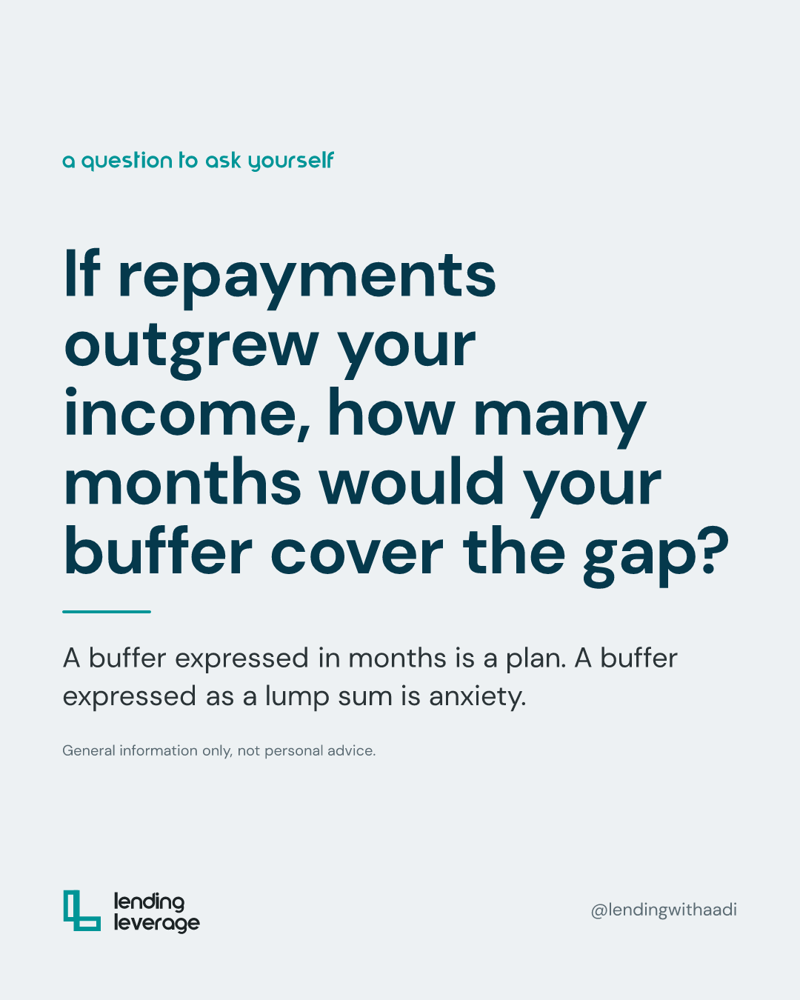

question · insights: turn_your_buffer_into_a_runway

LinkedIn caption

Don't ask how much buffer you have. Ask how many months it buys.  
  
When a repayment gets too big to carry from income alone, people look at their savings and feel one of two things: relief or dread, depending on the size of the number. Neither is a plan.  
  
What we do instead is simple. Set a fixed amount the household pays every month, the amount it can actually sustain. Let the offset or equity cover the gap. Then divide the buffer by the monthly shortfall and count the months.  
  
A buffer expressed as five years of runway is a plan you can sleep on. The same buffer expressed as a lump sum is just anxiety with a dollar sign.  
  
So ask yourself: if the shortfall started today, how many months does my buffer buy? Write the review date down.  
  
General information only, not personal advice.

Instagram caption

Don't ask how much buffer you have. Ask how many months it buys.  
  
A lump sum in savings feels like relief or dread, depending on the number. Neither is a plan.  
  
Try this instead. Pick the repayment your household can actually sustain. Let the buffer cover the gap. Divide the buffer by the monthly shortfall. That's your runway, in months, and a date to review the plan.  
  
If the shortfall started today, how many months would your buffer buy?  
  
General information only, not personal advice.  
  
#askyourself #buffer #moneyhabits #homeloan #lendingleverage

### `ask-yourself/payday-offset` — Where does your pay land on payday? It matters more than you think. · *to confirm*

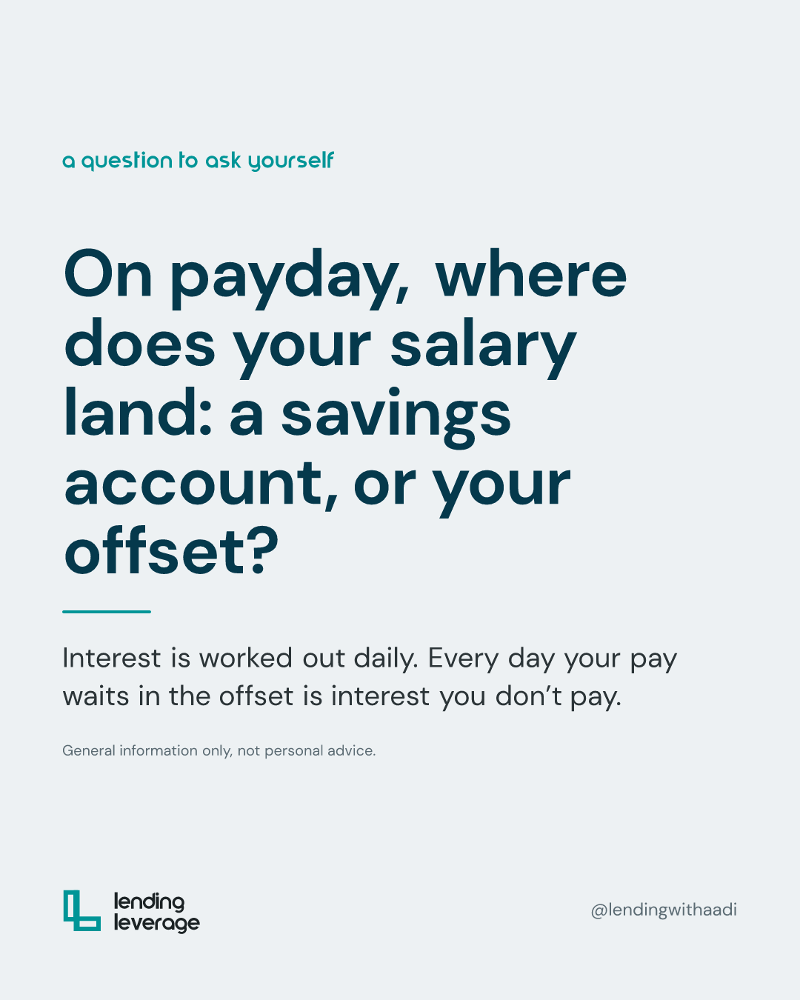

question · insights: run_your_whole_banking_through_the_offset, have_your_salary_land_in_the_offset, idle_cash_belongs_in_an_offset

LinkedIn caption

Where does your pay land on payday? It matters more than you think.  
  
Most people have a savings account the pay goes into, a transaction account the bills come out of, and a home loan somewhere else. The offset, if there is one, gets the leftovers at the end of the month.  
  
Flip it. Interest on your loan is calculated daily. Every day your salary sits in the offset before the bills go out is a day of interest you don't pay. Not a lot per day. A lot over thirty years.  
  
The change is one form with your payroll team and moving a few direct debits. No extra repayments, no discipline required. The balance grows by default and the interest falls by default.  
  
So, ask yourself: is your pay landing where it does the most work?  
  
General information only, not personal advice.

Instagram caption

Where does your pay land on payday? It matters more than you think.  
  
Most people pay into a savings account, pay bills from a transaction account, and let the offset get the leftovers.  
  
Flip it. Interest is worked out daily, so every day your salary waits in the offset before the bills go out is interest you don't pay. One payroll form, a few direct debits moved, and the loan shrinks on its own.  
  
Is your pay landing where it does the most work?  
  
General information only, not personal advice.  
  
#askyourself #offsetaccount #moneyhabits #homeloan #lendingleverage

### `ask-yourself/car-before-house` — Before the house, decide how you&rsquo;d pay for the car. · *to confirm*

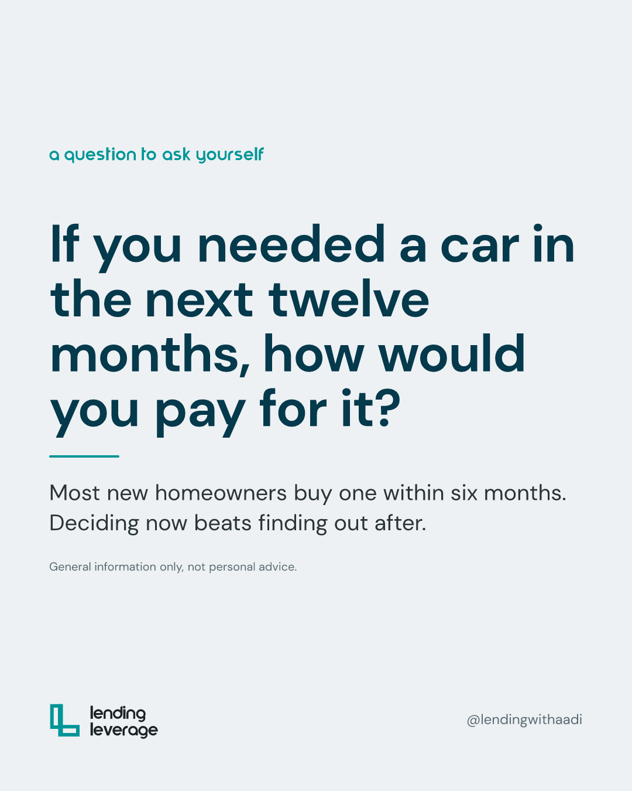

question · insights: home_buyers_buy_a_car_within_six_months

LinkedIn caption

Before the house, decide how you'd pay for the car.  
  
We ask this in the first meeting and people look at us like we've changed the subject. We haven't. Most people who buy a home buy a car within six months, and people replace cars every two and a half years, not the five they plan on.  
  
So a car repayment is coming. The only question is whether you decided how to fund it or whether it decided for you, six months into a new mortgage.  
  
Cash from the offset? A loan? A cheaper car than you'd like for a couple of years? There's no right answer. There's only the answer you chose versus the one that happened to you.  
  
Ask yourself now, while the home loan is still being shaped.  
  
General information only, not personal advice.

Instagram caption

Before the house, decide how you'd pay for the car.  
  
Sounds like a change of subject. It isn't. Most people who buy a home buy a car within six months, and replace cars every two and a half years, not five.  
  
So a car repayment is coming. Cash from the offset, a loan, a cheaper car for a couple of years: no right answer, only the one you chose versus the one that happened to you.  
  
If you needed a car in the next year, how would you pay for it?  
  
General information only, not personal advice.  
  
#askyourself #firsthomebuyer #carloan #moneyhabits #lendingleverage

### `ask-yourself/budget-not-limit` — Tell the agent your budget, not your limit. · *to confirm*

question · insights: keep_your_real_budget_to_yourself, comfortable_capacity_not_maximum

LinkedIn caption

Tell the agent your budget, not your limit.  
  
At some point a buyer's agent or a selling agent will ask the question: would you stretch a bit above that? It sounds helpful. It's a negotiation, and you're the other side of it.  
  
Our suggestion is simple. Tell them the number you want to stick to. Keep the real headroom to yourself. If something genuinely special turns up, that's the moment to push, and you'll know it when you see it. Not before, and not because someone asked nicely at an open home.  
  
The number that matters most is your walk-away figure, and the best time to agree it is before you've spoken to anyone. Settle it with your broker, write it down, then brief the agents.  
  
So ask yourself: who knows your real number?  
  
General information only, not personal advice.

Instagram caption

Tell the agent your budget, not your limit.  
  
Sooner or later an agent asks: would you stretch a bit above that? It sounds helpful. It's a negotiation, and you're on the other side of it.  
  
Tell them the number you want to stick to. Hold the headroom back. If something genuinely special turns up, that's when you push, not because someone asked at an open home. Agree your walk-away figure before you brief anyone.  
  
Who knows your real number right now?  
  
General information only, not personal advice.  
  
#askyourself #firsthomebuyer #negotiation #melbourneproperty #lendingleverage

### `ask-yourself/card-limit` — The bank counts your card limit, not your balance. · *to confirm*

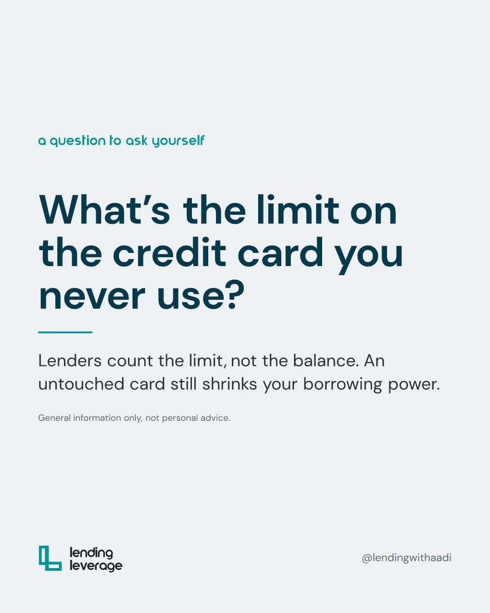

question · insights: credit_limits_cut_capacity_trim_them_when_it_counts

LinkedIn caption

The bank counts your card limit, not your balance.  
  
You owe nothing on it. It's the emergency card, the one in the drawer. To a lender it's a debt you could run up tomorrow, so they assess it at the full limit, and that limit comes straight off what you can borrow.  
  
That doesn't mean cancel it today. A safety net is a safety net, and giving it up months before you need the borrowing power is a bad trade. What we usually do is keep it open through the early stages and reduce or close it at the point it actually matters for the approval. Timing, not just whether.  
  
So ask yourself: what's the limit on the card you never use? And when, not whether, would you trim it?  
  
General information only, not personal advice.

Instagram caption

The bank counts your card limit, not your balance.  
  
The emergency card in the drawer, the one you owe nothing on? A lender sees a debt you could run up tomorrow, so they assess it at the full limit, and that comes straight off your borrowing power.  
  
Don't cancel it today. Keep the safety net through the early stages and trim it when it actually matters for the approval. Timing, not just whether.  
  
What's the limit on the card you never use?  
  
General information only, not personal advice.  
  
#askyourself #creditcard #borrowingpower #moneyhabits #lendingleverage

### `ask-yourself/banks-maximum` — The bank&rsquo;s maximum is not your number. · *to confirm*

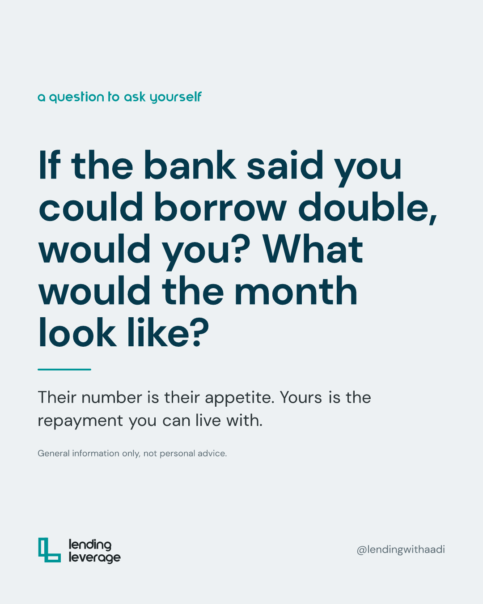

question · insights: comfortable_capacity_not_maximum, borrow_less_than_the_bank_offers

LinkedIn caption

The bank's maximum is not your number.  
  
When a lender comes back with a borrowing figure far above what you had in mind, it feels like good news. It's information, not a plan. That number is the bank's appetite for lending to you, worked out on their rules and their buffers. It says nothing about the life you want to live around the repayment.  
  
We do it the other way round. Start with the repayment you're comfortable with and the years you intend to keep working. Size the loan backwards from that. We'd rather help you borrow less than let a calculator set your life.  
  
So, a stress test you can run yourself. Take the repayment you're considering. Add a few hundred dollars a month. Which part of your month would feel it first?  
  
General information only, not personal advice.

Instagram caption

The bank's maximum is not your number.  
  
A borrowing figure far above what you expected feels like good news. It's information. That number is the bank's appetite, on their rules. It says nothing about the life you want around the repayment.  
  
We start with the repayment you're comfortable with and size the loan backwards. We'd rather help you borrow less than let a calculator set your life.  
  
If your repayment rose by a few hundred a month, which part of your month would feel it first?  
  
General information only, not personal advice.  
  
#askyourself #borrowingpower #moneyhabits #homeloan #lendingleverage

### `ask-yourself/loan-after-sixty-five` — Past fifty-five, the bank asks how the loan ends, not how it starts. · *to confirm*

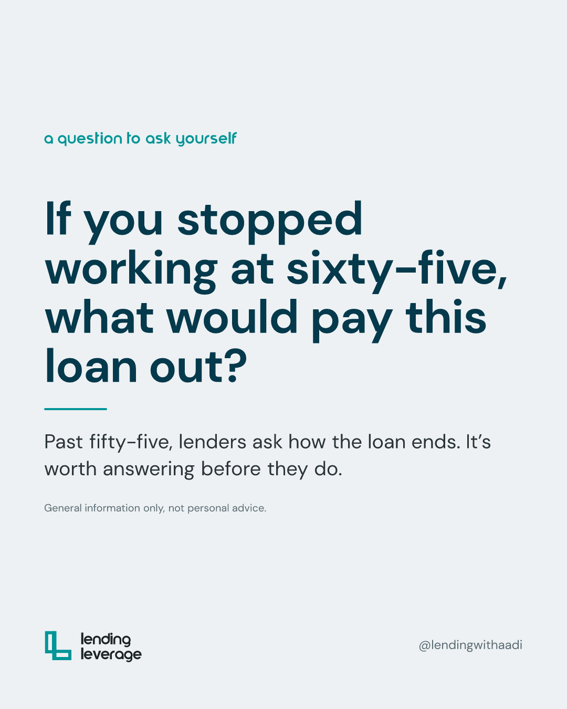

question · insights: borrowing_near_retirement_needs_an_exit_story, we_check_with_the_accountant_before_answering_super_questions

LinkedIn caption

Past fifty-five, the bank asks how the loan ends, not how it starts.  
  
A thirty-year term in your late fifties or sixties is possible. What the lender wants is a credible story for how it gets paid out: downsizing, super, a co-borrower, income that keeps going past the usual age. We build that story before we apply, not when the assessor asks.  
  
But it's a question worth asking yourself regardless of what a bank thinks. If you stopped working at sixty-five, what would pay this loan out? Can you point to it? Can you evidence it?  
  
If the honest answer involves super, that's a conversation for your planner or accountant, not us. We'd rather say 'let me check' than guess at super rules.  
  
Ask the question now. The answer shapes the loan.  
  
General information only, not personal advice.

Instagram caption

Past fifty-five, the bank asks how the loan ends, not how it starts.  
  
A thirty-year term in your sixties is possible. The lender wants a credible exit: downsizing, super, a co-borrower, income that continues. We build that story before we apply.  
  
It's worth asking yourself regardless. If the answer involves super, that's one for your planner or accountant, not your broker. We'd rather say 'let me check' than guess.  
  
If you stopped working at sixty-five, what would pay this loan out?  
  
General information only, not personal advice.  
  
#askyourself #retirement #homeloan #mortgagebroker #lendingleverage

### `ask-yourself/who-pays-if-you-cant` — The loan is approved. Now, who pays it if you can&rsquo;t? · *to confirm*

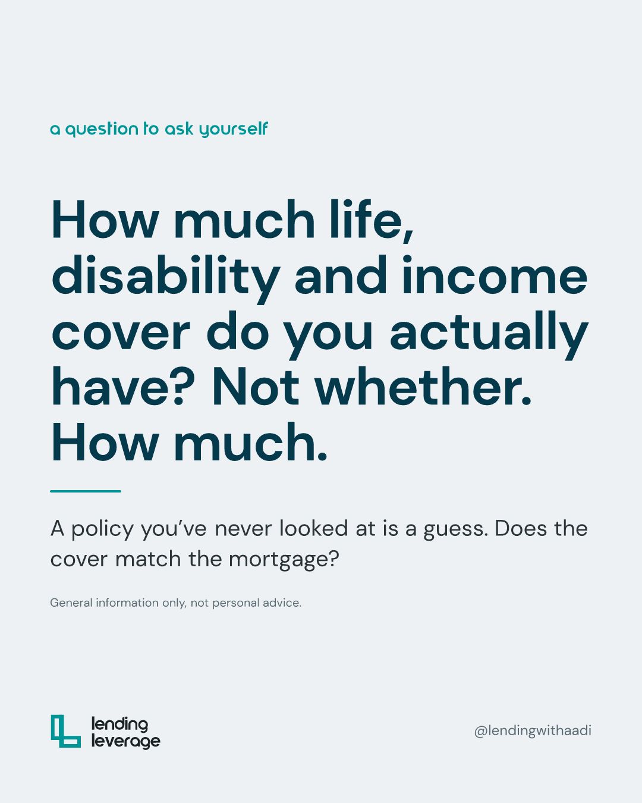

question · insights: protection_conversation_after_approval, could_one_income_carry_the_mortgage

LinkedIn caption

The loan is approved. Now, who pays it if you can't?  
  
It's the question nobody wants after the good news, which is exactly why we ask it as a proper step after formal approval rather than a line buried in a proposal.  
  
Most people answer 'I've got some through super'. Some is not a number. How much life cover? How much if you couldn't work for a year? Does any of it bear a relationship to the size of the mortgage you've just taken on?  
  
We don't sell policies and we won't push a tick-box one that doesn't do the job. We'd rather refer you to a proper adviser, and if you'd rather not go there, we respect that.  
  
But ask yourself the question honestly, with the real numbers in front of you.  
  
General information only, not personal advice.

Instagram caption

The loan is approved. Now, who pays it if you can't?  
  
Nobody wants the question after the good news. That's why we ask it as a proper step after approval, not a line buried in a proposal.  
  
'I've got some through super' is not a number. How much life cover? How much if you couldn't work for a year? Does it bear any relation to the mortgage you just took on? We don't sell policies; we point you to someone qualified.  
  
Do you know your actual cover, or just that you have some?  
  
General information only, not personal advice.  
  
#askyourself #protection #homeloan #moneyhabits #lendingleverage

## Carousels

Twenty reserve carousels: what-actually-happens walkthroughs, before-you-sign checklists, five-things-we-check and plain-English explainers across first home, investors, business owners, refinancing and how we work.

### `carousels/build-first-home` — Building your first home? Here&rsquo;s what actually happens, in order. · *to confirm*

carousel, 7 slides · insights: sequence_land_and_build_contracts_before_signing, never_sign_land_contract_unreviewed, ask_for_fixed_price_and_time_no_harm_asking, two_places_a_build_loses_time, construction_loans_progress_draws, interest_only_during_build_cushions_rent_plus_repayments

LinkedIn caption

Building your first home? Here's what actually happens, in order.  
  
Most people start with the builder's brochure. We start with the paperwork order, because whether you sign the land and build contracts together or land first can change which low-deposit options you qualify for. That decision is made before anyone signs a block.  
  
Then the land contract goes to a solicitor, every time. Titling dates, sunset clauses and finance timing live in that document, and a developer's contract is written for the developer.  
  
The slide on where a build loses time is the one to screenshot. Land delays cost you very little. Builder delays cost you rent and interest at the same time. That's where the negotiating energy goes.  
  
The rest is in the carousel, including how progress payments actually work.  
  
General information only, not personal advice.

Instagram caption

Building your first home? Here's what actually happens, in order. Swipe through.  
  
Contract order first, because it decides which low-deposit options you can use. Land contract to a solicitor, always. Ask the builder for a fixed price and a deadline. Know where a build loses time, and that it's the builder, not the land, that costs you. Then progress payments, stage by stage, with repayments rising as the house does.  
  
Which stage of a build worries you most?  
  
General information only, not personal advice.  
  
#firsthomebuyer #houseandland #newbuild #mortgagebroker #lendingleverage

### `carousels/settlement-day` — Settlement day is boring when it goes right. Here&rsquo;s how we keep it boring. · *to confirm*

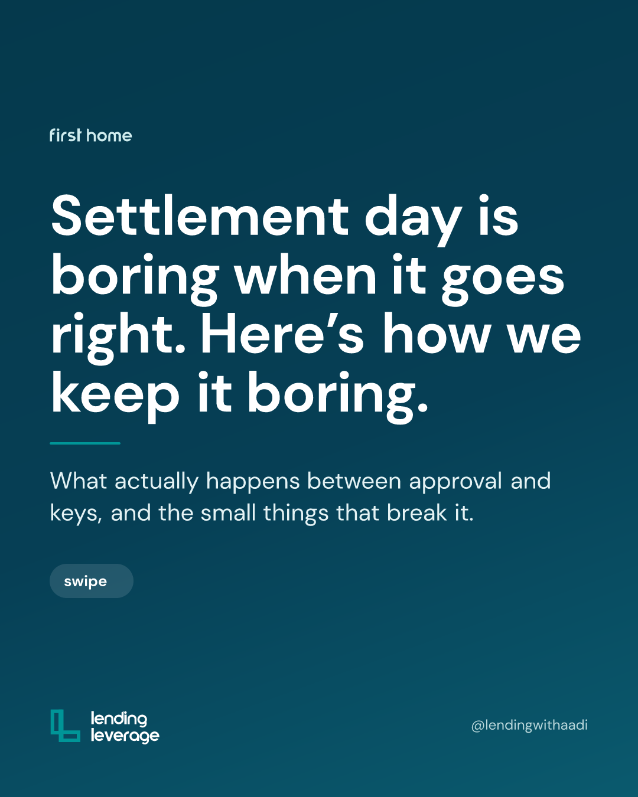

carousel, 7 slides · insights: keep_the_deposit_in_trust_until_settlement, deposit_must_land_before_settlement_not_application, check_loan_docs_match_the_structure, no_new_credit_between_approval_and_the_next_assessment, take_the_full_penalty_free_extension, settlement_extension_check_the_other_side

LinkedIn caption

Settlement day is boring when it goes right. Here's how we keep it boring.  
  
The days between approval and keys are where a good purchase gets messy. Not because anything dramatic happens, but because small things get missed.  
  
The deposit stays in the agent's trust account until settlement, because releasing it early hands your protection to the seller. The loan documents get read by us the moment the deal goes unconditional, because the structure we fought for has a habit of going missing between approval and contract.  
  
And nothing new goes on your credit file until the keys are in your hand. A car loan in that window can reopen a file that was finished.  
  
The carousel covers the rest, including what to do if a settlement date has to move.  
  
General information only, not personal advice.

Instagram caption

Settlement day is boring when it goes right. Swipe for how we keep it that way.  
  
Deposit stays in trust until the day. Funds verifiable and in Australia by settlement, not on day one. We read the loan documents before you sign them. No new credit between approval and keys. And if a date has to move, ask once, for the full window, after checking what it does to the other side.  
  
Which of these did nobody tell you before your first purchase?  
  
General information only, not personal advice.  
  
#settlementday #firsthomebuyer #homeloan #mortgagebroker #lendingleverage

### `carousels/after-settlement` — You&rsquo;ve got the keys. Our job starts again. · *to confirm*

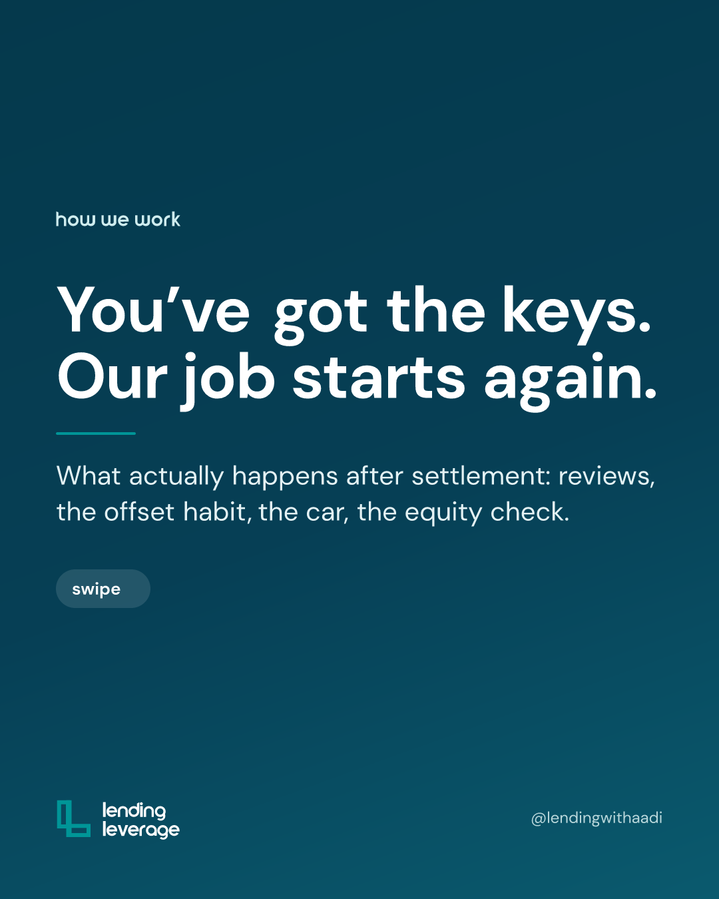

carousel, 7 slides · insights: client_care_rhythm_six_touchpoints, have_your_salary_land_in_the_offset, debt_gets_easier_over_time, home_buyers_buy_a_car_within_six_months, protection_conversation_after_approval, trapped_equity_can_buy_another_income_asset

LinkedIn caption

You've got the keys. Our job starts again.  
  
Most people think a broker's work ends at settlement. For us it's where the relationship actually starts. We run six touchpoints a year after settlement: rate reviews at six and twelve months, an equity check, and the conversations in between.  
  
The first habit we set up is simple. Your pay lands in the offset and you spend from there, so the balance grows by default and interest falls without any extra discipline.  
  
The slide on the car is the one people laugh at and then nod. Most new home owners buy a car within six months. We'd rather plan it than discover it.  
  
The equity check comes later, once the home has grown. The rest is in the carousel.  
  
General information only, not personal advice.

Instagram caption

You've got the keys. Our job starts again. Swipe for what actually happens after settlement.  
  
Six touchpoints a year, with rate reviews at six and twelve months. Pay into the offset, spend from the offset. A buffer for the first two years, because that's when the loan feels biggest. The car conversation before the car. And an equity check once the home has grown.  
  
When did your broker last call you after settlement?  
  
General information only, not personal advice.  
  
#homeowner #offsetaccount #mortgagebroker #moneyhabits #lendingleverage

### `carousels/parental-guarantor` — Mum and Dad going guarantor? Here&rsquo;s what they actually sign. · *to confirm*

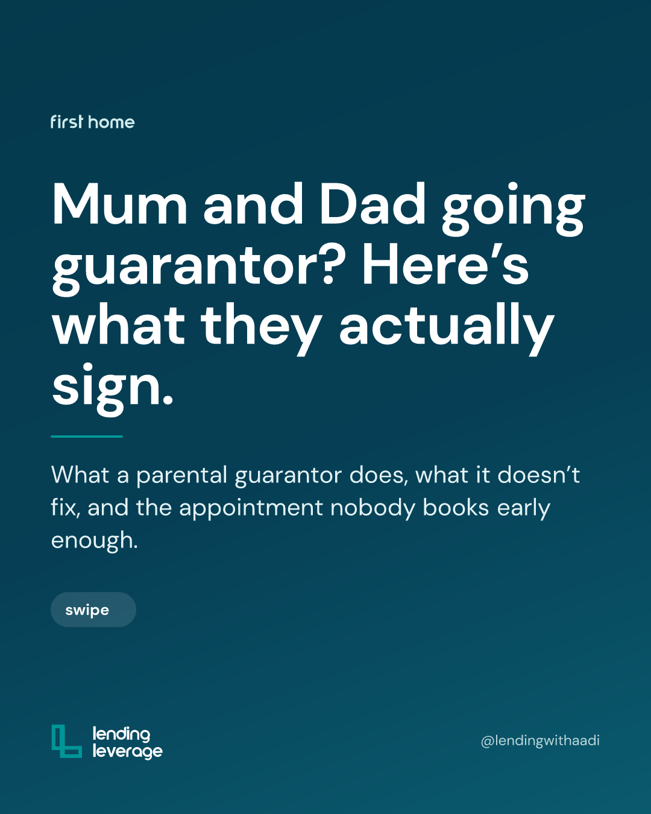

carousel, 7 slides · insights: strong_income_plus_guarantor_beats_no_deposit, capacity_problems_need_cash_flow_fixes_not_guarantors, guarantor_home_is_locked_in_for_years, guarantor_legal_advice_needs_a_solicitor_not_a_jp, a_parent_near_retirement_shortens_the_loan_runway

LinkedIn caption

Mum and Dad going guarantor? Here's what they actually sign.  
  
A parental guarantor is one of the most useful tools we have for a first-home buyer with a strong income and a thin deposit. It is also one of the most misunderstood, usually by the parents.  
  
The slide to start with is what it doesn't fix. A guarantor solves a deposit problem. If the shortfall is in repayments, the parents' signature changes nothing, and the fix is on the monthly commitments instead.  
  
Then the practical bits. Their home is tied up for several years and selling early usually means a cash contribution. And the independent legal advice certificate needs a solicitor, not a JP, which is why we book that appointment the day loan documents are issued rather than discovering it at settlement.  
  
The carousel has all five.  
  
General information only, not personal advice.

Instagram caption

Mum and Dad going guarantor? Swipe for what they actually sign.  
  
It solves a deposit problem, not a repayment problem. Their home is tied up for several years, and selling early usually means putting cash in. The legal advice certificate needs a solicitor, not a JP. And security from a parent often does more, for longer, than putting a parent near retirement on the loan itself.  
  
Has your family talked about the release timeline, or just the signature?  
  
General information only, not personal advice.  
  
#guarantor #firsthomebuyer #familyfinance #mortgagebroker #lendingleverage

### `carousels/refinancing-honestly` — What actually happens when you ask us to refinance. Sometimes we say don&rsquo;t. · *to confirm*

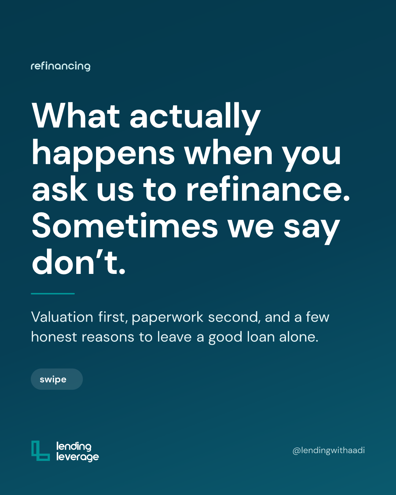

carousel, 7 slides · insights: dont_refinance_for_small_gains, run_the_valuation_before_you_send_a_single_payslip, valuations_vary_by_lender_so_test_before_you_commit, pay_down_to_80_lvr_to_unlock_better_rate, switching_lenders_is_redirecting_your_salary, refinance_small_surplus_covers_interest_gap

LinkedIn caption

What actually happens when you ask us to refinance. Sometimes we say don't.  
  
We won't move a loan just to move it. If you already have a good rate and we can't add a real structural benefit, a needed cash-out, a cleaner split, a better fit for the next purchase, we'd rather leave it alone and tell you so.  
  
When it is worth looking at, the order matters. Valuation first, paperwork second. The property value decides whether the exercise makes sense, so we order valuations with several lenders before asking for a payslip.  
  
The slide on repricing is the quiet one. Sometimes a small lump sum and a reprice with your current bank does more than a move, with no exit fees and the same offsets.  
  
The rest, including why the new loan settles slightly above the old balance, is in the carousel.  
  
General information only, not personal advice.

Instagram caption

What actually happens when you ask us to refinance. Swipe through, because sometimes the answer is don't.  
  
We won't move a loan just to move it. Valuation first, paperwork second. One lender's valuation is one opinion, so we run several. Sometimes a reprice with your current bank beats moving. And if you do move, switching is mostly one form: where your pay goes.  
  
When did someone last tell you not to refinance?  
  
General information only, not personal advice.  
  
#refinance #homeloan #mortgagebroker #honestadvice #lendingleverage

### `carousels/business-from-equity` — Funding your business from your home&rsquo;s equity. What actually happens. · *to confirm*

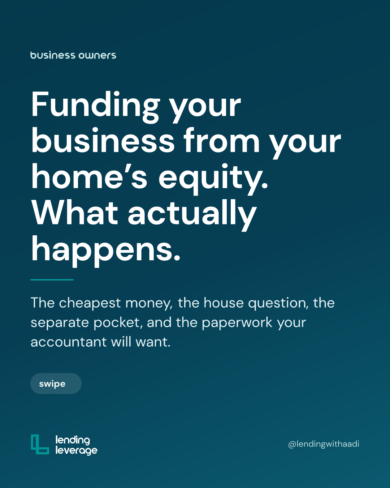

carousel, 7 slides · insights: mortgage_backed_credit_cheapest_for_business, keep_the_family_home_out_of_business_security, interest_only_pockets_for_a_business_that_dips_in_and_out, transact_through_offset_never_redraw, loan_agreement_when_funding_a_trust, one_conversation_per_bank_or_purposes_collide

LinkedIn caption

Funding your business from your home's equity. What actually happens.  
  
It comes up because the maths is hard to argue with. Credit secured by residential property is usually the cheapest money a business can borrow.  
  
But the next slide is the one we spend the most time on: do you want the house involved at all? We start unsecured or with the smallest security a lender will take. If property has to come in, an investment property goes before anyone's family home. Plenty of owners say no, and we respect that.  
  
If you proceed, the structure is a separate interest-only pocket beside the home loan, drawn through an offset, never redraw, with a loan agreement to the entity if your accountant says so.  
  
And one voice talks to the bank. Two requests to one lender at once is how both die.  
  
General information only, not personal advice.

Instagram caption

Funding your business from your home's equity. Swipe for what actually happens.  
  
It's usually the cheapest money a business can borrow. The first question is whether you want the house involved at all, and no is a fine answer. If yes: a separate interest-only pocket beside the home loan, drawn through an offset, never redraw, and a loan agreement to the entity if your accountant wants one.  
  
Would you put your home behind your business, or keep them apart?  
  
General information only, not personal advice.  
  
#businessowner #businessfinance #equity #mortgagebroker #lendingleverage

### `carousels/before-land-contract` — Before you sign a land or off-the-plan contract, five checks. · *to confirm*

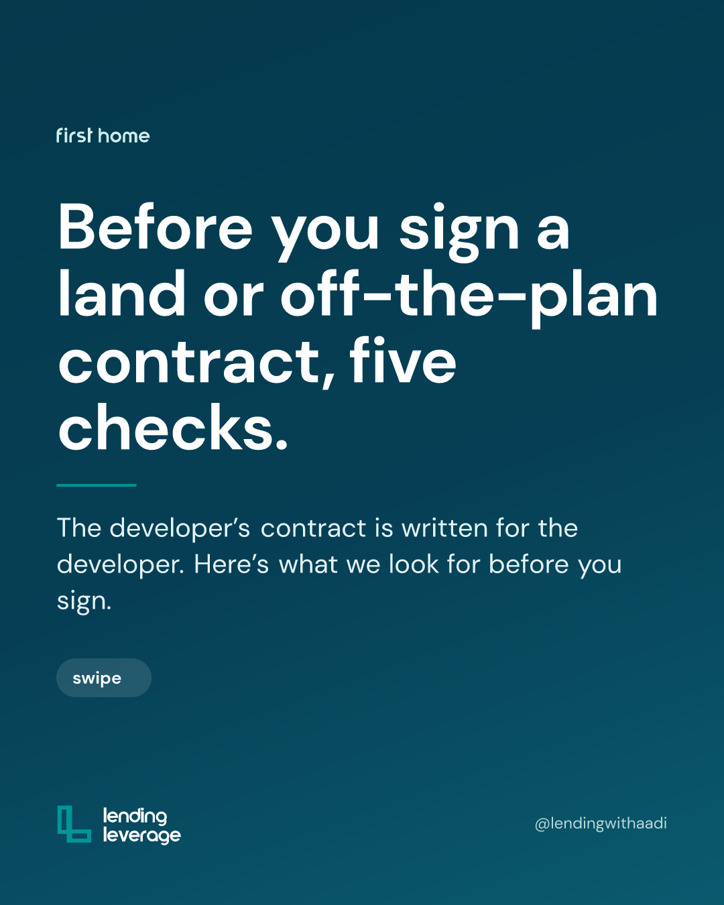

carousel, 7 slides · insights: never_sign_land_contract_unreviewed, sunset_clause_get_advice_before_you_sign_or_extend, compare_build_cost_to_established_homes, a_finance_clause_is_your_penalty_free_exit, dont_bank_on_the_grant_at_settlement

LinkedIn caption

Before you sign a land or off-the-plan contract, five checks.  
  
A developer's contract is written by the developer's lawyers for the developer's benefit. That's not sinister, it's just who drafted it. So the first rule is simple: a solicitor reads it before you sign, and if you don't have one, we refer one.  
  
The sunset clause slide is the one people skip and regret. It can be negotiated at signing, and when the developer runs late and asks you to extend, that request goes to your solicitor and broker before anyone replies.  
  
And the finance clause. A lender won't commit to an unusual property in writing before a valuation, and the valuation needs a signed contract. The clause is how you sign and still have a penalty-free way out.  
  
The other two are in the carousel.  
  
General information only, not personal advice.

Instagram caption

Before you sign a land or off-the-plan contract, five checks. Swipe through.  
  
A solicitor reads it first. The sunset clause gets negotiated at signing and never extended without advice. Land plus build gets compared to established homes nearby. There's a finance clause so you can sign and still have an exit. And the grant is a bonus, never the deposit.  
  
Which of these five did your contract have covered?  
  
General information only, not personal advice.  
  
#offtheplan #houseandland #firsthomebuyer #mortgagebroker #lendingleverage

### `carousels/before-loan-documents` — Before you sign the loan documents, five things to check. · *to confirm*

carousel, 7 slides · insights: check_loan_docs_match_the_structure, every_fee_listed_is_not_every_fee_charged, one_offset_each_on_a_joint_loan, thirty_year_term_pay_like_twenty_five, if_we_cant_draw_your_structure_you_wont_use_it_right

LinkedIn caption

Before you sign the loan documents, five things to check.  
  
Approved isn't the same as written down. We read the loan documents on the lender portal the moment a deal goes unconditional, before they reach the client, because the structure we fought for has a habit of going missing between approval and contract. Interest-only periods especially.  
  
The fee schedule slide is there to calm you down. The documents list every fee the lender could ever charge because the law requires it. Most are for situations you'll never meet. Ask which two or three you will actually pay.  
  
And the napkin test. If your structure can't be drawn on one page with arrows showing where the money moves, it's too clever to run correctly. We'd rather draw it for you now than explain it later.  
  
All five in the carousel.  
  
General information only, not personal advice.

Instagram caption

Before you sign the loan documents, five things to check. Swipe through.  
  
Does it match what was approved, line by line? The fee list is every fee that could happen, not what will. Is there an offset for each of you? Is it the longest term available, so your capacity stays open? And can the whole structure fit on a napkin?  
  
Did anyone walk you through your last loan documents, or did you just sign?  
  
General information only, not personal advice.  
  
#homeloan #loandocuments #moneyhabits #mortgagebroker #lendingleverage

### `carousels/before-buying-with-sibling` — Buying with a sibling or a mate? Settle these five things first. · *to confirm*

carousel, 7 slides · insights: buying_with_family_common_debt_reducer, co_buy_one_lives_one_invests_split_the_loan, co_owner_on_title_may_be_asked_onto_the_loan, joint_asset_nothing_moves_without_both_signatures, security_guarantor_not_servicing_guarantor

LinkedIn caption

Buying with a sibling or a mate? Settle these five things first.  
  
Co-buying gets people into the market who couldn't do it alone. It also creates a loan that follows both of you for years, so we have the awkward conversations now.  
  
The first slide decides whether it's a good idea. When one of you later wants to buy alone, some lenders count only your share of the joint loan against you. Others count the whole thing. We model it both ways before advising anyone to co-buy.  
  
If one of you will live there and the other won't, the loan can be split into an owner-occupier portion and an investment portion. It takes workshopping with lenders, but it's a normal structure and nobody has to pretend anything.  
  
Title versus loan, both signatures, and the security-only option are in the carousel.  
  
General information only, not personal advice.

Instagram caption

Buying with a sibling or a mate? Swipe for the five things to settle first.  
  
How will the next lender read the joint loan when one of you buys alone? Can the loan be split if one lives there and one invests? Who's on title and who's on the loan? Nothing moves later without both signatures. And a co-owner can give security without being assessed on income.  
  
Have you and your co-buyer talked about what happens when one of you wants out?  
  
General information only, not personal advice.  
  
#cobuying #firsthomebuyer #propertytogether #mortgagebroker #lendingleverage

### `carousels/before-build-contract` — Before you sign a fixed-price build contract, five things. · *to confirm*

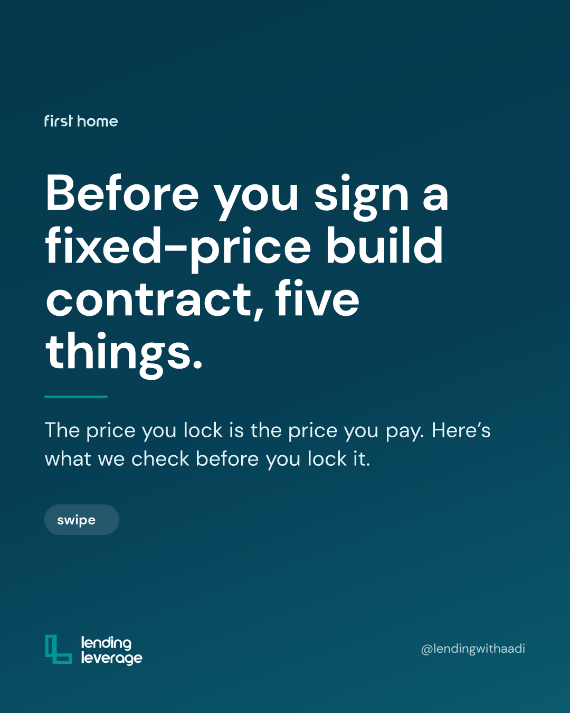

carousel, 7 slides · insights: sign_a_fixed_price_build_contract_early, quote_other_builders_even_if_you_keep_yours, cheap_builder_costs_you_in_five_years, see_every_builder_in_one_trip, pay_for_the_lender_that_inspects_your_build

LinkedIn caption

Before you sign a fixed-price build contract, five things.  
  
The price you lock today is the price you pay, which is exactly why we want it locked early, once the land is certain, and why we want the terms read properly. Builders are changing them.  
  
The slide people push back on is two more quotes. Even if you've already signed a preliminary agreement and intend to stay, send your final spec to two other builders. Price differences can be large, and if you stay put, the quotes confirm you're paying market rate.  
  
Then the question that matters more than the brochure: who is the builder? A new home is only as new as whoever built it. Ask for addresses of houses they finished five years ago and drive past.  
  
The construction fee slide surprises people. Pay for the bank that inspects each stage.  
  
General information only, not personal advice.

Instagram caption

Before you sign a fixed-price build contract, swipe for the five things we check.  
  
Lock the price once the land is certain and read the terms. Get two more quotes on the same spec, even if you stay. Ask the builder for addresses from five years ago. Compare builders side by side in one trip. And pay for the lender that inspects each stage before paying the builder.  
  
Would you pay a fee for a second set of eyes on your builder?  
  
General information only, not personal advice.  
  
#newbuild #buildingahome #firsthomebuyer #mortgagebroker #lendingleverage

### `carousels/check-apartment` — Five things we check on an apartment before you offer. · *to confirm*

carousel, 7 slides · insights: apartment_body_corporate_due_diligence, older_pocket_sized_unit_blocks, long_days_on_market_is_a_warning_light, buy_what_the_next_buyer_wants, never_use_the_agents_inspector_or_lawyer

LinkedIn caption

Five things we check on an apartment before you offer.  
  
There's always a reason someone is selling. A tired landlord is fine. A building problem is not, and in apartments that reason usually sits in the body corporate records. We read the minutes and ask what the last three special levies were for.  
  
The slide on days on market is the simplest check and the most skipped. If comparable apartments sold and this one has sat for months, something is wrong with the price, the layout or the building. Find out which before you get excited about a bargain.  
  
And the last one is blunt. If the agent recommended the inspector or the lawyer, they are not yours. The only people checking the property should be paid by you.  
  
The block type we quietly like, and the next-buyer test, are in the carousel.  
  
General information only, not personal advice.

Instagram caption

Five things we check on an apartment before you offer. Swipe through.  
  
The body corporate minutes and the last three special levies. The block itself, and why the fees are what they are. Days on market compared to similar listings. Who would buy it after you. And whether the inspector and lawyer are yours or the agent's.  
  
What's the one thing you'd want checked before buying an apartment?  
  
General information only, not personal advice.  
  
#apartmentliving #firsthomebuyer #duediligence #mortgagebroker #lendingleverage

### `carousels/check-investment-true-cost` — An investment property&rsquo;s true monthly cost. Five lines we check. · *to confirm*

carousel, 7 slides · insights: know_the_two_year_holding_cost_before_you_sign, model_a_generous_cost_line_and_judge_the_property_by_it, older_properties_bring_little_depreciation, holding_cost_sets_the_growth_you_need, shop_the_landlord_insurance_every_year

LinkedIn caption

An investment property's true monthly cost. Five lines we check.  
  
The brochure gives you a yield. We give you a monthly number, before and after tax, and then multiply it by two years, because the total you will carry before rent and value catch up is the number that should drive the decision.  
  
The cost line is modelled fat on purpose. Rates, insurance, water, agent fees, maintenance. If a property can't live inside a generous budget, that's a problem with the property, not the budget.  
  
The slide on growth is the one to hold onto. Divide what the property costs you a year by what you paid. That's the growth the suburb must deliver just to break even. Ask whether it ever has.  
  
Depreciation on older stock, and the insurance line, are in the carousel. The tax side is one for your accountant.  
  
General information only, not personal advice.

Instagram caption

An investment property's true monthly cost. Swipe for the five lines we check.  
  
The two-year holding cost, after tax. A deliberately generous cost line for rates, insurance and upkeep. How little depreciation an older property actually brings. The growth rate the suburb needs just to break even. And the insurance quote worth re-shopping every year.  
  
Do you know what your investment costs you each month, after everything?  
  
General information only, not personal advice.  
  
#propertyinvestor #investmentproperty #holdingcosts #mortgagebroker #lendingleverage

### `carousels/check-business-before-lender` — Five things we check on your business before a lender does. · *to confirm*

carousel, 7 slides · insights: know_what_security_your_bank_already_holds, align_entity_ownership_before_a_business_refinance, the_risk_team_googles_every_director_in_your_group, one_big_customer_is_a_red_flag_to_a_bank, a_spreadsheet_is_not_evidence_official_prints_only

LinkedIn caption

Five things we check on your business before a lender does.  
  
Credit teams are thorough. The question is whether they find something you have an answer for, or something that stalls the file a month. So we check first.  
  
The slide that catches the most people is what your existing bank already holds. A small facility can carry a general security over your whole trading business, and nobody notices until a new lender's due diligence turns it up a week before settlement.  
  
Then the entity chart. The fastest business refinance pathways assume the same people own and direct every entity on the loan. A mismatch turns a quick file into a pile of exceptions.  
  
And the risk team will search every director and every old venture in your group. We'd rather write the one-paragraph explanation now.  
  
Concentration and documents are in the carousel.  
  
General information only, not personal advice.

Instagram caption

Five things we check on your business before a lender does. Swipe through.  
  
What security your current bank already holds. Whether the same people own and direct every entity on the loan. Every director and every old venture the risk team will find. How much of your revenue sits with one customer. And whether your numbers are official documents or a spreadsheet.  
  
Do you know what security your bank holds over your business right now?  
  
General information only, not personal advice.  
  
#businessowner #businessfinance #smallbusiness #mortgagebroker #lendingleverage

### `carousels/check-portfolio-not-paying` — Your rentals pay for themselves but not you? Five things we check. · *to confirm*

carousel, 7 slides · insights: portfolio_must_leave_you_surplus, hold_if_sustainable_sell_if_not, bank_valuation_is_not_a_sale_price, selling_a_security_property_triggers_a_servicing_review, every_loan_split_needs_a_paper_trail

LinkedIn caption

Your rentals pay for themselves but not you? Five things we check.  
  
A portfolio where rent almost covers the repayments and you live off your wage is not working for you. It is surviving. When we review one, the first question is what's left each month after every repayment. If the answer is nothing, the structure changes first.  
  
The second slide separates two questions people tangle together. Has this property done well, and can you comfortably hold it for two more years? A good buy can still be the wrong one to keep.  
  
And if selling is on the table, the slide on servicing matters. Sell one property and the lender reassesses you without that rent, and may want debt paid down that you planned to keep. We plan the swap before the contract.  
  
Valuations and paper trails are in the carousel.  
  
General information only, not personal advice.

Instagram caption

Your rentals pay for themselves but not you? Swipe for the five things we check.  
  
What's left each month after every repayment. Whether holding is sustainable, separate from whether it was a good buy. The bank's valuation versus a real sale price. What selling one does to the loans on the others. And whether you can say where every loan split went.  
  
What does your portfolio leave you each month, honestly?  
  
General information only, not personal advice.  
  
#propertyportfolio #propertyinvestor #cashflow #mortgagebroker #lendingleverage

### `carousels/knockback-that-wasnt` — The bank said no. That&rsquo;s one bank. It isn&rsquo;t the answer. · *to confirm*

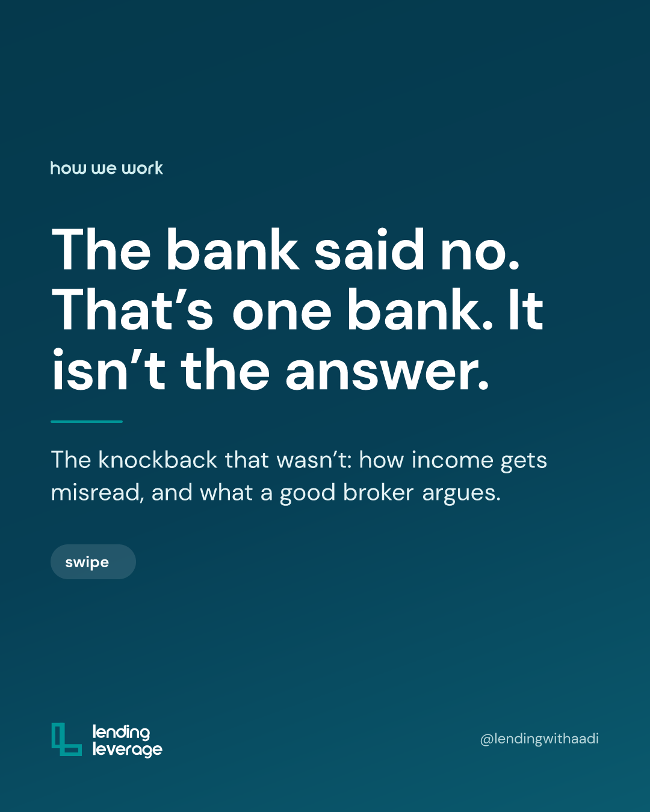

carousel, 7 slides · insights: one_banks_no_is_not_the_markets_no, appetite_beats_the_policy_document, packaged_income_needs_a_broker_who_argues, explain_your_payslips_before_the_lender_misreads_them, credit_exceptions_need_a_clear_story, same_bank_different_desk_different_answer

LinkedIn caption

The bank said no. That's one bank. It isn't the answer.  
  
A branch saying no, or a broker saying we can't help you, is one lender's policy on one day. It is not a verdict on you. We regularly see knockbacks on self-employed income, packaged income and small deposits become approvals once the file is packaged properly and taken to a lender with appetite for that borrower.  
  
The slide on misread income is the one we feel strongest about. Salary-packaged pay gets shaded or ignored by assessors and by brokers who don't understand it. It is real income, and our job is to present it correctly and argue when it's discounted.  
  
And borderline deals are approved on the story, not the spreadsheet. We talk to credit first, then write the submission as a narrative.  
  
Sometimes the answer is even simpler: same bank, different desk.  
  
General information only, not personal advice.

Instagram caption

The bank said no. That's one bank. Swipe for why it isn't the answer.  
  
One no is one lender's policy on one day. Published policy and real appetite are different things. Packaged income gets misread and we argue it. A one-page income note stops an assessor guessing. And borderline files get approved on the story, so we write one.  
  
Have you ever taken a knockback as the final word?  
  
General information only, not personal advice.  
  
#homeloan #declined #mortgagebroker #howwework #lendingleverage

### `carousels/debt-recycling-plain` — Debt recycling, without the jargon. · *to confirm*

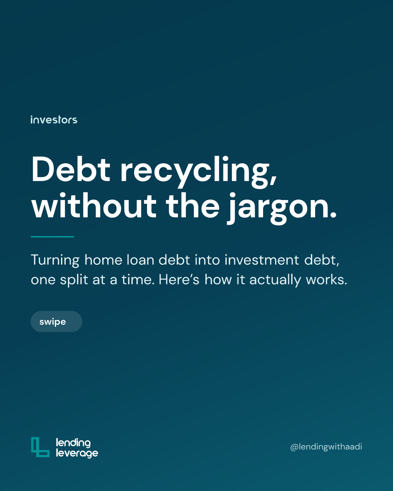

carousel, 7 slides · insights: redraw_is_not_savings_debt_recycling, one_loan_split_per_purpose, set_up_the_full_split_draw_a_little_scale_later, call_us_before_you_move_borrowed_money, broker_designs_accountant_verifies

LinkedIn caption

Debt recycling, without the jargon.  
  
The idea is simple. You slowly turn debt against your home, which you can't claim, into debt against investments, which you may be able to, one labelled split at a time. Tax is your accountant's call. Structure is ours.  
  
The first slide is the one most people get wrong. Money in redraw has already paid down your home loan. Pulling it back out to invest muddies the purpose of that loan. The cleaner path is a separate split, set up for investing and nothing else.  
  
The slide on setting it up once is where nervous clients relax. We set up the full split now, leave the undrawn part in offset costing nothing, and you draw what you're comfortable with. More later, no new application.  
  
And before any transfer between accounts, check with us. One wrong move undoes the trail.  
  
General information only, not personal advice.

Instagram caption

Debt recycling, without the jargon. Swipe for how it actually works.  
  
Redraw isn't savings, so pulling it out to invest muddies the loan. Use a separate split per purpose, each with its own offset. Set the whole thing up once and draw it slowly. Check with us before moving money between accounts. And your accountant signs off before anything is implemented.  
  
Had debt recycling explained to you in a way that made sense?  
  
General information only, not personal advice.  
  
#debtrecycling #propertyinvestor #loanstructure #mortgagebroker #lendingleverage

### `carousels/cash-offset-debt-asset` — Cash is for the offset. Debt is for the asset. · *to confirm*

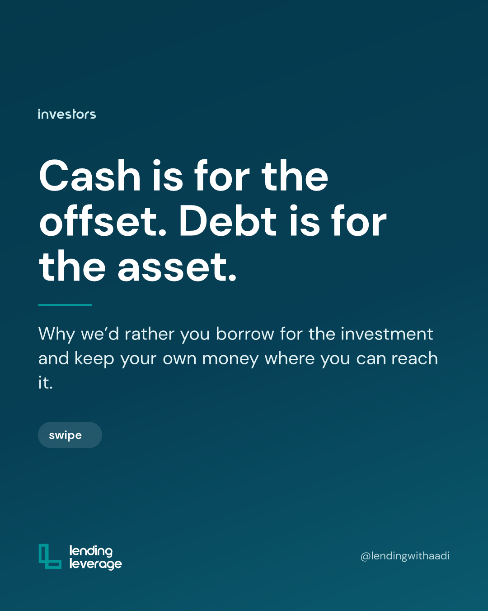

carousel, 7 slides · insights: debt_fund_the_asset_keep_the_cash_working, never_pay_an_investment_deposit_from_cash, get_the_funding_step_right_at_purchase, offset_gives_the_interest_saving_without_locking_the_cash, offset_savings_are_not_taxable_income

LinkedIn caption

Cash is for the offset. Debt is for the asset.  
  
When a client has the cash to buy an investment outright, we still prefer to borrow for it. The property grows the same either way, and your cash keeps working somewhere you can reach it.  
  
The slide on day one is the one that can't be undone. How you fund a purchase at settlement is a tax event. Pay cash and borrow against the property a fortnight later, and the interest may never be deductible. We decide the source of funds before the contract, with your accountant.  
  
The offset slides explain the other half. A bigger deposit and the same money in an offset save the same interest, but only one is available on a bad day. And interest you don't pay is never taxed.  
  
The tax treatment is one for your accountant.  
  
General information only, not personal advice.

Instagram caption

Cash is for the offset. Debt is for the asset. Swipe for why.  
  
The property grows the same whether you paid cash or borrowed. Paying the deposit from cash and borrowing later wastes the deductible position, and day one can't be rewound. A bigger deposit and an offset save the same interest, but only one is reachable. And interest you don't pay is never taxed. Check it with your accountant.  
  
Where does your spare cash sit right now, and why there?  
  
General information only, not personal advice.  
  
#offsetaccount #propertyinvestor #loanstructure #mortgagebroker #lendingleverage

### `carousels/negotiate-terms-not-price` — Negotiate terms, not price. Five moves that cost you nothing. · *to confirm*

carousel, 7 slides · insights: write_the_offer_down_so_the_agent_must_present_it, sweeten_the_terms_not_the_price, ask_what_terms_the_vendor_actually_values, set_your_walk_away_price_before_auction_day, keep_your_real_budget_to_yourself

LinkedIn caption

Negotiate terms, not price. Five moves that cost you nothing.  
  
Buyers think negotiation is about the number. Mostly it's about certainty. A vendor who knows your deal will settle, on a date that suits them, often takes less than a nervous higher offer.  
  
The first slide is the one that surprises people. If the agent tells you verbally that your number won't fly, write the offer down anyway. A written offer has to be presented, and the vendor makes the call, not the agent.  
  
Then ask what the vendor actually values before you give anything away. Often a short settlement earns nothing and standard clauses cost nothing, so spend your concessions where they count.  
  
And the walk-away number goes on paper the day before, not in your head on the day.  
  
The fifth move, budget versus limit, is in the carousel.  
  
General information only, not personal advice.

Instagram caption

Negotiate terms, not price. Swipe for five moves that cost you nothing.  
  
Write the offer down so it has to be presented. Ask what the vendor actually values before you concede anything. Shape your settlement and conditions around that, so you compete on certainty. Put your walk-away number on paper the day before. And tell the agent your budget, not your limit.  
  
Have you ever won a property on terms rather than price?  
  
General information only, not personal advice.  
  
#negotiation #firsthomebuyer #propertyoffer #mortgagebroker #lendingleverage

### `carousels/why-a-broker` — Why use a broker at all? Our honest answer, in five slides. · *to confirm*

carousel, 7 slides · insights: brokers_are_paid_the_same_so_no_favourite_bank, a_broker_is_paid_by_the_lender_not_a_higher_rate, we_sound_out_every_bank_before_one_application_hits_your_file, forty_lenders_on_paper_six_in_practice, slow_replies_are_the_broker_red_flag

LinkedIn caption

Why use a broker at all? Our honest answer, in five slides.  
  
Start with money, because everyone wonders. Every lender pays us the same, so we have no favourite bank and no reason to steer you anywhere but the right answer. You don't pay us, and that doesn't raise your rate.  
  
The slide on applying once is the practical one. A branch has to lodge an application to find out if you fit, and every lodgement touches your credit file. We talk to every lender's credit team first, then lodge once with the one that already said yes.  
  
And the forty lenders thing. Most brokers who say forty really work with six. We know our top ten deeply, and that depth is what lets us workshop a hard file instead of guessing.  
  
The fifth slide is a test you can run on any broker.  
  
General information only, not personal advice.

Instagram caption

Why use a broker at all? Swipe for our honest answer.  
  
Every bank pays us the same, so no favourite. You don't pay us and your rate doesn't go up. We ask every lender first and apply once, so your credit file isn't touched five times. Forty lenders on the website usually means six in real life; we say ten and mean it. And if your broker takes two days to text back, that's your answer.  
  
What's the one thing you'd want a broker to be honest about?  
  
General information only, not personal advice.  
  
#mortgagebroker #howwework #homeloan #honestadvice #lendingleverage

### `carousels/what-bank-counts-business` — What a bank will and won&rsquo;t count when you own the business. · *to confirm*

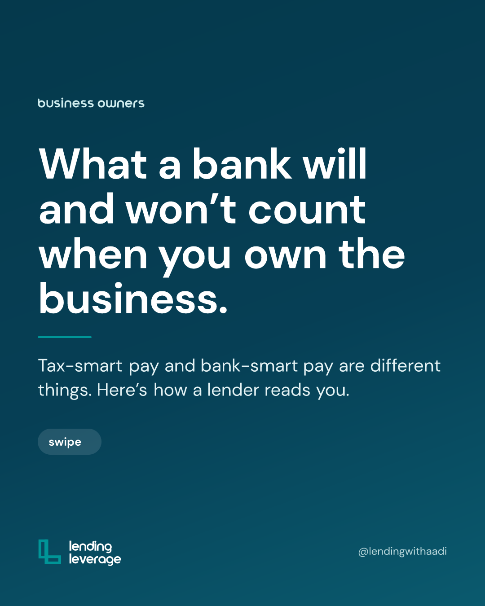

carousel, 7 slides · insights: banks_lend_on_income_tax_has_been_paid_on, rising_income_can_be_shown_with_recent_activity, full_tax_returns_tell_the_story_a_notice_cant, same_trade_history_bridges_a_short_abn, young_business_lead_with_director_track_record, business_car_debt_belongs_with_the_business

LinkedIn caption

What a bank will and won't count when you own the business.  
  
Your accountant's job is to make your tax bill small. A lender's job is to find income it can rely on. Those goals pull in opposite directions, and most owners find out mid-application.  
  
The first slide is the hard truth. Drawings and untaxed distributions suit the accountant, but lenders struggle to use income that hasn't been taxed. If you plan to keep borrowing, how you pay yourself has to be readable by a bank. That's a conversation for your broker and accountant together, before the next return.  
  
The slide on growth is the good news. With the right lender, recent activity statements and interims can show this year's income rather than last year's.  
  
Short ABN with years on the tools, young businesses, and the work ute are in the carousel.  
  
General information only, not personal advice.

Instagram caption

What a bank will and won't count when you own the business. Swipe through.  
  
Income tax has been paid on counts. Untaxed drawings mostly don't. This year's growth can count with the right lender and recent activity statements. Send the full return, not just the notice. Years in the same trade as an employee can bridge a short ABN. And a young business leads with its directors.  
  
Does your accountant know you plan to borrow in the next two years?  
  
General information only, not personal advice.  
  
#businessowner #selfemployed #homeloan #mortgagebroker #lendingleverage

## Headlines vs your household

A run on the gap between what the news says about property and what actually matters at your kitchen table. Built in the note style; no market figures, so it stays usable whichever way the headlines turn.

### `headlines/no-headline-for-settled` — Nobody writes a headline about the settlement that went fine. · *to confirm*

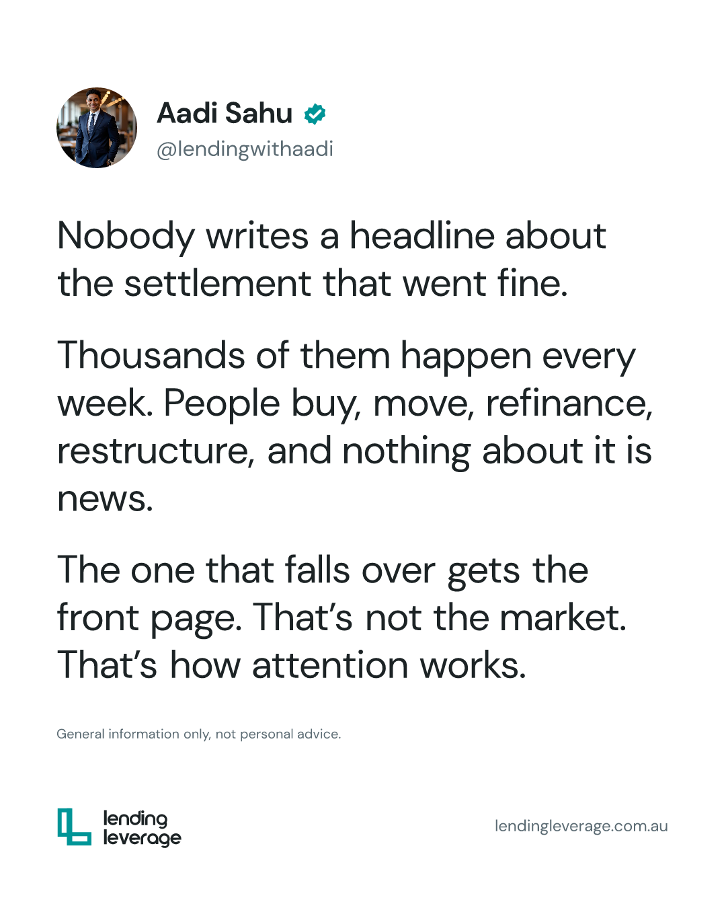

note · insights: complex_restructures_are_the_market_now, finance_is_the_fastest_part

LinkedIn caption

Nobody writes a headline about the settlement that went fine.  
  
Thousands of them happen every week. People buy, move, refinance, restructure, and none of it is news, because nothing went wrong.  
  
The one that falls over gets the front page. Prices dip, a headline screams, and suddenly everyone you know is nervous about a market most of them aren’t transacting in.  
  
From where we sit, the files keep coming in. Different shapes than a few years ago, more restructuring than buying, but moving. The news reports the exceptions. Your household runs on the rule.  
  
Worth remembering before the next headline decides your mood.  
  
General information only, not personal advice.

Instagram caption

Nobody writes a headline about the settlement that went fine.  
  
Thousands happen every week. The one that falls over makes the news, and suddenly everyone’s nervous about a market most of them aren’t even transacting in. That’s not the market. That’s how attention works.  
  
When did a headline last change how you felt about your own finances?  
  
General information only, not personal advice.  
  
#propertymarket #homeloan #perspective #mortgagebroker #lendingleverage

### `headlines/same-market-different-problems` — Same market. Very different problems. · *to confirm*

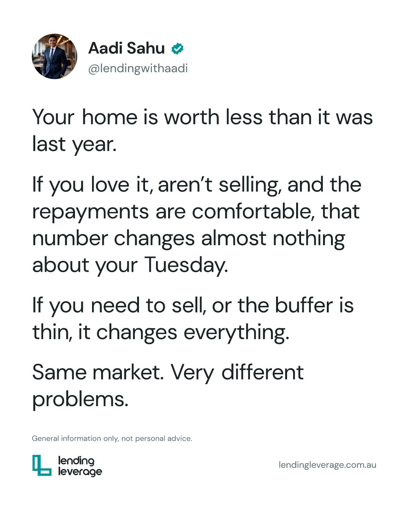

note · insights: hold_if_sustainable_sell_if_not, bank_valuation_is_not_a_sale_price, turn_your_buffer_into_a_runway

LinkedIn caption

Your home is worth less than it was last year. What does that actually change?  
  
If you love the place, you’re not selling, and the repayments are comfortable, the honest answer is: almost nothing about your Tuesday. A valuation is a number on a day. You don’t pay it, and you don’t live in it.  
  
If you need to sell, or you’re refinancing on thin equity, or the buffer is already gone, it changes a great deal. That’s a conversation worth having early, not late.  
  
Same market, very different problems. The headline can’t tell you which one you have. Your numbers can.  
  
General information only, not personal advice.

Instagram caption

Your home is worth less than it was last year. So what?  
  
If you love it, aren’t selling and the repayments are comfortable, that number barely touches your week. If you need to sell or the buffer is thin, it matters a lot. Same market, very different problems.  
  
Which of those two are you, honestly?  
  
General information only, not personal advice.  
  
#propertyvalues #homeloan #equity #mortgagebroker #lendingleverage

### `headlines/what-if-youre-fine` — What if you’re actually fine? · *to confirm*

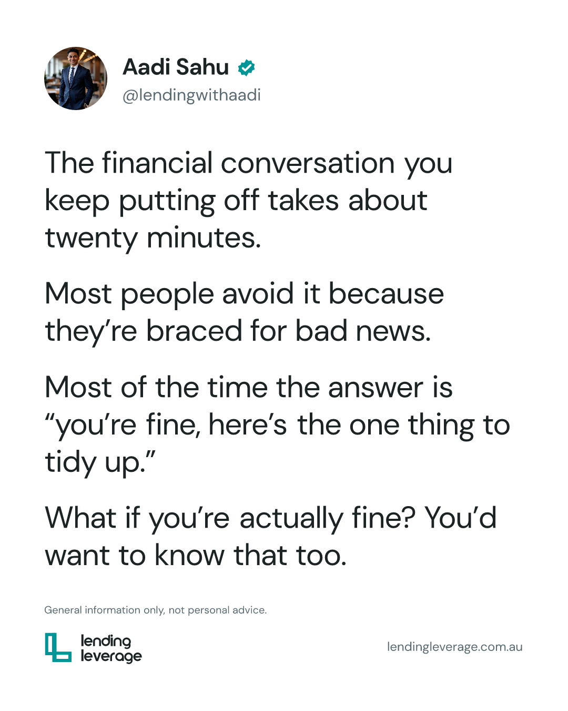

note · insights: you_probably_dont_know_your_own_rate, could_one_income_carry_the_mortgage, complex_questions_get_a_call_not_an_email

LinkedIn caption

What if you’re actually fine?  
  
There’s a financial conversation most households keep putting off. Not because it’s long (it’s about twenty minutes) but because everyone is braced for bad news, and nobody wants that squeezed between school pickup and dinner.  
  
Here’s what we see when people finally have it: most of the time the answer is “you’re fine, and here’s the one thing to tidy up.” A rate nobody has checked in two years. A buffer that should be measured in months, not dollars. One income carrying a mortgage that two incomes signed for.  
  
You don’t avoid the conversation because you’re in trouble. You avoid it because you don’t know. Knowing is the breathing room.  
  
General information only, not personal advice.

Instagram caption

What if you’re actually fine?  
  
The money conversation you keep putting off takes about twenty minutes. Most people avoid it braced for bad news. Most of the time the answer is “you’re fine, here’s the one thing to tidy up.” Knowing is the breathing room.  
  
When did you last actually look at your own loan?  
  
General information only, not personal advice.  
  
#homeloan #moneyhabits #financialwellbeing #mortgagebroker #lendingleverage

### `headlines/know-your-numbers` — You don’t need to predict the market. You need to know your numbers. · *to confirm*

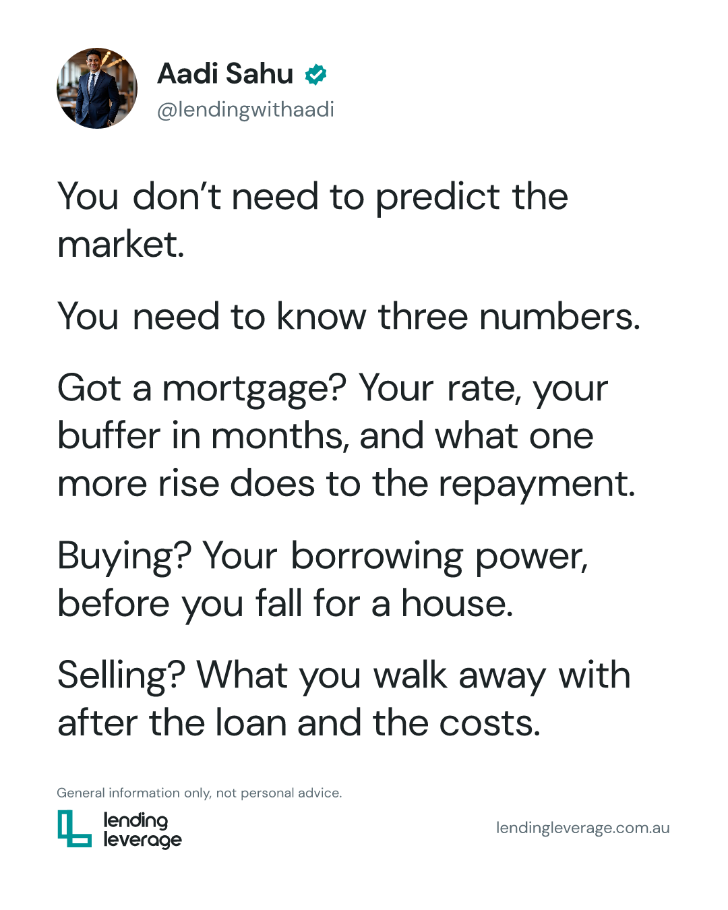

note · insights: capacity_differs_by_lender_run_several, turn_your_buffer_into_a_runway, set_your_walk_away_price_before_auction_day

LinkedIn caption

You don’t need to predict the market. You need to know your numbers.  
  
Everyone spends their evenings guessing what the Reserve Bank will do next. Almost nobody spends five minutes on the numbers that actually decide their year.  
  
If you have a mortgage: your rate, your buffer measured in months, and what one more rise does to the repayment.  
  
If you’re buying: your real borrowing power, run through more than one lender, before you fall for a house rather than after.  
  
If you’re selling: what you actually walk away with once the loan and the selling costs are paid, and the number below which you don’t sell.  
  
Three numbers. None of them require a forecast.  
  
General information only, not personal advice.

Instagram caption

You don’t need to predict the market. You need to know three numbers.  
  
Mortgage: your rate, your buffer in months, what one more rise does. Buying: your borrowing power before you fall for a house. Selling: what you walk away with after the loan and the costs.  
  
Which of your three could you say right now, without looking?  
  
General information only, not personal advice.  
  
#borrowingpower #homeloan #knowyournumbers #mortgagebroker #lendingleverage

### `headlines/same-market-different-fear` — Same market. Different fear. · *to confirm*

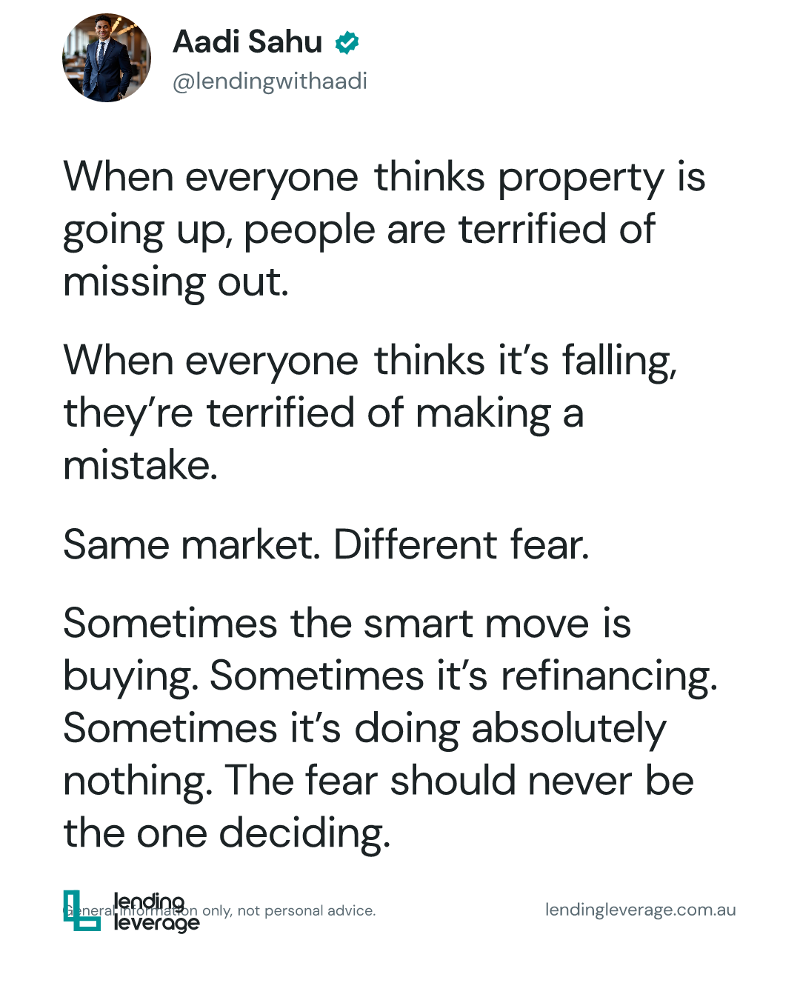

note · insights: soft_market_hurts_those_who_sit_out, dont_refinance_for_small_gains, start_from_goals_work_backwards

LinkedIn caption

When everyone thinks property is going up, people are terrified of missing out. When everyone thinks it’s falling, they’re terrified of making a mistake.  
  
Same market. Different fear. And the fear is a terrible decision-maker either way.  
  
We see it on files every week. The upgrader who sits out a soft market and loses the discount on the way in. The owner who refinances for a tiny saving because a headline said rates were moving. The buyer with a solid plan who freezes because of a dinner-party opinion.  
  
Start from what you actually want in the next few years and work backwards. Sometimes that’s buying. Sometimes it’s refinancing. Sometimes it’s doing absolutely nothing, on purpose.  
  
General information only, not personal advice.

Instagram caption

Market going up? People fear missing out. Market falling? People fear a mistake. Same market, different fear.  
  
Sometimes the smart move is buying. Sometimes refinancing. Sometimes doing absolutely nothing, on purpose. The fear should never be the one deciding.  
  
Which fear is running your decisions right now?  
  
General information only, not personal advice.  
  
#propertymarket #homeloan #decisions #mortgagebroker #lendingleverage

### `headlines/thread-headlines-vs-household` — Not every problem in the headlines needs to become a problem in your house. · *to confirm*

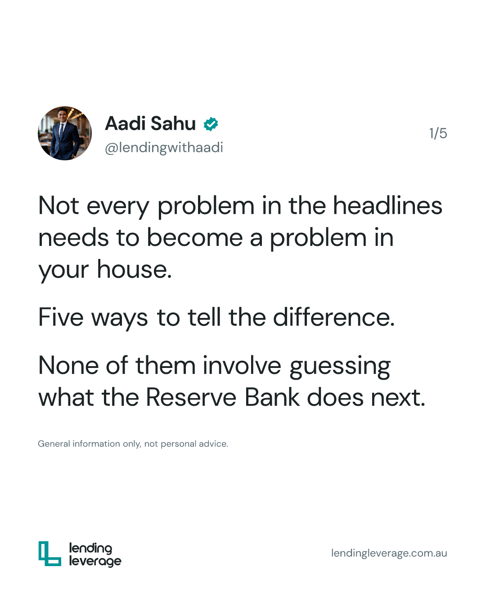

carousel, 5 slides · insights: hold_if_sustainable_sell_if_not, turn_your_buffer_into_a_runway, capacity_differs_by_lender_run_several, dont_refinance_for_small_gains, could_one_income_carry_the_mortgage

LinkedIn caption

Not every problem in the headlines needs to become a problem in your house.  
  
Prices falling is a headline. Whether it’s yours depends on one question: are you selling, struggling, or short on equity? If none of those, it’s weather.  
  
A rate rise is a headline. Your problem is a buffer you can’t measure. Divide what you have by what one more rise costs each month, and you have a plan instead of a worry.  
  
Borrowing power shrinking is a headline. Your number depends on which lender reads your payslips, so know yours before you fall for a house.  
  
Everyone refinancing is a headline. Your loan might already be fine, and leaving it alone can be the smartest move, when you’ve decided it on purpose.  
  
General information only, not personal advice.

Instagram caption

Not every problem in the headlines needs to become a problem in your house. Swipe for five ways to tell the difference.  
  
Falling prices only matter if you’re selling, struggling or short on equity. A rate rise only matters against a buffer you’ve measured. Borrowing power is your number, not the news’s. And sometimes doing nothing is the plan.  
  
Which headline has been living rent-free in your head?  
  
General information only, not personal advice.  
  
#propertymarket #homeloan #perspective #mortgagebroker #lendingleverage

## How we work

Behind the scenes at Lending Leverage: who pays us, how we run a file, and the questions people actually ask a broker, answered plainly.

### `how-we-work/who-pays-you` — You don't pay us. The bank does. Your rate doesn't change. · *to confirm*

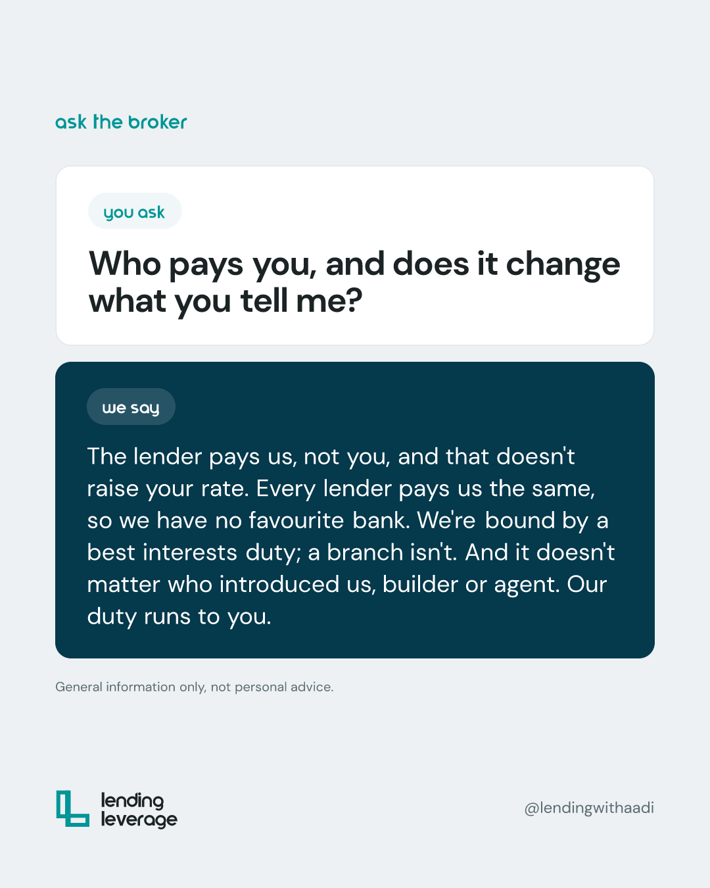

qa · insights: brokers_are_paid_the_same_so_no_favourite_bank, a_broker_is_paid_by_the_lender_not_a_higher_rate, a_referral_never_changes_our_advice

LinkedIn caption

You don't pay us. The bank does. Your rate doesn't change.  
  
It's the first question people should ask a broker. So here's the plain answer. The lender pays the broker when a loan settles. You don't get charged, and your interest rate isn't loaded to cover it. The same loan through us costs you the same as walking into the branch, except someone is sitting on your side of the table.  
  
Every lender pays us the same. That matters, because it means we have no reason to steer you anywhere but the right answer. A branch can only sell its own product and carries no duty to act in your best interest. We do.  
  
And if a builder or an agent introduced us, that changes nothing. Our duty runs to you, not to whoever made the introduction.  
  
General information only, not personal advice.

Instagram caption

You don't pay us. The bank does. Your rate doesn't change.  
  
The lender pays the broker when your loan settles. You aren't charged, and your rate isn't loaded to cover it. Same loan, same cost as going direct, with someone on your side.  
  
Every lender pays us the same, so we have no favourite bank. A branch can only sell its own product. We're bound to act in your best interest, and that holds no matter who introduced us.  
  
Has anyone ever told you plainly how your broker gets paid?  
General information only, not personal advice.  
  
#mortgagebroker #homeloans #melbournebroker #plainenglishfinance #lendingleverage

### `how-we-work/forty-lenders` — Forty lenders on the website usually means six in real life. · *to confirm*

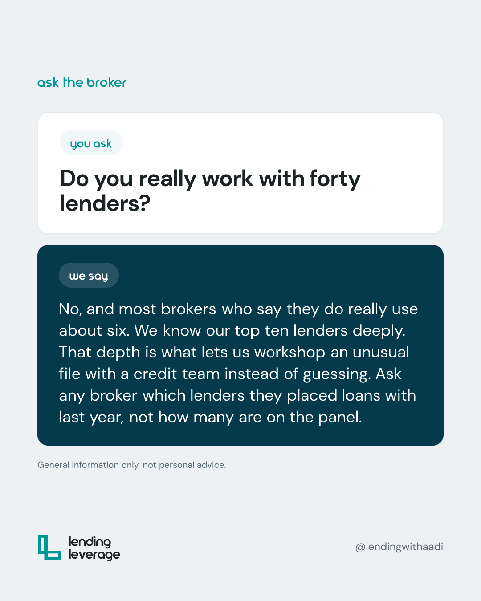

qa · insights: forty_lenders_on_paper_six_in_practice

LinkedIn caption

Forty lenders on the website usually means six in real life.  
  
People ask us if we work with forty lenders. The honest answer is no, and neither does almost anyone else who says they do. Most brokers place the bulk of their loans with a handful of banks they know well.  
  
We'd rather be open about it. We know our top ten lenders deeply: how their credit teams think, what they'll look at twice, where an unusual file has a real chance. That depth is what lets us workshop your scenario with a person instead of guessing from a policy document.  
  
So the number on the panel tells you very little. The better question for any broker is which lenders they actually placed loans with last year. That answer tells you where their real knowledge sits.  
  
General information only, not personal advice.

Instagram caption

Forty lenders on the website usually means six in real life.  
  
Do we work with forty lenders? Honestly, no. Almost nobody does, whatever the website says. Most brokers place most of their loans with a handful of banks they know well.  
  
We know our top ten deeply. That depth is what lets us workshop an unusual file with a credit team instead of guessing from a policy document.  
  
Next time you meet a broker, skip the panel size. Ask which lenders they actually placed loans with last year.  
  
Has a broker ever given you a straight answer to that one?  
General information only, not personal advice.  
  
#mortgagebroker #homeloans #melbournebroker #askthebroker #lendingleverage

### `how-we-work/credit-score` — We ask every bank first, then apply once. · *to confirm*

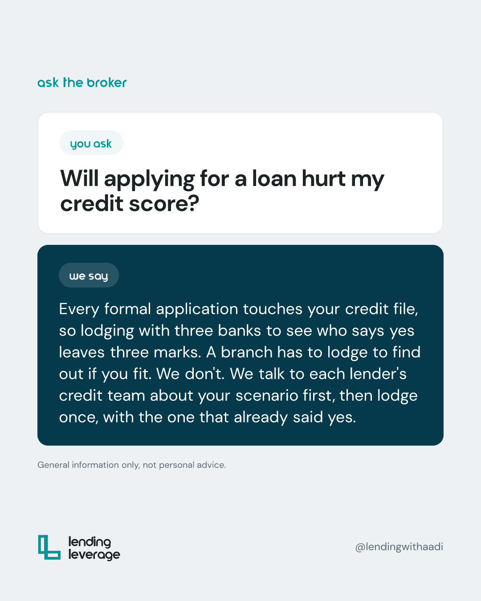

qa · insights: we_sound_out_every_bank_before_one_application_hits_your_file

LinkedIn caption

We ask every bank first, then apply once.  
  
Will applying hurt your credit score? Every formal application touches your credit file. So if you walk into three branches to see who says yes, you leave three marks behind.  
  
A branch has to lodge an application to find out whether you fit. That's the only tool it has. We have a different one. We can talk to each lender's credit team about your scenario before anything is lodged: who has appetite, on what terms, where the sticking points are.  
  
Then we lodge once, with the lender that has already said yes in principle. One application on your file, not a trail of them.  
  
Before you apply anywhere, ask whether your scenario has been workshopped with the lender first.  
  
General information only, not personal advice.

Instagram caption

We ask every bank first, then apply once.  
  
Every formal application touches your credit file. Walk into three branches to see who says yes and you leave three marks behind.  
  
A branch has to lodge to find out whether you fit. We don't. We talk to each lender's credit team about your scenario first, then lodge once, with the one that has already said yes in principle.  
  
One application on your file, not a trail of them.  
  
Has anyone ever lodged an application for you before checking it would fly?  
General information only, not personal advice.  
  
#mortgagebroker #creditscore #homeloans #melbournebroker #lendingleverage

### `how-we-work/after-pre-approval` — If your broker takes two days to text back, that is your answer. · *to confirm*

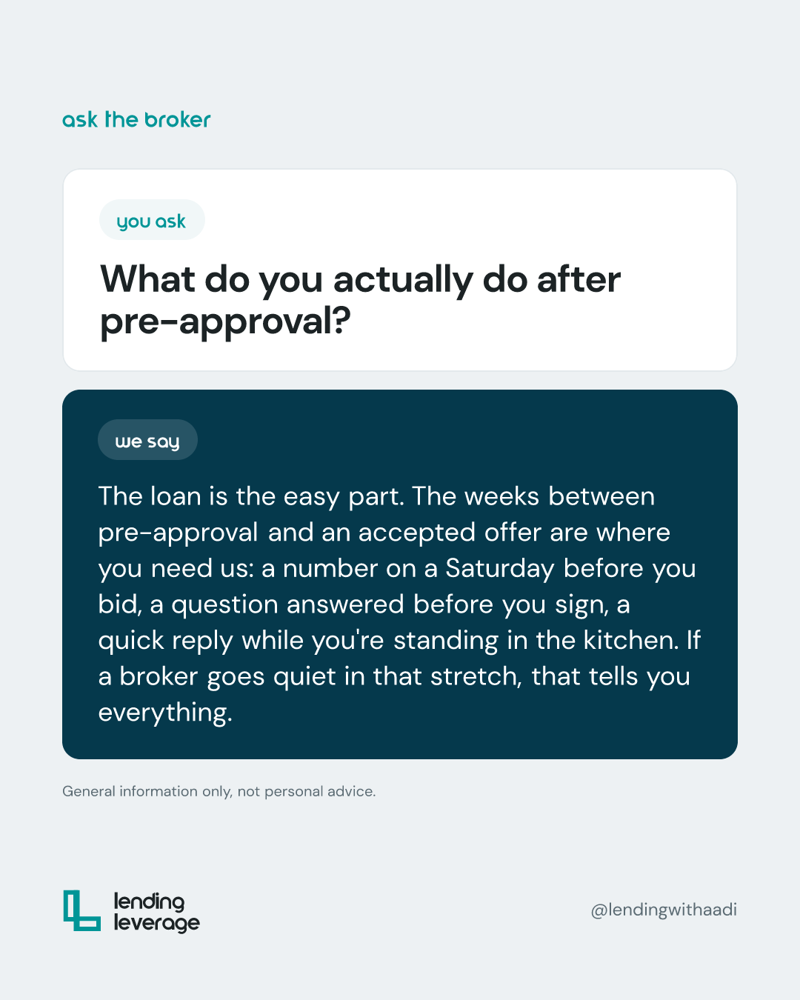

qa · insights: slow_replies_are_the_broker_red_flag

LinkedIn caption

If your broker takes two days to text back, that is your answer.  
  
What do we actually do after pre-approval? More than before it. The loan is the easy part. The hard part is the stretch between pre-approval and an accepted offer, when you're inspecting on Saturdays, second-guessing a price on Sunday night and trying to work out what you can really commit to.  
  
That's when you need a number quickly, a question answered before you sign anything, and someone who picks up. If a broker goes quiet in that window, the support you were actually paying for isn't there.  
  
So when you're choosing a broker, ask how they support you between pre-approval and offer, and how fast they reply. The answer matters more than the rate they quote you.  
  
General information only, not personal advice.

Instagram caption

If your broker takes two days to text back, that is your answer.  
  
The loan is the easy part. The real work is the stretch between pre-approval and an accepted offer: Saturday inspections, a price you're unsure about, a contract in your inbox.  
  
That's when you need a number quickly and someone who picks up. If a broker goes quiet in that window, the support you were paying for isn't there.  
  
Ask any broker how they back you between pre-approval and offer, and how fast they reply.  
  
How long did your broker take to get back to you last time?  
General information only, not personal advice.  
  
#firsthomebuyer #mortgagebroker #preapproval #melbournebroker #lendingleverage

### `how-we-work/talk-to-my-accountant` — We draw the structure. Your accountant signs off. Then we build. · *to confirm*

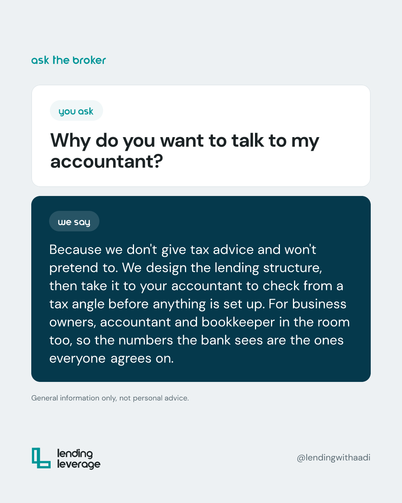

qa · insights: broker_designs_accountant_verifies, accountant_bookkeeper_and_broker_must_talk

LinkedIn caption

We draw the structure. Your accountant signs off. Then we build.  
  
People sometimes bristle when we ask to talk to their accountant. Fair enough, so here's why. We don't give tax advice and we won't pretend to. What we do is design the lending structure: which loans, which splits, where the offset sits, how the money moves. Then we take that drawing to your accountant to check from a tax angle before anything is set up.  
  
For business owners we go one step further. When the accountant and the bookkeeper don't talk to each other, things fall through the gap and the lending suffers. We'd rather be in the room with both, so the numbers the bank sees are the numbers everyone agrees on.  
  
Before you sign, ask whether your loan structure has been checked with your accountant.  
  
General information only, not personal advice.

Instagram caption

We draw the structure. Your accountant signs off. Then we build.  
  
Why do we want to talk to your accountant? Because we don't give tax advice and won't pretend to. We design the lending structure, then take it to your accountant to check from a tax angle before anything is set up.  
  
For business owners, we'd rather have the accountant and bookkeeper in the room too. When they don't talk, things fall through the gap and the lending suffers.  
  
Has your broker ever asked to meet your accountant?  
General information only, not personal advice.  
  
#mortgagebroker #businessowners #loanstructure #melbournebroker #lendingleverage

### `how-we-work/messy-situation` — Banks approve stories, not spreadsheets. · *to confirm*

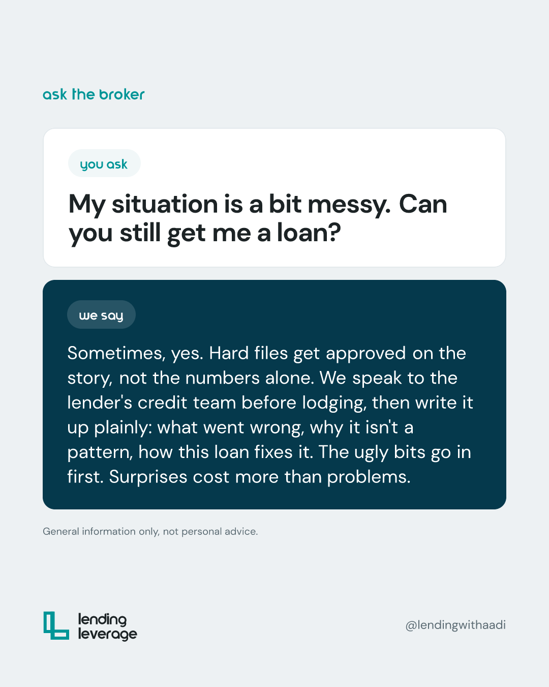

qa · insights: credit_exceptions_need_a_clear_story, disclose_everything_to_the_lender_upfront

LinkedIn caption

Banks approve stories, not spreadsheets.  
  
"My situation's a bit messy. Can you still get me a loan?" We hear it a lot, and the answer is sometimes yes, but never by hoping nobody notices.  
  
Hard files don't get approved on the numbers alone. They get approved on the narrative. Before we lodge anything borderline we speak to the lender's credit team, get a steer, and then write the submission as a story: what went wrong, why it isn't a pattern, and how this loan fixes it.  
  
The other half is telling the bank the ugly bits first. A problem the lender knows about on day one is a problem. The same thing surfacing after they've priced the deal is a surprise, and surprises reset the whole conversation.  
  
If your file is unusual, ask what the written case will say before it goes in.  
  
General information only, not personal advice.

Instagram caption

Banks approve stories, not spreadsheets.  
  
"My situation's a bit messy. Can you still help?" Sometimes, yes. Never by hoping nobody notices.  
  
Hard files get approved on the story, not the numbers alone. We speak to the lender's credit team before lodging, then write it up plainly: what went wrong, why it isn't a pattern, how this loan fixes it.  
  
And the ugly bits go in first. Surprises cost more than problems.  
  
If your file is unusual, has anyone shown you what the bank will actually read?  
General information only, not personal advice.  
  
#mortgagebroker #homeloans #plainenglish #melbournebroker #lendingleverage

### `how-we-work/five-year-question` — If your broker only talked about rate, you got a transaction, not advice. · *to confirm*

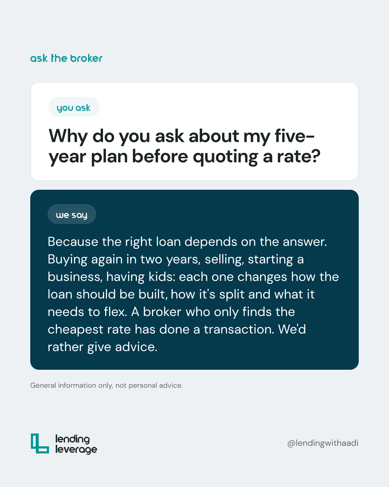

qa · insights: rate_shopping_makes_you_a_transactional_broker

LinkedIn caption

If your broker only talked about rate, you got a transaction, not advice.  
  
Why do we ask where you see yourself in three to five years before we quote anything? Because the right loan depends on the answer.  
  
Buying again in two years looks different from staying put for ten. Starting a business changes how income will be read next time. Kids on the way changes the buffer you want. Each one changes how the loan should be built, how it's split and what it needs to flex around.  
  
If all a broker does is find you the cheapest rate, that's a transaction. Useful, maybe, but it isn't advice, and it won't survive your next move.  
  
So expect the questions about your next five years before anyone mentions a rate. If they don't come, ask why.  
  
General information only, not personal advice.

Instagram caption

If your broker only talked about rate, you got a transaction, not advice.  
  
Why do we ask about your next five years before quoting anything? Because the right loan depends on the answer. Buying again, selling, starting a business, having kids: each one changes how the loan should be built and how it's split.  
  
Finding the cheapest rate is a transaction. Useful, but it isn't advice, and it won't survive your next move.  
  
Expect the five-year questions first. If they don't come, ask why.  
  
When did a broker last ask you where you'll be in five years?  
General information only, not personal advice.  
  
#mortgagebroker #homeloans #refinance #melbournebroker #lendingleverage

### `how-we-work/ask-the-banks-first` — We ask the banks before we tell them who you are. · *to confirm*

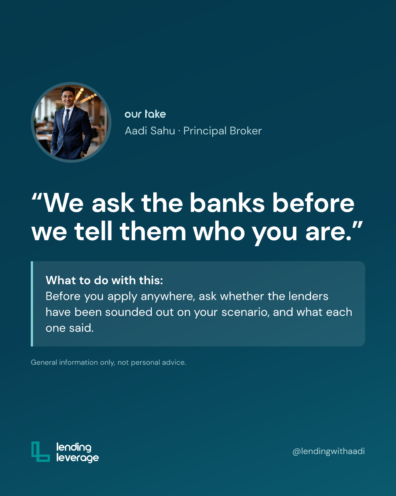

take · insights: sound_out_lenders_anonymously_before_you_apply, we_sound_out_every_bank_before_one_application_hits_your_file

LinkedIn caption

We ask the banks before we tell them who you are.  
  
Here's what happens in the week before a complex deal is lodged. We take the scenario, not the name, to several lenders' credit teams. Who has appetite? On what terms? Where will it get stuck?  
  
Nothing touches your credit file while that happens. Nobody has your name. You haven't paid for a formal application anywhere. What you get back is a short list of lenders that have already said "yes, send it", and a clear picture of what each one will want to see.  
  
Then we lodge once, with the one that fits. A branch can't do this; it has one product and has to lodge to find out.  
  
Before you apply anywhere, ask what the lenders said when your scenario was put to them.  
  
General information only, not personal advice.

Instagram caption

We ask the banks before we tell them who you are.  
  
In the week before a complex deal is lodged, we take the scenario, not the name, to several lenders' credit teams. Who has appetite? On what terms? Where will it get stuck?  
  
Nothing touches your credit file while that happens. What comes back is a short list of lenders that have already said "send it", and a clear picture of what each wants to see. Then we lodge once.  
  
Has anyone ever shown you what the banks said before you applied?  
General information only, not personal advice.  
  
#mortgagebroker #businesslending #homeloans #melbournebroker #lendingleverage

### `how-we-work/one-page-structure` — If your loan structure can't fit on one page, it's too clever. · *to confirm*

take · insights: if_we_cant_draw_your_structure_you_wont_use_it_right, map_every_entity_and_loan_on_one_page_first

LinkedIn caption

If your loan structure can't fit on one page, it's too clever.  
  
Clients keep asking us to draw their structure and send a photo. They're right to. Every loan, every split, every offset, with arrows showing where money comes in and where it goes. If it can't be sketched on one page, it's too complicated to run properly, and a structure you can't run properly isn't saving you anything.  
  
It's also where we start when someone arrives overwhelmed by what a previous adviser built. The first job isn't a loan. It's a map: every entity, every property, every loan, and how money moves between them. Nothing gets refinanced until the client can see the whole thing on one page.  
  
Ask your broker to draw your splits, offsets and cash flows before settlement. Then stick it on the fridge.  
  
General information only, not personal advice.

Instagram caption

If your loan structure can't fit on one page, it's too clever.  
  
Clients ask us to draw their structure and send a photo. They're right to. Every loan, split and offset, with arrows showing where the money flows. If it can't be sketched on one page, it's too complicated to run properly.  
  
It's also where we start when someone arrives overwhelmed by what someone else built. First job isn't a loan. It's a map. Nothing gets refinanced until you can see the whole thing.  
  
Could you draw your own loan structure right now?  
General information only, not personal advice.  
  
#loanstructure #mortgagebroker #propertyinvestor #melbournebroker #lendingleverage

### `how-we-work/after-settlement` — Your broker's job starts again the day your loan settles. · *to confirm*

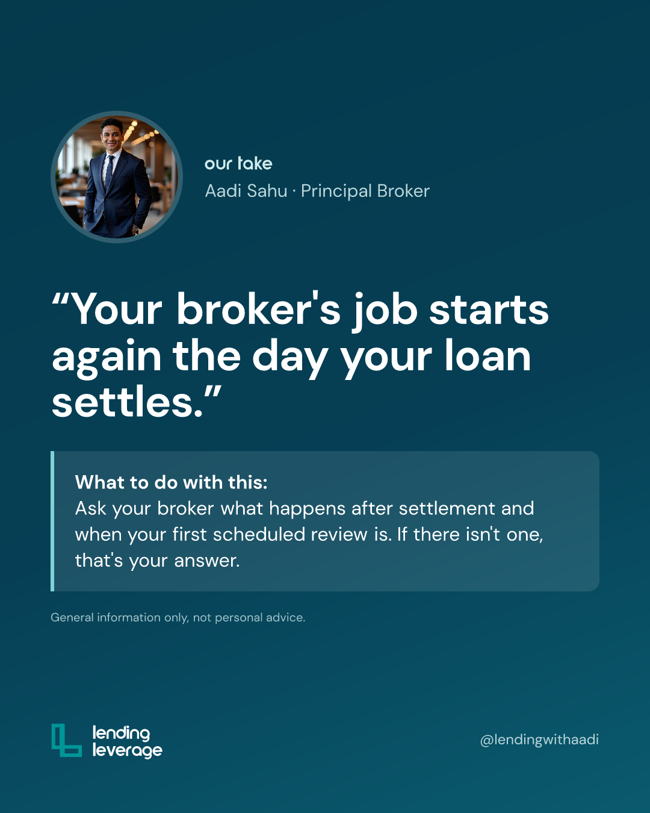

take · insights: client_care_rhythm_six_touchpoints

LinkedIn caption

Your broker's job starts again the day your loan settles.  
  
Most people think settlement is the finish line. For us it's the start of the relationship. We run six touchpoints a year with every client after settlement: rate reviews at six and twelve months, an equity check, and the check-ins in between where we ask what's changed. New job, new baby, a loan that no longer fits.  
  
We budget for this. It's real time and real cost per client, and we do it because that's where good lending comes from: knowing a client's situation well enough to see the next move before they do. It's also, honestly, where our referrals come from.  
  
Ask your broker what happens after settlement and when your first scheduled review is. If the answer is a shrug, you know what you've got.  
  
General information only, not personal advice.

Instagram caption

Your broker's job starts again the day your loan settles.  
  
Settlement isn't the finish line. It's the start. We run six touchpoints a year after settlement: rate reviews at six and twelve months, an equity check, and the check-ins between where we ask what's changed.  
  
It costs us real time per client. We do it because that's where good lending comes from, and, honestly, where our referrals come from.  
  
Ask your broker what happens after settlement and when your first review is.  
  
When did you last hear from the person who set up your loan?  
General information only, not personal advice.  
  
#mortgagebroker #homeloans #refinance #melbournebroker #lendingleverage

### `how-we-work/warm-referrals` — A good referral isn't a phone number. It's a briefing. · *to confirm*

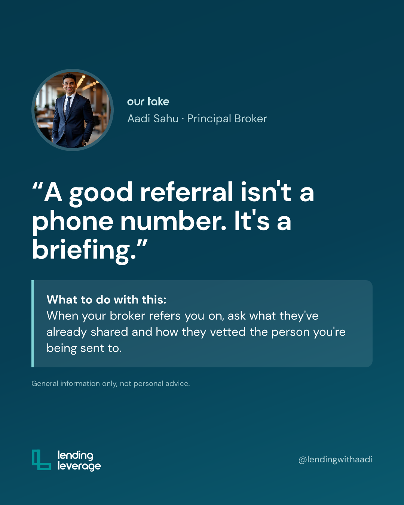

take · insights: warm_referrals_not_tick_and_flick, refer_out_only_question_is_client_service

LinkedIn caption

A good referral isn't a phone number. It's a briefing.  
  
When we introduce a client to a conveyancer, a planner or an accountant, that person doesn't start from zero. They walk in already briefed with what our compliance allows us to share: what's being bought, what the timeline looks like, what the client is worried about. A referral that's just a name and a number tells the client we never really knew them.  
  
The same goes for things we don't do in-house, like asset finance. The only question we ask about the partner is what service our client will get. The referral fee is irrelevant if the experience is worse than ours, because the client remembers it as our introduction.  
  
When your broker refers you on, ask what they've already shared and how they vetted the person.  
  
General information only, not personal advice.

Instagram caption

A good referral isn't a phone number. It's a briefing.  
  
When we introduce you to a conveyancer, planner or accountant, they walk in already briefed with what we're allowed to share. A name and a number on its own tells you we never really knew you.  
  
Same for things we don't do in-house. The only question we ask about a partner is what service you'll get. The referral fee is irrelevant if the experience is worse than ours.  
  
When you were last referred on, did the next person already know your story?  
General information only, not personal advice.  
  
#mortgagebroker #homebuying #conveyancer #melbournebroker #lendingleverage

### `how-we-work/calm-person-on-the-call` — Our job is to be the only calm person on the call. · *to confirm*

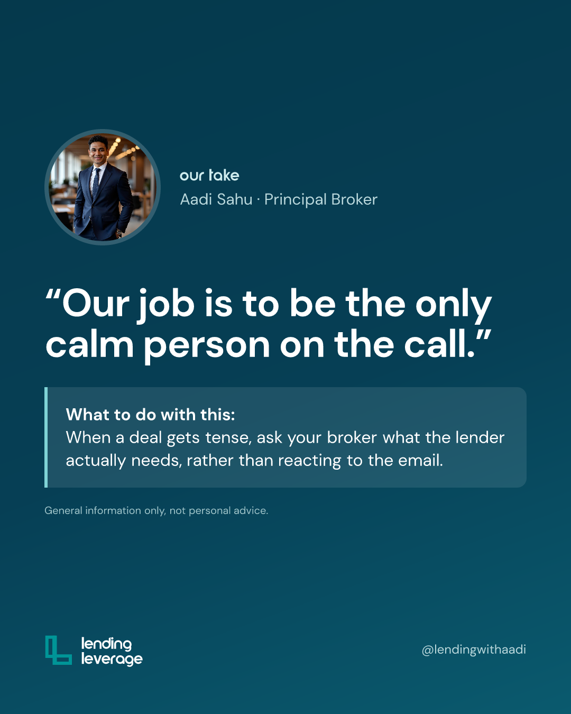

take · insights: broker_manages_two_stakeholders

LinkedIn caption

Our job is to be the only calm person on the call.  
  
A broker sits between two parties who both need to be kept honest and kept calm. The lender wants a clean file and a straight answer. The client wants to know why the bank is asking for one more document, three days out. Both are reasonable. Both get tense.  
  
So we carry the lender's position to the client and the client's position to the lender, in plain words, without the heat. We stay frank when the conversation gets hard, because a soft answer now costs more later. And we never let a deal turn into a fight, because the next deal is with the same people.  
  
When a deal gets tense, ask your broker to translate what the lender actually needs, rather than reacting to the email yourself.  
  
General information only, not personal advice.

Instagram caption

Our job is to be the only calm person on the call.  
  
A broker sits between two parties who both need to be kept honest and kept calm. The lender wants a straight answer. You want to know why the bank is asking for one more document, three days out.  
  
So we carry each side's position to the other, in plain words, without the heat. Frank when it gets hard. Never a fight, because the next deal is with the same people.  
  
When a deal got tense, did your broker calm it down or add to it?  
General information only, not personal advice.  
  
#mortgagebroker #settlement #homeloans #melbournebroker #lendingleverage

## Myth vs what we see

A common belief crossed out against what actually shows up on our files, one myth per card.

### `myth/cash-is-safe` — The house grows the same whether you paid cash or borrowed. · *to confirm*

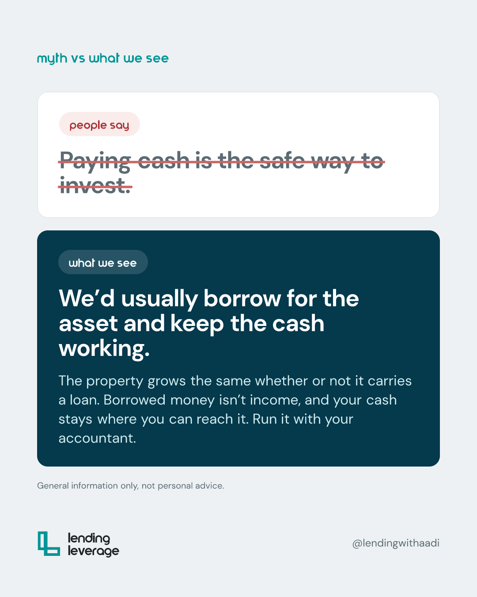

myth · insights: debt_fund_the_asset_keep_the_cash_working

LinkedIn caption

"Paying cash is the safe way to invest."  
  
We hear this from clients who have done well and have the money to buy an investment outright. It feels prudent. We'd usually suggest the opposite.  
  
The house grows the same whether you paid cash or borrowed. Growth doesn't care how the purchase was funded. So the question is only what your cash does in the meantime.  
  
Tied up in the property, it does nothing you can reach. Kept working, in an offset or deployed elsewhere, it stays available and the borrowed money carries the asset. Borrowed money isn't income, which is another reason to run the whole picture with your accountant before deciding.  
  
General information only, not personal advice.

Instagram caption

"Paying cash is the safe way to invest."  
  
The house grows the same whether you paid cash or borrowed. Growth doesn't care how you funded it.  
  
So we usually prefer to borrow for the asset and keep the cash working where you can reach it. Safe isn't the same as locked away. Run the tax side past your accountant.  
  
If you had the cash, would you pay outright?  
  
General information only, not personal advice.  
  
#propertyinvestor #investmentproperty #wealthbuilding #mortgagebroker #lendingleverage

### `myth/interest-free-invisible` — Interest-free doesn't mean invisible to the bank. · *to confirm*

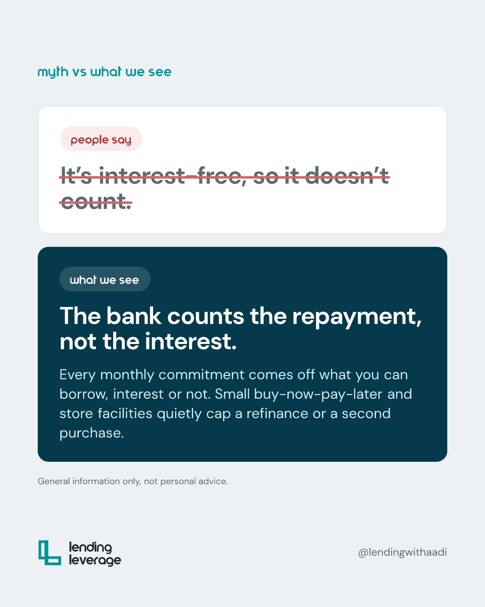

myth · insights: interest_free_debt_still_counts_against_capacity

LinkedIn caption

"It's interest-free, so it doesn't count."  
  
Interest-free doesn't mean invisible to the bank.  
  
The lender isn't looking at what the loan costs you in interest. It is looking at what leaves your account every month. An interest-free couch, a phone plan with a handset built in, a buy-now-pay-later balance: each one is a monthly commitment, and monthly commitments come straight off what you can borrow.  
  
On their own they look trivial. Together they are often the reason a refinance comes in short or a second purchase doesn't fit.  
  
Before you ask what you can borrow, list every repayment you make, including the ones that cost you nothing.  
  
General information only, not personal advice.

Instagram caption

"It's interest-free, so it doesn't count."  
  
Interest-free doesn't mean invisible to the bank. Lenders count the repayment, not the interest. The couch, the phone, the buy-now-pay-later balance: each one is a monthly commitment that comes off what you can borrow.  
  
Small on their own. Together, often the reason a loan comes in short.  
  
How many interest-free repayments leave your account each month?  
  
General information only, not personal advice.  
  
#firsthomebuyer #borrowingpower #moneyhabits #mortgagebroker #lendingleverage

### `myth/ten-percent-contract` — A strong pre-approval can replace a big deposit on the contract. · *to confirm*

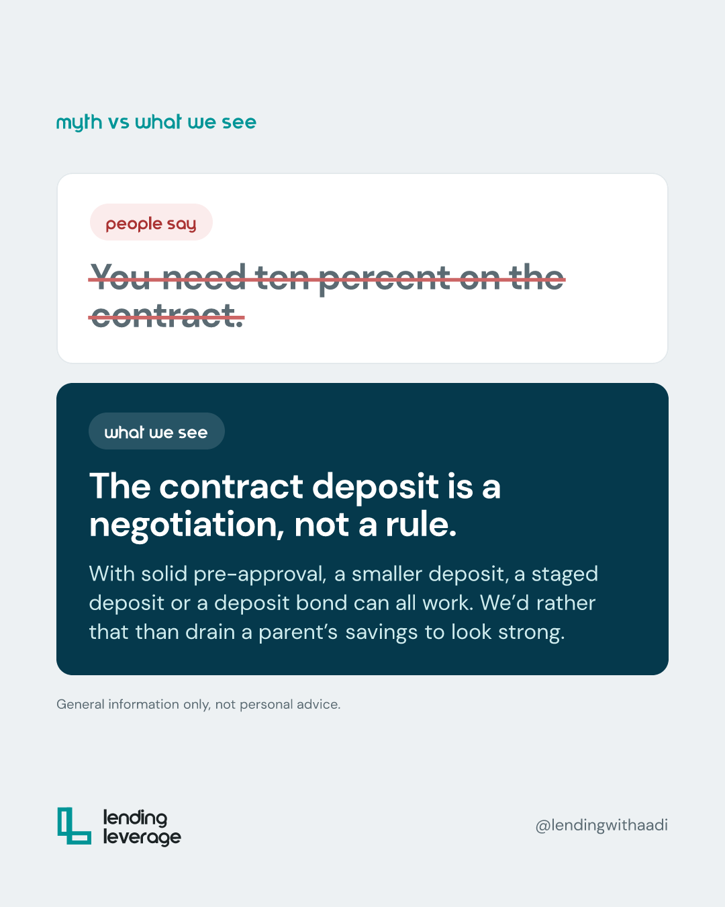

myth · insights: deposit_size_is_negotiable_when_finance_is_solid

LinkedIn caption

"You need ten percent on the contract."  
  
A strong pre-approval can replace a big deposit on the contract.  
  
The deposit written into a contract of sale is a negotiation between you and the vendor. It is not a law, and it has nothing to do with how much the bank needs from you at settlement.  
  
When the finance is rock solid, a smaller deposit, a deposit paid in stages, or a deposit bond are all things a vendor can accept. We would rather set one of those up than watch a buyer drain a parent's savings just to look strong on paper.  
  
Before you make an offer, ask what deposit terms your finance position can actually support.  
  
General information only, not personal advice.

Instagram caption

"You need ten percent on the contract."  
  
The deposit on a contract is a negotiation, not a rule. With solid pre-approval, a smaller deposit, a staged deposit or a deposit bond can all work.  
  
We'd rather do that than watch someone drain a parent's savings to look strong on paper.  
  
Did anyone tell you the contract deposit was negotiable?  
  
General information only, not personal advice.  
  
#firsthomebuyer #contractofsale #homebuying #mortgagebroker #lendingleverage

### `myth/tax-return-softens` — Old house, little depreciation. Budget on the real monthly cost. · *to confirm*

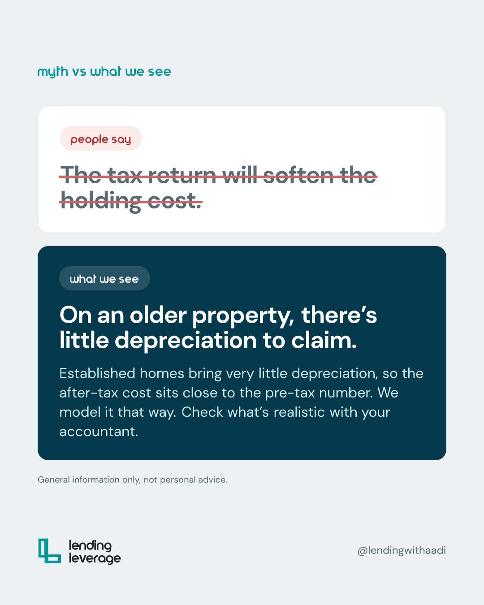

myth · insights: older_properties_bring_little_depreciation

LinkedIn caption

"The tax return will soften the holding cost."  
  
Old house, little depreciation. Budget on the real monthly cost.  
  
Investors buying established homes often assume the monthly shortfall will shrink at tax time the way a brochure for a new build promises. On an older property it mostly won't. There is very little depreciation left to claim, so the after-tax holding cost sits close to the pre-tax number.  
  
We model it that way on purpose. If the property only works once the tax return arrives, it doesn't work.  
  
If you are buying established, ask your accountant what depreciation is realistically available before you count on it.  
  
General information only, not personal advice.

Instagram caption

"The tax return will soften the holding cost."  
  
On an older property, there's very little depreciation to claim. The after-tax cost sits close to the pre-tax cost, so we model the full monthly number and don't count on tax time to rescue it.  
  
Ask your accountant what's realistic before you rely on it.  
  
Have you budgeted the real monthly cost, or the hoped-for one?  
  
General information only, not personal advice.  
  
#propertyinvestor #investmentproperty #propertytax #mortgagebroker #lendingleverage

### `myth/investment-first-benefits` — Buying an investment first doesn't always cost you first home benefits. · *to confirm*

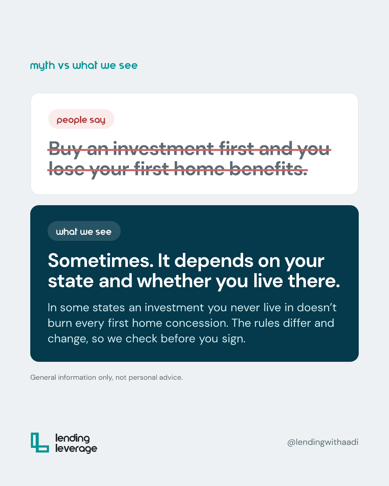

myth · insights: investment_first_can_keep_your_first_home_benefits

LinkedIn caption

"Buy an investment first and you lose your first home benefits."  
  
Buying an investment first doesn't always cost you first home benefits.  
  
People who could get into the market now sometimes wait years because of this belief. The reality is more useful. In some states, buying an investment and never living in it does not burn every first home concession for the home you buy later.  
  
The rules differ by state and they change, so we never assume. We check for your situation before you sign anything.  
  
But if waiting is the only thing between you and a first property, ask the question first. The answer can change the plan.  
  
General information only, not personal advice.

Instagram caption

"Buy an investment first and you lose your first home benefits."  
  
Not always. In some states, an investment you never live in doesn't burn every concession for the home you buy later. The rules differ and change, so we check for your state before you sign.  
  
Don't let an assumption keep you out of the market for years.  
  
Have you checked what survives an investment-first purchase where you live?  
  
General information only, not personal advice.  
  
#firsthomebuyer #rentvesting #propertyinvestor #mortgagebroker #lendingleverage

### `myth/deposit-and-duty` — A bigger deposit doesn't shrink your stamp duty. Only the property does. · *to confirm*

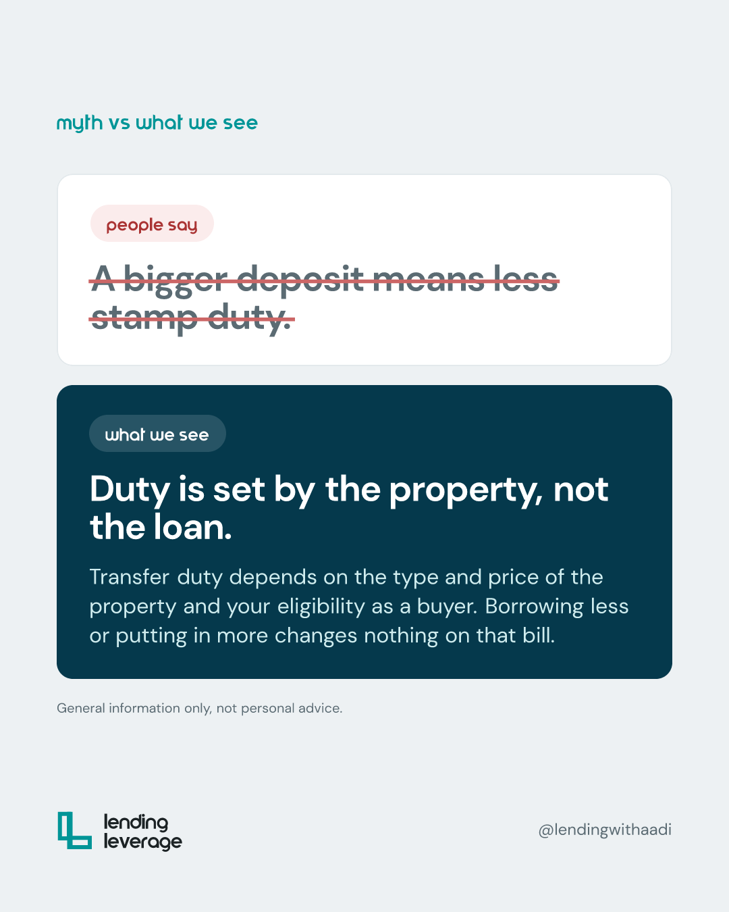

myth · insights: stamp_duty_is_about_the_property_not_the_loan

LinkedIn caption

"A bigger deposit means less stamp duty."  
  
A bigger deposit doesn't shrink your stamp duty. Only the property does.  
  
We hear a version of this most weeks. Someone has saved hard and assumes the extra deposit will knock something off the duty bill. It won't.  
  
Transfer duty has nothing to do with your deposit or how much you borrow. It is set by the type and price of the property and by your eligibility as a buyer. A smaller loan changes your repayments. It does not change the duty.  
  
Budget duty off the purchase price and property type, and ask which concessions you personally qualify for. That is where the savings are, if there are any.  
  
General information only, not personal advice.

Instagram caption

"A bigger deposit means less stamp duty."  
  
It doesn't. Duty is set by the type and price of the property and your eligibility as a buyer. Your deposit and your loan size have nothing to do with it.  
  
Budget the duty off the purchase price, then ask which concessions you qualify for.  
  
Did you think the deposit changed the duty bill?  
  
General information only, not personal advice.  
  
#firsthomebuyer #stampduty #homebuying #mortgagebroker #lendingleverage

### `myth/selling-buys-capacity` — Selling your home gives you cash, not borrowing power. · *to confirm*

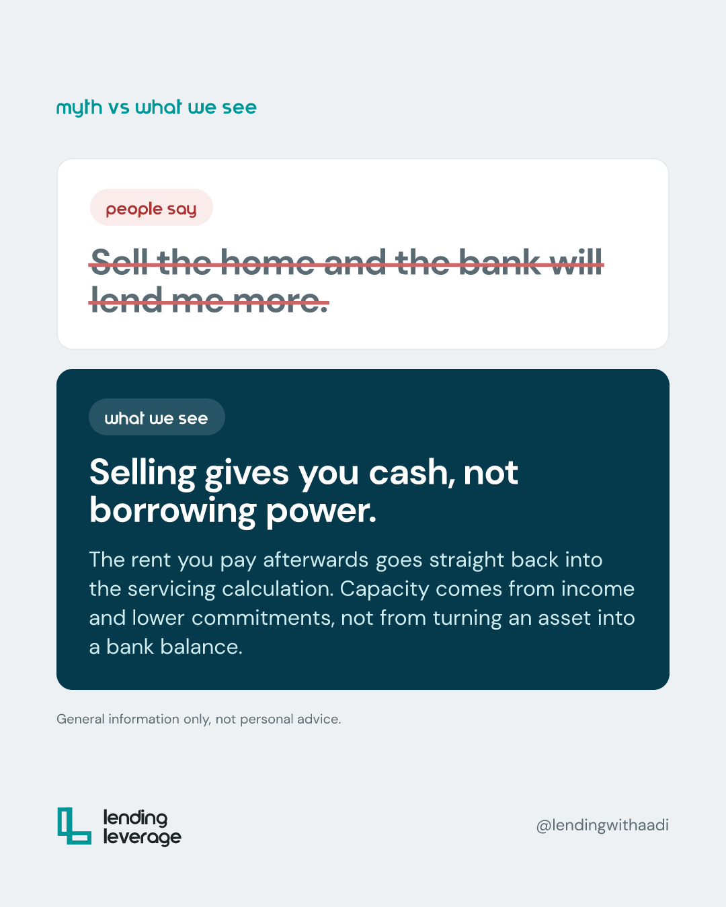

myth · insights: selling_up_doesnt_buy_capacity

LinkedIn caption

"Sell the home and the bank will lend me more."  
  
Selling your home gives you cash, not borrowing power.  
  
Investors who feel stuck sometimes see a sale as the way out. Clear the loan, bank the difference, borrow again with a clean slate. It rarely works like that.  
  
Once you sell, you need somewhere to live. The rent you pay goes straight back into the servicing calculation, often in place of a repayment that was smaller. Your deposit got bigger. Your capacity didn't.  
  
Borrowing power comes from income and lower commitments. Before you list, ask your broker to run the numbers with your future rent included.  
  
General information only, not personal advice.

Instagram caption

"Sell the home and the bank will lend me more."  
  
Selling gives you cash, not borrowing power. Once you've sold you need somewhere to live, and that rent goes straight back into the servicing calculation.  
  
Bigger deposit, same capacity. Sometimes less.  
  
Have you run your numbers with the rent you'd pay after selling?  
  
General information only, not personal advice.  
  
#propertyinvestor #borrowingpower #homeloan #mortgagebroker #lendingleverage

### `myth/one-bank-for-everything` — Different banks win at different things. Use more than one.

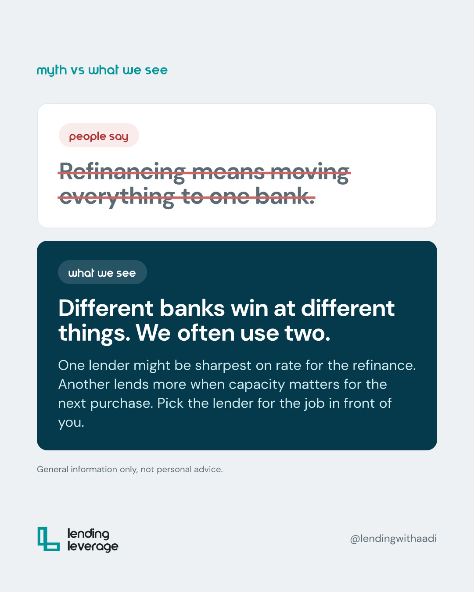

myth · insights: rate_now_capacity_later

LinkedIn caption

"Refinancing means moving everything to one bank."  
  
Different banks win at different things. Use more than one.  
  
The tidy instinct is to have every loan in one place. One login, one relationship. We understand it, and we often don't do it.  
  
For a refinance where the goal is a sharper rate, one lender might be the obvious pick. For the next purchase, where what matters is how much they will lend, a different lender might say yes to a bigger number. Nothing says those two have to be the same bank.  
  
So we ask a narrower question: which lender is strongest for the job you need done now? Then we match the loan to the job.  
  
General information only, not personal advice.

Instagram caption

"Refinancing means moving everything to one bank."  
  
Different banks win at different things. One might be sharpest on rate for the refinance. Another might lend more when you're buying the next place. We often use both.  
  
Pick the lender for the job in front of you, not the one that looks tidiest.  
  
Are all your loans with one bank because it's best, or because it's tidy?  
  
General information only, not personal advice.  
  
#refinance #homeloan #propertyinvestor #mortgagebroker #lendingleverage

### `myth/bank-valuation` — The bank's valuation is not what your house would sell for. · *to confirm*

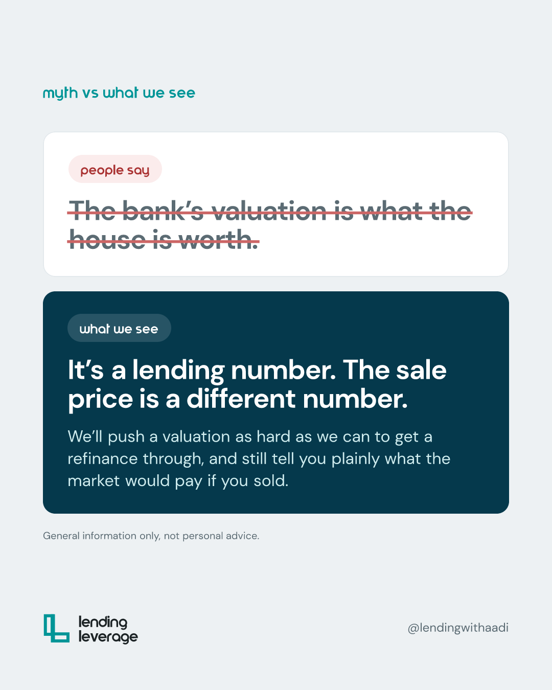

myth · insights: bank_valuation_is_not_a_sale_price

LinkedIn caption

"The bank's valuation is what the house is worth."  
  
The bank's valuation is not what your house would sell for.  
  
They are two different numbers for two different jobs. A bank valuation exists to protect the lender, so it tends to be conservative. A sale price is whatever a buyer will pay on the day, which can be higher or lower.  
  
We'll push a valuation as hard as we can when it gets a refinance over the line. We'll also tell you plainly what the market would actually pay if you listed, because planning your next move off the wrong number is how people get caught.  
  
Ask your broker for both.  
  
General information only, not personal advice.

Instagram caption

"The bank's valuation is what the house is worth."  
  
Two different numbers for two different jobs. The bank's figure protects the bank, so it leans conservative. The sale price is what a buyer pays on the day.  
  
We'll fight for the valuation when it gets your refinance through, and still tell you the realistic sale range.  
  
Do you know both numbers for your place?  
  
General information only, not personal advice.  
  
#refinance #propertyvaluation #homeloan #mortgagebroker #lendingleverage

### `myth/offset-not-working` — Your repayment won't drop. Your interest will. That's the point. · *to confirm*

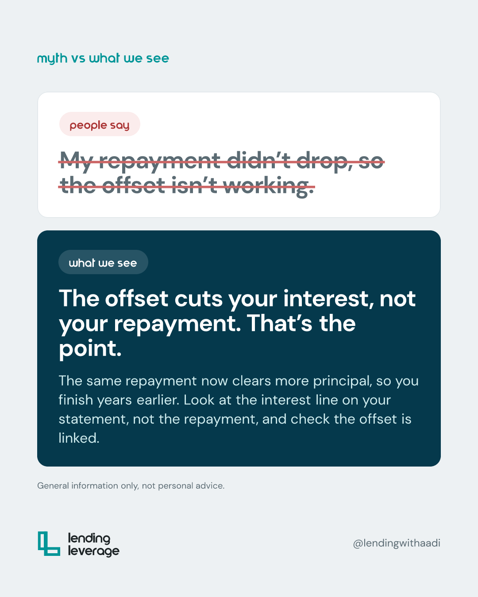

myth · insights: offset_cuts_interest_not_your_repayment

LinkedIn caption

"My repayment didn't drop, so the offset isn't working."  
  
Your repayment won't drop. Your interest will. That's the point.  
  
We see people stop using their offset because nothing seemed to change. The minimum repayment stayed the same, so they assumed the money wasn't doing anything.  
  
It was. Money in an offset lowers the interest charged, not the repayment. So more of the same repayment goes to principal, and you finish the loan years earlier. The change is on the interest line of your statement, not the repayment line.  
  
Check two things: the interest charged against the interest the loan would otherwise calculate, and that the offset is actually linked to the right loan.  
  
General information only, not personal advice.

Instagram caption

"My repayment didn't drop, so the offset isn't working."  
  
It is. An offset lowers the interest charged, not the repayment. So more of the same repayment goes to principal and you finish years earlier.  
  
The change is on the interest line of your statement. Check that, and check the offset is linked to the right loan.  
  
Have you ever looked at the interest line, not just the repayment?  
  
General information only, not personal advice.  
  
#offsetaccount #homeloan #moneyhabits #mortgagebroker #lendingleverage

### `myth/one-banks-no` — Your borrowing power isn't one number. It depends who you ask. · *to confirm*

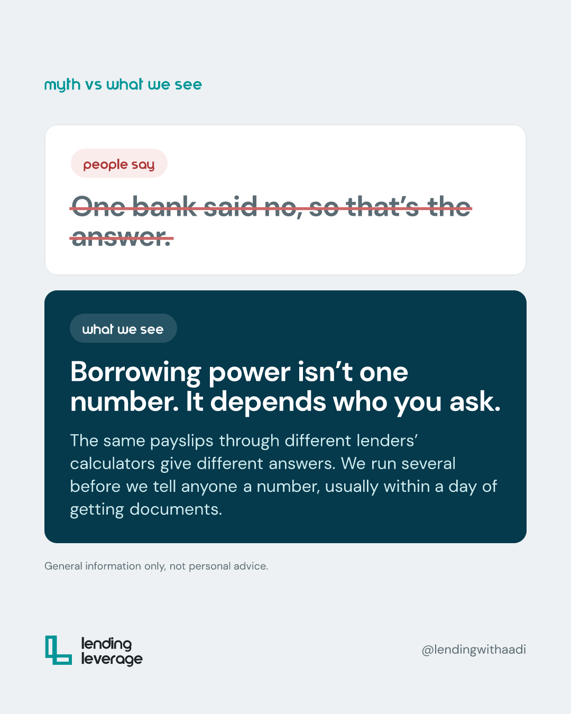

myth · insights: capacity_differs_by_lender_run_several

LinkedIn caption

"One bank said no, so that's the answer."  
  
Your borrowing power isn't one number. It depends who you ask.  
  
There is no single borrowing capacity. The same payslips, the same expenses, the same debts, run through different lenders' calculators, come out as different figures. Sometimes very different. One lender's no is one lender's policy on one day.  
  
That is why we run several before we tell anyone a number, and we can usually do that within a day of getting documents.  
  
If you've been told no once and stopped, ask how many lenders your capacity was actually tested with. The answer is often one.  
  
General information only, not personal advice.

Instagram caption

"One bank said no, so that's the answer."  
  
Borrowing power isn't one number. The same payslips through different lenders' calculators give different figures, sometimes very different. One no is one lender's policy on one day.  
  
We run several before we tell anyone a number.  
  
How many lenders was your capacity actually tested with?  
  
General information only, not personal advice.  
  
#borrowingpower #homeloan #firsthomebuyer #mortgagebroker #lendingleverage

### `myth/interest-only-cheaper` — Interest-only is a tool, not a default. It usually costs more. · *to confirm*

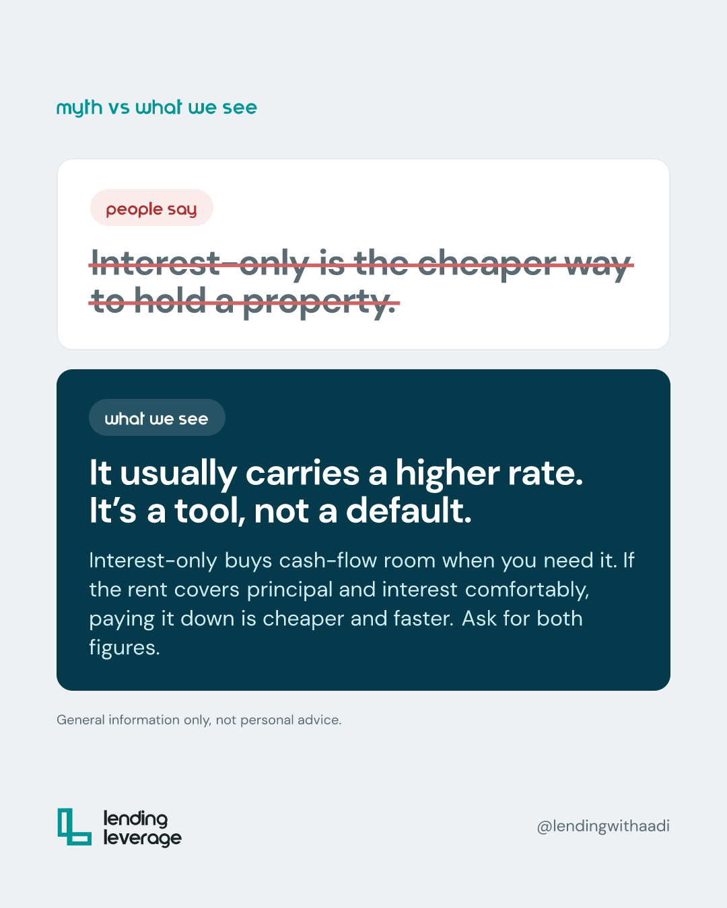

myth · insights: interest_only_costs_more_so_choose_it_for_a_reason

LinkedIn caption

"Interest-only is the cheaper way to hold a property."  
  
Interest-only is a tool, not a default. It usually costs more.  
  
The monthly repayment is lower, which is where the belief comes from. But interest-only loans usually carry a higher rate than principal and interest, so over the year you often pay more for the privilege of paying less each month.  
  
We use interest-only when the cash flow genuinely needs the room, or when the structure calls for it. If the rent covers principal and interest comfortably, paying the loan down is both cheaper and faster.  
  
Ask for both repayment figures and both rates. Then choose interest-only for a reason, not out of habit.  
  
General information only, not personal advice.

Instagram caption

"Interest-only is the cheaper way to hold a property."  
  
The monthly repayment is lower. The rate is usually higher. Over a year you often pay more to pay less each month.  
  
We use interest-only when cash flow needs the room. If the rent covers principal and interest comfortably, paying it down is cheaper and faster.  
  
Is your interest-only loan there for a reason, or by habit?  
  
General information only, not personal advice.  
  
#propertyinvestor #interestonly #investmentloan #mortgagebroker #lendingleverage

### `myth/pre-approval-is-approval` — Ask one question of your pre-approval: did a human read it? · *to confirm*

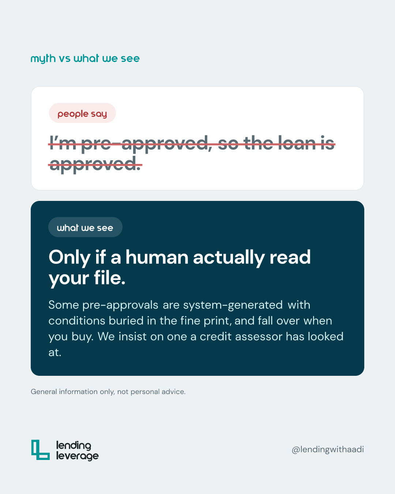

myth · insights: a_pre_approval_nobody_assessed_isnt_one

LinkedIn caption

"I'm pre-approved, so the loan is approved."  
  
Ask one question of your pre-approval: did a human read it?  
  
Some pre-approvals are generated by a system in minutes. They come with conditions buried in the fine print and nobody at the lender has actually looked at your payslips or your statements. They feel like approval right up until you buy a property, and then they fall over.  
  
We insist on a pre-approval that a credit assessor has read, so the approval you bid on is the approval you settle on.  
  
If you already hold one, ask whether it was fully assessed by credit or only passed an automated check. It is a fair question and the answer matters.  
  
General information only, not personal advice.

Instagram caption

"I'm pre-approved, so the loan is approved."  
  
Only if a human read it. Some pre-approvals are system-generated in minutes, with conditions buried in the fine print, and they fall over the moment you buy.  
  
We insist on one a credit assessor has actually looked at, so the approval you bid on is the one you settle on.  
  
Do you know whether a person assessed your pre-approval?  
  
General information only, not personal advice.  
  
#firsthomebuyer #preapproval #homeloan #mortgagebroker #lendingleverage

### `myth/grant-as-deposit` — Treat the grant as a bonus, never as your deposit. · *to confirm*

myth · insights: dont_bank_on_the_grant_at_settlement

LinkedIn caption

"The grant is part of my deposit."  
  
Treat the grant as a bonus, never as your deposit.  
  
First home grants are real money and worth applying for. But they are approved by someone else, on their timeline, and they can be reassessed or declined right up to the end.  
  
If your settlement figures rely on that money landing on the day, and it doesn't, the shortfall comes out of your own pocket while everyone waits. We have seen it, and it is a horrible way to spend settlement morning.  
  
So we plan every settlement as if the grant might not arrive in time. Keep enough of your own cash aside to settle without it, then chase the grant afterwards.  
  
General information only, not personal advice.

Instagram caption

"The grant is part of my deposit."  
  
Treat it as a bonus, never as your deposit. Grants are approved by someone else, on their timeline, and can be reassessed or declined at the last minute.  
  
We plan every settlement as if the grant won't land that day. Your own cash covers it, and the grant comes after.  
  
Could you settle tomorrow if the grant didn't show up?  
  
General information only, not personal advice.  
  
#firsthomebuyer #homebuying #settlement #mortgagebroker #lendingleverage

### `myth/guarantor-just-a-signature` — Mum and Dad's signature ties up their house, not just your deposit. · *to confirm*

myth · insights: guarantor_home_is_locked_in_for_years

LinkedIn caption

"Going guarantor is just a signature from Mum and Dad."  
  
Mum and Dad's signature ties up their house, not just your deposit.  
  
A guarantor loan can be the difference between buying now and renting for another five years. We arrange plenty of them. But everyone at the table needs to understand what is actually being signed.  
  
The parents' home is effectively committed for several years. If they decide to sell before the bank releases their home as security, a cash contribution is usually needed to let that happen. Retirement plans, a downsizing move, a sea change: they all need to fit around that commitment.  
  
Before anyone signs, ask when their home can be released as security and whether the guarantors plan to sell inside that window.  
  
General information only, not personal advice.

Instagram caption

"Going guarantor is just a signature from Mum and Dad."  
  
Their house is committed for years, not just your deposit. If they want to sell before their home is released as security, a cash contribution is usually required.  
  
We arrange plenty of guarantor loans. We just make sure the whole family agrees on the timeline first.  
  
Have your parents said when they plan to sell?  
  
General information only, not personal advice.  
  
#firsthomebuyer #guarantor #familyfinance #mortgagebroker #lendingleverage

## In his words

The screenshot-of-a-post look: white card, Aadi's name, three short paragraphs that land one idea. Ten single notes and five threads of five slides.

### `notes/nobody-cheers` — No one cheers for you keeping the loan you already have.

note · insights: dont_refinance_for_small_gains, idle_cash_belongs_in_an_offset, debt_gets_easier_over_time

LinkedIn caption

No one cheers for you keeping the loan you already have.  
  
Nobody posts about the refinance they didn’t do, the car they didn’t finance, the offset they didn’t touch. There’s no before-and-after photo for leaving a good loan alone.  
  
But that’s most of what building equity actually looks like from the inside. Pay lands in the offset. Spare cash stays there. The loan you were tempted to move for a tiny saving stays put. Year one feels like nothing. Year five looks like luck to everyone else.  
  
The boring decisions never look impressive in the moment. Only at the end.  
  
General information only, not personal advice.

Instagram caption

No one cheers for you keeping the loan you already have.  
  
Nobody posts about the refinance they didn’t do or the offset they didn’t touch. But that’s most of what building equity looks like from the inside: boring decisions, repeated, that only look impressive at the end.  
  
What’s the boring money decision you’re quietly proud of?  
  
General information only, not personal advice.  
  
#homeloan #offset #moneyhabits #mortgagebroker #lendingleverage

### `notes/bank-maximum` — The bank will tell you the most you can borrow. · *to confirm*

note · insights: comfortable_capacity_not_maximum

LinkedIn caption

The bank will tell you the most you can borrow.  
  
Nobody tells you the most you can comfortably repay. Those are different numbers, and most people only ever hear the first one.  
  
When we quote borrowing capacity we give the comfortable figure first. Could we squeeze more if we pushed? Usually. But approval and affordability are not the same thing, and living at the very edge of what a lender will give you rarely buys a better life.  
  
So you get two numbers from us: the one you can hold through a couple of rate moves, and the stretch. Plan on the first. Keep the second in the drawer.  
  
General information only, not personal advice.

Instagram caption

The bank will tell you the most you can borrow. Nobody tells you the most you can comfortably repay.  
  
We give the comfortable number first, every time. The stretch number exists, but it lives in the drawer for the day something genuinely special comes up.  
  
Do you know your comfortable number, or just your maximum?  
  
General information only, not personal advice.  
  
#borrowingpower #homeloan #firsthomebuyer #mortgagebroker #lendingleverage

### `notes/rates-vs-structure` — Everyone compares rates. Almost nobody compares structures.

note · insights: structure_over_rate

LinkedIn caption

Everyone compares rates. Almost nobody compares structures.  
  
A rate changes every few months. Banks are competitive on it, and one call to your lender’s retention team usually fixes a rate problem. You don’t need us for that.  
  
A structure is different. How the debt is split, what’s secured against what, where the offsets sit, whether the setup still works for the next thing you want to do. Those decisions compound for a decade, and nobody at a branch is paid to think about them.  
  
So before you refinance, ask one question: is this a rate problem or a structure problem?  
  
General information only, not personal advice.

Instagram caption

Everyone compares rates. Almost nobody compares structures.  
  
A rate changes every few months. A structure decides what you can do for the next ten years. If all you want is a sharper rate, honestly, call your bank. We’re here for how the loan is built.  
  
When did you last look at how your loan is set up, not just what it costs?  
  
General information only, not personal advice.  
  
#refinance #homeloan #loanstructure #mortgagebroker #lendingleverage

### `notes/good-debt` — Interest on your investment loan is usually deductible.

note · insights: investment_debt_interest_only_pay_down_home

LinkedIn caption

Interest on your investment loan is usually deductible. Interest on the home you live in isn’t.  
  
So every spare dollar has a better home, and it’s usually not the one people send it to. Paying down the investment loan feels responsible. It also shrinks a deduction. Paying down your own home loan cuts interest you can never claim.  
  
Our general view: keep investment debt interest-only, point repayments and the offset at the home loan, and revisit if you ever plan to move into the investment.  
  
The tax side depends on your situation, so have your accountant in that conversation.  
  
General information only, not personal advice.

Instagram caption

Interest on your investment loan is usually deductible. Interest on the home you live in isn’t.  
  
So every spare dollar has a better home. It’s just not the one most people send it to. Keep the investment loan interest-only, aim repayments at the home loan, and check the tax side with your accountant.  
  
Which loan is your extra cash hitting right now?  
  
General information only, not personal advice.  
  
#propertyinvestor #investmentproperty #gooddebt #mortgagebroker #lendingleverage

### `notes/redraw-isnt-savings` — Redraw feels like savings. It isn’t.

note · insights: redraw_is_not_savings_debt_recycling

LinkedIn caption

Redraw feels like savings. It isn’t.  
  
It’s money you’ve already paid off your home loan. The moment you pull it back out to fund an investment, you’ve mixed two purposes in one loan, and the purpose is what decides what you can claim.  
  
The cleaner approach is to reduce the home loan limit and set up a separate split for the investment. Same money, different label, a story your accountant can actually follow in three years’ time.  
  
It takes a bit of planning and some cost up front. Untangling it later costs more.  
  
General information only, not personal advice.

Instagram caption

Redraw feels like savings. It isn’t.  
  
It’s money you’ve already paid off your loan. Pull it out for an investment and you’ve muddied what that loan was for. A separate split keeps the story clean, and your accountant will thank you later.  
  
Is your redraw doing a job it was never meant to do?  
  
General information only, not personal advice.  
  
#redraw #offset #propertyinvestor #mortgagebroker #lendingleverage

### `notes/loan-is-the-easy-bit` — Buying your first home? The loan is the easy bit.

note · insights: first_home_whole_journey_not_just_loan

LinkedIn caption

Buying your first home? The loan is the easy bit.  
  
Finance is the part everyone worries about and, with the right preparation, the part that goes fastest. The hard part is everything around it: working out if a place is actually good value, spotting a body corporate problem before it’s yours, knowing what to offer and when to walk, and keeping the contract and settlement on track.  
  
That’s where we spend most of our time with first-home buyers. You do the inspecting, because how a place feels when you walk in matters most. We do the data, the due diligence and the negotiation alongside you, all the way to the keys.  
  
General information only, not personal advice.

Instagram caption

Buying your first home? The loan is the easy bit.  
  
The hard part is knowing whether the place is good value, what to offer, when to walk, and what the contract actually says. You inspect. We do the data, the digging and the negotiation, all the way to the keys.  
  
Which part of buying worries you most: the money, or the choosing?  
  
General information only, not personal advice.  
  
#firsthomebuyer #firsthome #melbourneproperty #mortgagebroker #lendingleverage

### `notes/one-banks-no` — The bank said no. That’s one bank. · *to confirm*

note · insights: one_banks_no_is_not_the_markets_no

LinkedIn caption

The bank said no. That’s one bank.  
  
One credit team, one policy, one way of reading your payslips. It isn’t the answer, it’s an answer.  
  
A surprising number of the files we settle were a no somewhere else first. Self-employed income read as unstable. Shift penalties ignored. A probation period treated as a risk instead of a start date. The income was real; the story was told badly, or told to the wrong desk.  
  
If you’ve been knocked back, the useful question isn’t “what’s wrong with me”. It’s “who reads this kind of income properly, and how do we present it”.  
  
General information only, not personal advice.

Instagram caption

The bank said no. That’s one bank.  
  
One credit team, one policy, one way of reading your payslips. Plenty of the files we settle were a no somewhere else first, because the income was real but the story was told badly.  
  
Have you ever taken one no as the final word?  
  
General information only, not personal advice.  
  
#homeloan #firsthomebuyer #selfemployed #mortgagebroker #lendingleverage

### `notes/thirty-years` — Sign for thirty years. Pay it off in twenty-five anyway. · *to confirm*

note · insights: thirty_year_term_pay_like_twenty_five

LinkedIn caption

Sign for thirty years. Pay it off in twenty-five anyway.  
  
Clients refinancing often ask to keep the loan at twenty-five years to match the old one. The instinct is good: don’t stretch the debt out. We’d still write it over thirty.  
  
The longer term sets a lower minimum repayment, and the minimum repayment is what every lender uses when they work out what else you can borrow. That protects your capacity for the next purchase.  
  
The actual paying down is done by you: higher repayments you set yourself, and an offset you keep building. Same finish line, with room to move if life changes.  
  
General information only, not personal advice.

Instagram caption

Sign for thirty years. Pay it off in twenty-five anyway.  
  
The longer term sets a lower minimum repayment, and the minimum is what lenders use to work out what else you can borrow. You do the real paying down yourself, with higher repayments and an offset.  
  
Is your loan term working for you, or just making you feel disciplined?  
  
General information only, not personal advice.  
  
#homeloan #refinance #borrowingpower #mortgagebroker #lendingleverage

### `notes/agents-commission` — The buyer’s agent says buy first. The selling agent says sell first. · *to confirm*

note · insights: agents_advice_follows_their_commission

LinkedIn caption

The buyer’s agent says buy first. The selling agent says sell first.  
  
Both can be good at their jobs and still give advice shaped by their own timeline and fee. That isn’t cynicism, it’s just how incentives work.  
  
So when you’re upgrading, we ask clients to isolate that advice for a moment. Run the buy-first and sell-first numbers with someone who gets paid the same either way. Decide on your finances. Then brief the agents on the plan and let them do what they’re genuinely good at.  
  
Ask who gets paid when you take their advice. It’s not rude. It’s due diligence.  
  
General information only, not personal advice.

Instagram caption

The buyer’s agent says buy first. The selling agent says sell first.  
  
Both are good at their jobs. Both are also describing the order that pays them. Decide on your own numbers, then brief the agents on the plan.  
  
Who gave you your last piece of property advice, and how were they paid?  
  
General information only, not personal advice.  
  
#upgrading #homeloan #propertyadvice #mortgagebroker #lendingleverage

### `notes/five-percent-buffer` — A bigger deposit feels safer. A buffer usually is.

note · insights: five_percent_deposit_keep_savings_buffer

LinkedIn caption

A bigger deposit feels safer. A buffer usually is.  
  
First-home buyers who qualify for a low-deposit scheme often want to tip every dollar into the deposit anyway, because a smaller loan feels like the responsible move. We usually suggest the opposite: use the scheme, keep part of the savings back, park it in an offset.  
  
Yes, you borrow a bit more, so you need the capacity for it. But the money in the offset saves interest exactly as if you’d paid it in, and it’s still yours when the hot water system dies in month three.  
  
A slightly bigger loan with money behind you beats a smaller loan and an empty account.  
  
General information only, not personal advice.

Instagram caption

A bigger deposit feels safer. A buffer usually is.  
  
If you qualify for a low-deposit scheme, we often prefer using it and keeping part of your savings back in an offset. Same interest saved, and the money is still yours when something breaks in month three.  
  
Would you rather a smaller loan or money in the bank?  
  
General information only, not personal advice.  
  
#firsthomebuyer #deposit #offset #mortgagebroker #lendingleverage

### `notes/thread-boring-decisions` — Five boring money decisions that quietly build equity. · *to confirm*

carousel, 5 slides · insights: run_your_whole_banking_through_the_offset, idle_cash_belongs_in_an_offset, upsizers_keep_offset_buffer_first_years, turn_your_buffer_into_a_runway, home_buyers_buy_a_car_within_six_months

LinkedIn caption

Five boring money decisions that quietly build equity.  
  
None of them will impress anyone at a barbecue. All of them show up on your loan balance in five years.  
  
Your pay lands in the offset, not a savings account. Savings interest gets taxed; offset interest saved doesn’t.  
  
If you’re upsizing, keep cash back for the first few years rather than tipping it all into the deposit.  
  
Measure your buffer in months, not dollars. A lump sum is anxiety; a number of months is a plan.  
  
And plan the car. Most people buy one within six months of settling, and it’s the car loan, not the mortgage, that makes the budget tight.  
  
General information only, not personal advice.

Instagram caption

Five boring money decisions that quietly build equity. Swipe.  
  
Pay into the offset. Keep a buffer when you upsize. Count that buffer in months, not dollars. Plan the car before it plans you. None of it is exciting. All of it compounds.  
  
Which of the five is the one you’ve been putting off?  
  
General information only, not personal advice.  
  
#moneyhabits #offset #homeloan #mortgagebroker #lendingleverage

### `notes/thread-what-a-broker-does` — What a broker actually does, in five lines. · *to confirm*

carousel, 5 slides · insights: brokers_are_paid_the_same_so_no_favourite_bank, we_sound_out_every_bank_before_one_application_hits_your_file, structure_over_rate, rate_shopping_makes_you_a_transactional_broker, client_care_rhythm_six_touchpoints

LinkedIn caption

What a broker actually does, in five lines. Not the version on the website.  
  
You don’t pay us. The bank does, and every bank pays about the same, so we don’t have a favourite. The only thing that moves our recommendation is your file.  
  
We ask every bank before we tell them who you are, then apply once, to the lender that already said yes in principle.  
  
If your broker only talked about rate, you got a transaction, not advice. Structure decides what you can do next.  
  
And settlement isn’t the end. Rate reviews, an equity check, a call when life changes. That’s the part that keeps clients for fifteen years.  
  
General information only, not personal advice.

Instagram caption

What a broker actually does, in five lines. Swipe.  
  
You don’t pay us, the bank does. We ask every bank first, then apply once. We talk structure, not just rate. And settlement is where the job starts again, not where it ends.  
  
What did your last broker do after your loan settled?  
  
General information only, not personal advice.  
  
#mortgagebroker #homeloan #howwework #melbourne #lendingleverage

### `notes/thread-investor-structure` — Buying an investment with your home’s equity? Five lines on getting the structure right. · *to confirm*

carousel, 5 slides · insights: fund_investment_from_equity_no_cross_collateral, undrawn_facility_in_offset_costs_nothing, investment_debt_interest_only_pay_down_home, transact_through_offset_never_redraw, structure_today_with_the_next_purchase_in_mind

LinkedIn caption

Buying an investment with your home’s equity? The loan is easy. The structure is what matters.  
  
Keep the two properties in separate lanes: the deposit comes from its own split against your home, with nothing tied to anything else.  
  
Park released equity in an offset. Until you use it, it costs you nothing, and you move when the right property turns up.  
  
Keep the investment debt interest-only and aim your repayments at the home loan. One interest bill is usually deductible; one never is. Your accountant should be in that conversation.  
  
Transact through the offset, never through redraw. And set up today’s loan with the next purchase already in mind.  
  
General information only, not personal advice.

Instagram caption

Buying an investment with your home’s equity? Swipe for the five lines we keep coming back to.  
  
Separate lanes for the two properties. Equity parked in an offset until you need it. Investment debt interest-only, repayments at the home loan. Offset, never redraw. And today’s loan set up for the next one.  
  
Which of these did nobody mention on your last loan?  
  
General information only, not personal advice.  
  
#propertyinvestor #equity #investmentproperty #mortgagebroker #lendingleverage

### `notes/thread-first-home-honestly` — First home, honestly. Five things we tell every buyer. · *to confirm*

carousel, 5 slides · insights: deposit_is_the_barrier_not_repayments, five_percent_deposit_keep_savings_buffer, borrowing_capacity_five_times_income, buyers_agent_not_worth_it_first_home, first_home_whole_journey_not_just_loan

LinkedIn caption

First home, honestly. Five things we tell every buyer in the first meeting.  
  
Most people can afford the repayments; they can’t afford the deposit. So we work on deposit pathways instead of telling you to wait for twenty percent, because prices rarely wait.  
  
Roughly five times your income is where borrowing power starts, before debts come off it. It’s a budget to search with, not a number to offer on.  
  
For a first home, a buyer’s agent is rarely worth the fee. You can do the walking through. We’ll do the data, the digging and the negotiation.  
  
And the loan is the easy bit. Value, offer, contract and settlement are where buyers get hurt.  
  
General information only, not personal advice.

Instagram caption

First home, honestly. Swipe for the five things we tell every buyer in the first meeting.  
  
The deposit is the barrier, not the repayments. Five times your income is a search budget, not an offer. A buyer’s agent is rarely worth it for a first home. And the loan is the easy bit.  
  
Which of these surprised you?  
  
General information only, not personal advice.  
  
#firsthomebuyer #firsthome #deposit #mortgagebroker #lendingleverage

### `notes/thread-refinancing-honestly` — Refinancing, honestly. Five things a broker doesn’t usually say out loud. · *to confirm*

carousel, 5 slides · insights: dont_refinance_for_small_gains, stay_with_existing_lender_when_structure_allows, variable_discount_is_for_life_of_loan, keep_pushing_rate_until_settlement, switching_lenders_is_redirecting_your_salary

LinkedIn caption

Refinancing, honestly. Five things a broker doesn’t usually say out loud.  
  
We won’t move a loan just to move it. If you already have a good rate and the switch adds nothing structural, we’ll tell you to stay; fees and hassle eat a marginal gain.  
  
Your current bank can often do what you need. A top-up, a variation, a reprice. We ask them first.  
  
Your rate will move, your discount shouldn’t. What we negotiate is the margin below the standard rate, and it stays for the life of the loan.  
  
The rate on the proposal is where the haggling starts. We keep going back to the pricing desk until settlement. And switching banks is mostly one form: where your pay goes.  
  
General information only, not personal advice.

Instagram caption

Refinancing, honestly. Swipe for five things a broker doesn’t usually say out loud.  
  
We won’t move a loan just to move it. Your current bank can often do what you need. Your discount should outlast any rate move. And the proposal rate is where the haggling starts, not ends.  
  
Has a broker ever told you not to refinance?  
  
General information only, not personal advice.  
  
#refinance #homeloan #interestrates #mortgagebroker #lendingleverage

## Our take

One Aadi view per card: the first-home, investor and refinancing opinions we hold and why, on his photo card.

### `our-take/brand-new-apartment-grant` — Don't buy a brand-new apartment just to get the grant.

take · insights: brand_new_apartments_for_grant

LinkedIn caption

Don't buy a brand-new apartment just to get the grant.  
  
We see it every year. A buyer qualifies for a first home grant, the grant only applies to new builds, and the search quietly narrows to off-the-plan apartments. The grant has chosen the home.  
  
Our view is that a grant should never pick the property. What you pay for brand-new, against what that apartment is worth the day you move in, can swallow the grant and then some.  
  
So we put the numbers side by side: the grant, the premium for new, and what an established place nearby would cost. Then you choose with your eyes open. Sometimes the new apartment still wins. Often it doesn't.  
  
General information only, not personal advice.

Instagram caption

Don't buy a brand-new apartment just to get the grant.  
  
A grant that only applies to new builds can quietly narrow your search to off-the-plan. The grant has picked your home.  
  
We'd rather put the numbers side by side: the grant, the premium you pay for new, and what an established place nearby costs. Then decide.  
  
Is a grant steering your search right now?  
  
General information only, not personal advice.  
  
#firsthomebuyer #firsthome #mortgagebroker #melbourneproperty #lendingleverage

### `our-take/old-small-block` — The unit type we quietly like: old, small block, no lift.

take · insights: older_pocket_sized_unit_blocks

LinkedIn caption

The unit type we quietly like: old, small block, no lift.  
  
Not glamorous. Brick, built decades ago, ten to fifteen one or two bedroom units sitting on a decent block of land. No lift, no gym, no concierge.  
  
Why we like them: there isn't much to maintain, so the body corporate fees stay sensible, and in our experience they hold their value when the shiny towers up the road don't.  
  
They are harder to find than a new build with a display suite. That is partly the point. If the budget says unit, for a first home or a first investment, this is the kind we'd look at first.  
  
General information only, not personal advice.

Instagram caption

The unit type we quietly like: old, small block, no lift.  
  
Brick, decades old, ten to fifteen units on a decent block. Nothing fancy to maintain, so the body corporate fees stay sensible, and they tend to hold their value when the towers nearby don't.  
  
Harder to find than a display suite. That's partly why we like them.  
  
Would you take an old brick block over a new tower?  
  
General information only, not personal advice.  
  
#firsthomebuyer #apartmentliving #melbourneproperty #mortgagebroker #lendingleverage

### `our-take/home-or-investment-first` — Own home or investment first? That's a life question, not a maths one.

take · insights: own_home_vs_rentvesting_lifestyle_call

LinkedIn caption

Own home or investment first? That's a life question, not a maths one.  
  
People ask us this expecting a spreadsheet answer. There isn't one. Both paths are valid.  
  
If you can keep living at home, buying an investment first can lift what you can borrow, because rental income counts in the assessment. That is the maths.  
  
But there is nothing like owning the place you live in. Your own kitchen, your own rules, no lease ending. That is the life part, and it matters just as much.  
  
So decide how you want to live for the next five years first. Then we'll work out what to buy and how to fund it.  
  
General information only, not personal advice.

Instagram caption

Own home or investment first? That's a life question, not a maths one.  
  
Both paths are valid. Buying an investment while you keep living at home can lift what you can borrow, because the rent counts. But there's nothing like your own front door.  
  
Work out how you want to live for the next five years. The loan follows the answer.  
  
Which would you choose, your own place or a rental first?  
  
General information only, not personal advice.  
  
#firsthomebuyer #rentvesting #propertyinvestor #mortgagebroker #lendingleverage

### `our-take/take-the-permanent-role` — Changing jobs before you buy? Take the permanent role.

take · insights: permanent_payg_beats_contracting_for_timing

LinkedIn caption

Changing jobs before you buy? Take the permanent role.  
  
Contracting often pays more on paper. If a home purchase is twelve months away, it can still cost you the house.  
  
Lenders treat contract income the way they treat self-employed income. It needs a track record before it counts, and a track record takes time you may not have.  
  
A permanent salaried role is the opposite. A few payslips and a letter, and the income is usable.  
  
We are not saying contracting is wrong. We are saying the order matters. If you are changing jobs anyway and a purchase is close, ask how each option would be read by a lender before you sign the offer letter.  
  
General information only, not personal advice.

Instagram caption

Changing jobs before you buy? Take the permanent role.  
  
Contracting can pay more, but lenders read it like self-employed income. It needs a track record before it counts. A permanent salary counts after a few payslips.  
  
If a purchase is close and you're moving jobs anyway, the order matters.  
  
Have you checked how a job change would read to a lender?  
  
General information only, not personal advice.  
  
#firsthomebuyer #homeloan #borrowingpower #mortgagebroker #lendingleverage

### `our-take/solicitor-not-conveyancer` — Conveyancer or solicitor? Only one can tell you what the contract means. · *to confirm*

take · insights: prefer_solicitor_over_conveyancer

LinkedIn caption

Conveyancer or solicitor? Only one can tell you what the contract means.  
  
Both can do the conveyancing. Both will get the title transferred and the settlement booked.  
  
The difference shows up before that, when you are negotiating. Special conditions, repairs the vendor promised, a clause that reads oddly. A conveyancer can process the contract. Only a solicitor can advise you on it.  
  
That is exactly the moment first home buyers need advice, so we prefer our clients use a solicitor. It usually costs a little more. On the biggest contract most people ever sign, we think it is worth it.  
  
General information only, not personal advice.

Instagram caption

Conveyancer or solicitor? Only one can tell you what the contract means.  
  
Both can do the paperwork. But when you're negotiating repairs or a strange special condition, you need someone who can give you legal advice on the contract. That's a solicitor.  
  
We prefer our clients use one. A little more cost, on the biggest contract you'll ever sign.  
  
Who is reading your contract before you sign it?  
  
General information only, not personal advice.  
  
#firsthomebuyer #contractofsale #propertyadvice #mortgagebroker #lendingleverage

### `our-take/purchase-ready` — Don't chase a pre-approval. Get purchase-ready. · *to confirm*

take · insights: purchase_ready_beats_pre_approved

LinkedIn caption

Don't chase a pre-approval. Get purchase-ready.  
  
A pre-approval is a piece of paper from one lender on one day. Useful, but it is not the goal.  
  
Purchase-ready means your document pack is current, we have already run your capacity across several lenders, and we know which one suits the kind of property you are looking at. When the right place appears, we can lodge with the right lender within a couple of days and you can make an offer with a short finance clause.  
  
That is what wins a property. Not the letter, the readiness behind it.  
  
General information only, not personal advice.

Instagram caption

Don't chase a pre-approval. Get purchase-ready.  
  
A pre-approval is one lender's opinion on one day. Purchase-ready means your documents are current, your capacity is known across lenders, and we can lodge within days of you finding the place.  
  
That's what lets you make an offer with a short finance clause and mean it.  
  
If the right property came up this week, could you move on it?  
  
General information only, not personal advice.  
  
#firsthomebuyer #preapproval #homeloan #mortgagebroker #lendingleverage

### `our-take/agents-inspector-not-yours` — If the agent recommended them, they're not yours. · *to confirm*

take · insights: never_use_the_agents_inspector_or_lawyer

LinkedIn caption

If the agent recommended them, they're not yours.  
  
The selling agent's building inspector. The lawyer the agent suggested. They may be perfectly competent. They also work inside the agent's world, and the agent's job is to sell you the house.  
  
We arrange an independent building and pest inspector and an independent solicitor every time. Not because we assume anyone is dishonest, but because the only people checking the property should be paid by you and answer to you.  
  
It is a small thing to organise and it removes a conflict you don't need on the biggest purchase of your life. Ask for independent referrals before you look at the agent's list.  
  
General information only, not personal advice.

Instagram caption

If the agent recommended them, they're not yours.  
  
The agent's building inspector and the agent's suggested lawyer work in the agent's world. The agent's job is to sell you the house.  
  
We arrange an independent inspector and an independent solicitor every time. The only people checking the property should be paid by you.  
  
Who picked your building inspector?  
  
General information only, not personal advice.  
  
#firsthomebuyer #buildinginspection #propertyadvice #mortgagebroker #lendingleverage

### `our-take/offset-next-deposit` — Planning to upgrade? Build your next deposit inside an offset.

take · insights: offset_on_investment_loan_for_next_home

LinkedIn caption

Planning to upgrade? Build your next deposit inside an offset.  
  
A common setup we see: someone owns an investment property, lives elsewhere, and wants to buy their next home in a couple of years. They are saving hard in a bank account.  
  
We'd usually do it differently. Keep the investment loan interest-only, attach an offset, and point every spare dollar at that offset. While you save, the money cuts the interest on the investment loan. When you buy, you pull it out and it becomes a bigger deposit on the new home.  
  
Same savings, working the whole time, and nothing locked away. Worth a conversation with your accountant about how it fits your tax position.  
  
General information only, not personal advice.

Instagram caption

Planning to upgrade? Build your next deposit inside an offset.  
  
Own an investment and saving for the next home? We'd usually keep the investment loan interest-only, attach an offset, and save into that. The money cuts your interest while it sits there, then comes out as a bigger deposit when you buy.  
  
Worth checking with your accountant too.  
  
Where are your savings sitting right now?  
  
General information only, not personal advice.  
  
#propertyinvestor #offsetaccount #homeupgrade #mortgagebroker #lendingleverage

### `our-take/buy-the-house` — If you can afford it, buy the house.

take · insights: house_beats_unit_for_investment

LinkedIn caption

If you can afford it, buy the house.  
  
Investors ask us about units because the entry price is lower. Fair enough. But if the budget stretches to a house, our view is that the house wins almost every time.  
  
Two reasons. Land is what grows, and a house comes with more of it. And in a lot of family-oriented regional markets, the rental demand is for houses, not apartments.  
  
So before you settle on the unit, ask what a modest house in a proven area would cost. Sometimes the gap is smaller than you think, and the long-term difference is bigger than you think.  
  
General information only, not personal advice.

Instagram caption

If you can afford it, buy the house.  
  
Units are cheaper to get into. But if the budget stretches, a house beats a unit as an investment almost every time: more land under it, and in many family areas the rental demand is for houses.  
  
Ask what a modest house in a proven area costs before you settle on the unit.  
  
House or unit, what's your next move?  
  
General information only, not personal advice.  
  
#propertyinvestor #investmentproperty #propertyinvesting #mortgagebroker #lendingleverage

### `our-take/cheap-small-town` — Cheap isn't the same as good value in a small town.

take · insights: small_town_growth_risk

LinkedIn caption

Cheap isn't the same as good value in a small town.  
  
Every few months someone sends us a listing from a town they've never been to. The price looks incredible. The rent looks like it covers the loan.  
  
We are cautious. Cheap is often cheap for a reason: a small population, one or two employers, and not much pulling new people in. Unless there is solid data showing the place has actually grown over time, you are taking a real bet on whether it grows at all.  
  
Affordable is a starting point, not a reason. Ask for the data first.  
  
General information only, not personal advice.

Instagram caption

Cheap isn't the same as good value in a small town.  
  
The listing looks incredible. The rent seems to cover the loan. But a small population and one or two employers is a real bet on whether the place grows at all.  
  
Unless the data shows it has, affordable isn't a reason on its own.  
  
What's the growth data on the town you're looking at?  
  
General information only, not personal advice.  
  
#propertyinvestor #regionalproperty #investmentproperty #mortgagebroker #lendingleverage

### `our-take/thirty-pay-twenty-five` — Sign for thirty years. Pay it off in twenty-five anyway. · *to confirm*

take · insights: thirty_year_term_pay_like_twenty_five

LinkedIn caption

Sign for thirty years. Pay it off in twenty-five anyway.  
  
Clients refinancing often ask us to keep the loan at twenty-five years to match the old one. The instinct is good: don't stretch the debt out. We'd still write it over thirty.  
  
The longer term sets a lower minimum repayment, and the minimum repayment is what every lender uses when they work out what else you can borrow. That protects your capacity for the next purchase.  
  
The actual paying down is done by you: higher repayments you set yourself, and an offset you keep building. Same result in twenty-five years, with room to move if you need it.  
  
General information only, not personal advice.

Instagram caption

Sign for thirty years. Pay it off in twenty-five anyway.  
  
People ask us to keep the shorter term so they don't stretch the debt out. We'd rather write it over thirty: the lower minimum repayment protects your borrowing power for the next purchase.  
  
Then you pay it like twenty-five, with your own higher repayments and an offset.  
  
Are you paying more than your minimum right now?  
  
General information only, not personal advice.  
  
#homeloan #propertyinvestor #borrowingpower #mortgagebroker #lendingleverage

### `our-take/drive-past` — Buy something you can drive past. Interstate is darts in the dark. · *to confirm*

take · insights: buy_where_you_can_drive_past

LinkedIn caption

Buy something you can drive past. Interstate is darts in the dark.  
  
The interstate hot-spot pitch is everywhere. Someone has a report, a growth story and a property ready to go, in a city you've visited twice.  
  
Where the numbers are comparable, we favour an investment within reach of where you live or somewhere you genuinely know. You can see the street. You know which side of the highway people want. You notice when the shopping centre gets a new tenant.  
  
Buying interstate on someone else's research is throwing darts in the dark, and the person handing you the darts usually gets paid when they land.  
  
General information only, not personal advice.

Instagram caption

Buy something you can drive past. Interstate is darts in the dark.  
  
The hot-spot pitch comes with a report and a property ready to go, in a city you barely know. Where the numbers are comparable, we'd rather you buy somewhere you can see the street.  
  
Someone else's research is their research, and they usually get paid when you act on it.  
  
Could you drive past your investment this weekend?  
  
General information only, not personal advice.  
  
#propertyinvestor #investmentproperty #melbourneproperty #mortgagebroker #lendingleverage

### `our-take/deposit-sets-the-pace` — Your income says buy. Your deposit says wait. The deposit wins. · *to confirm*

take · insights: deposits_not_servicing_set_the_pace_of_a_portfolio

LinkedIn caption

Your income says buy. Your deposit says wait. The deposit wins.  
  
High-income investors are often surprised by this. The calculator says they can service another property tomorrow. So why can't they buy one?  
  
Because every purchase needs equity or cash up front, and that is the real ceiling. The speed you can grow a portfolio is set by how fast you can release equity through valuations or save the next deposit, not by what you could repay.  
  
So we plan the next two purchases around deposit timing. When does the next valuation make sense, how much comes out, and what does that fund. The income is the easy part.  
  
General information only, not personal advice.

Instagram caption

Your income says buy. Your deposit says wait. The deposit wins.  
  
For high earners the ceiling is rarely what you can repay. It's what you can put down. Every purchase needs equity or cash up front, so the pace of a portfolio is set by valuations and deposits, not the calculator.  
  
We plan the next two purchases around deposit timing first.  
  
Do you know where your next deposit is coming from?  
  
General information only, not personal advice.  
  
#propertyinvestor #propertyportfolio #equity #mortgagebroker #lendingleverage

### `our-take/ask-your-bank-first` — Your current bank can often do what you need. Ask them first.

take · insights: stay_with_existing_lender_when_structure_allows

LinkedIn caption

Your current bank can often do what you need. Ask them first.  
  
It might sound odd coming from a broker. We get paid when loans move. But moving a loan has a cost in time, paperwork and sometimes fees, and often it isn't necessary.  
  
Need a top-up for a renovation? A construction increase? A split restructured? Where your existing lender can do it, we try to keep the loan there first and only look elsewhere when they can't.  
  
That is the honest version of refinancing: the change you need, with the least disruption to get it. Sometimes that means a new lender. Often it means one variation with the old one.  
  
General information only, not personal advice.

Instagram caption

Your current bank can often do what you need. Ask them first.  
  
Odd thing for a broker to say, but moving a loan costs time and paperwork, and often it isn't needed. A top-up, a construction increase, a split fixed up: if your lender can do it, we keep the loan there first.  
  
We only go elsewhere when they can't.  
  
Have you asked your lender before deciding to move?  
  
General information only, not personal advice.  
  
#refinance #homeloan #mortgagebroker #melbourne #lendingleverage

### `our-take/haggling-starts-at-proposal` — The rate on your proposal is where the haggling starts, not ends. · *to confirm*

take · insights: keep_pushing_rate_until_settlement

LinkedIn caption

The rate on your proposal is where the haggling starts, not ends.  
  
When we send a proposal, the rate on it is a starting point. Between then and settlement we keep going back to the lender's pricing desk. If the market moves, or we hear a sharper number is possible, we chase it.  
  
Most people assume the number they were quoted is the number they get. It doesn't have to be. Lenders re-price all the time, and a file that is already approved is one they want to keep.  
  
So ask your broker a simple question: do you re-price before settlement, and how often? The answer tells you a lot.  
  
General information only, not personal advice.

Instagram caption

The rate on your proposal is where the haggling starts, not ends.  
  
We treat the quoted rate as a starting point and keep going back to the lender's pricing desk right up to settlement. If a sharper number is possible, we chase it.  
  
Most people assume the number quoted is the number they get. It doesn't have to be.  
  
Did anyone re-price your loan before you settled?  
  
General information only, not personal advice.  
  
#homeloan #refinance #interestrate #mortgagebroker #lendingleverage

### `our-take/check-your-rate` — Most people are wrong about their own interest rate. Check yours. · *to confirm*

take · insights: you_probably_dont_know_your_own_rate

LinkedIn caption

Most people are wrong about their own interest rate. Check yours.  
  
When we ask new clients what rate they are on, the answer is usually lower than the truth. Not because anyone is lying. They remember the rate they signed at, and the rate has moved since.  
  
It is why we ask for open banking data before any review. In minutes it shows the real current rate on each split, whether a split is interest-only, and what the offset is actually doing.  
  
You don't need us for the first step. Log in today and read the actual rate on each loan account. Then decide whether it is a conversation worth having.  
  
General information only, not personal advice.

Instagram caption

Most people are wrong about their own interest rate. Check yours.  
  
Ask someone their rate and they'll usually quote the one they signed at. It has moved since. We ask for open banking data before any review because it shows the real rate on every split in minutes.  
  
You can do the first step yourself: log in and read it.  
  
When did you last look at your actual rate?  
  
General information only, not personal advice.  
  
#homeloan #interestrate #refinance #mortgagebroker #lendingleverage

### `our-take/cheapest-is-slowest` — The cheapest lender is often the slowest. Which matters more right now? · *to confirm*

take · insights: small_lender_rate_vs_major_bank_speed

LinkedIn caption

The cheapest lender is often the slowest. Which matters more right now?  
  
Smaller lenders often have the sharpest rates and the longest queues. That is not a criticism. It is a trade-off, and the right side of it depends on where you are.  
  
If you are about to make an offer, speed wins. We'll go to a major bank that can turn the file around in days and wear a slightly higher rate, because a cheaper loan that arrives after the finance clause expires is no loan at all.  
  
If there is no rush, we wait for the better rate.  
  
So tell your broker how close you are to a contract. It changes the answer.  
  
General information only, not personal advice.

Instagram caption

The cheapest lender is often the slowest. Which matters more right now?  
  
Smaller lenders often have the sharpest rates and the longest queues. If you're about to make an offer, speed wins and we'll take the faster bank. If there's no rush, we wait for the better rate.  
  
The right lender depends on where you are in the process.  
  
Are you weeks from an offer, or months?  
  
General information only, not personal advice.  
  
#homeloan #mortgagebroker #firsthomebuyer #refinance #lendingleverage

### `our-take/clear-the-car` — Got savings and a car loan? Clear the car first.

take · insights: pay_off_car_loan_before_mortgage

LinkedIn caption

Got savings and a car loan? Clear the car first.  
  
This one is close to a no-brainer for us. If you have healthy savings and a car loan, paying the car loan out before you apply for a home loan usually does more for you than keeping the cash as deposit.  
  
A car repayment is a monthly commitment, and monthly commitments are exactly what shrinks borrowing power. Remove it and the capacity comes back, often by far more than the savings you spent.  
  
Even with a payout or break fee, the maths usually works. Ask what clearing the car does to your borrowing figure before you decide.  
  
General information only, not personal advice.

Instagram caption

Got savings and a car loan? Clear the car first.  
  
A car repayment is a monthly commitment, and monthly commitments are what shrink borrowing power. Pay it out before you apply and the capacity usually comes back by more than the savings you spent, even with a break fee.  
  
Close to a no-brainer for us.  
  
Is a car loan sitting next to your deposit right now?  
  
General information only, not personal advice.  
  
#firsthomebuyer #borrowingpower #moneyhabits #mortgagebroker #lendingleverage

### `our-take/buffer-in-months` — Don't ask how much buffer you have. Ask how many months it buys. · *to confirm*

take · insights: turn_your_buffer_into_a_runway

LinkedIn caption

Don't ask how much buffer you have. Ask how many months it buys.  
  
A buffer expressed as a lump sum is just anxiety. You look at the number, you look at the repayment, and you feel vaguely worried.  
  
We do it differently. If a repayment is too much to carry from income alone, we set a fixed amount the household pays each month and let the offset or equity cover the gap. Then we divide the buffer by that gap and get a number of months.  
  
Five years of runway is a plan. You know when to review it, and you can stop checking the balance every night.  
  
General information only, not personal advice.

Instagram caption

Don't ask how much buffer you have. Ask how many months it buys.  
  
A lump sum in the offset is just a number that makes you nervous. Divide it by the monthly gap between what you earn and what the loan costs, and it becomes a runway.  
  
A runway has a date on it. That's a plan you can stop worrying about.  
  
How many months does your buffer actually buy?  
  
General information only, not personal advice.  
  
#moneyhabits #offsetaccount #homeloan #mortgagebroker #lendingleverage

### `our-take/day-one-is-the-hardest` — Your mortgage feels biggest on day one. It gets easier.

take · insights: debt_gets_easier_over_time

LinkedIn caption

Your mortgage feels biggest on day one. It gets easier.  
  
We say this to almost every first home buyer at settlement, because the number on the loan statement is intimidating and nobody tells you the honest part: the first couple of years are the hardest, and then it gets easier to manage.  
  
Incomes tend to rise. The repayment stays roughly where it is. The habits settle in. What felt enormous in year one feels ordinary by year five.  
  
So plan for the hard part. Build your buffer for the first two years, because that is when the loan bites. After that, you've usually got it.  
  
General information only, not personal advice.

Instagram caption

Your mortgage feels biggest on day one. It gets easier.  
  
The honest bit nobody says at settlement: the first couple of years are the hardest. Incomes tend to rise, the repayment stays roughly where it is, and the habits settle in.  
  
So build your buffer for the first two years. That's when it bites.  
  
If you've had a loan a while, did year one feel the hardest?  
  
General information only, not personal advice.  
  
#firsthomebuyer #homeloan #moneyhabits #mortgagebroker #lendingleverage

## Plain English

One piece of lending jargon per card, explained the way Aadi does across a table, and why it matters to you.

### `plain-english/lvr` — How much of the property&rsquo;s value you&rsquo;re borrowing, as a percentage. · *to confirm*

term · insights: pay_down_to_80_lvr_to_unlock_better_rate

LinkedIn caption

How much of the property's value you're borrowing, as a percentage. That's LVR.  
  
Borrow $400k on a place worth $500k and your LVR is 80%. Simple maths, but the banks care about it more than almost anything else on your file.  
  
They price and approve in bands. Sit just above a band and you pay more and face more questions. Sit just under it and it's the same bank, the same offsets, a better deal, no exit fees.  
  
That's why we check LVR before anything else when a client asks about repricing. Sometimes a modest lump sum does more than a refinance ever would.  
  
Ask what your LVR is today and how far you are from the next band.  
  
General information only, not personal advice.

Instagram caption

How much of the property's value you're borrowing, as a percentage. That's your LVR, and the bank cares about it more than you'd think.  
  
Borrow $400k on a $500k place and you're at 80%. Banks price and approve in bands, so sitting just under a line can mean a better deal from the same bank, same offsets, no moving.  
  
Do you know your LVR today, or just your repayment?  
  
General information only, not personal advice.  
  
#plainenglish #homeloan #mortgagebroker #melbourneproperty #lendingleverage

### `plain-english/offset-account` — A bank account linked to your loan. Its balance cancels out loan interest. · *to confirm*

term · insights: idle_cash_belongs_in_an_offset, run_your_whole_banking_through_the_offset, offset_cuts_interest_not_your_repayment

LinkedIn caption

A bank account linked to your loan. Its balance cancels out loan interest. That's an offset.  
  
Say you owe $500k and have $50k in the offset. You pay interest on $450k. The money is still yours, still available, still an everyday account. It just stops the bank charging you on the part it covers.  
  
Two things people miss. First, interest is calculated daily, so your salary landing there on payday and sitting for a week before the bills go out is doing real work. Most people leave that money in a savings account earning less than their loan costs.  
  
Second, your repayment doesn't drop. The interest line on your statement does, so more of each repayment hits the principal. That's the point.  
  
General information only, not personal advice.

Instagram caption

A bank account linked to your loan. Its balance cancels out loan interest. That's an offset, in one line.  
  
Owe $500k with $50k in the offset and you pay interest on $450k. The money stays yours. Interest is worked out daily, so even your pay sitting there for a week before the bills go out counts.  
  
Your repayment won't drop. Your interest will. Check the interest line on your next statement.  
  
Is your pay landing in your offset, or in a savings account?  
  
General information only, not personal advice.  
  
#offsetaccount #homeloan #moneyhabits #mortgagebroker #lendingleverage

### `plain-english/redraw` — Extra repayments you&rsquo;ve made that the loan lets you take back out. · *to confirm*

term · insights: offset_gives_the_interest_saving_without_locking_the_cash

LinkedIn caption

Extra repayments you've made that the loan lets you take back out. That's redraw.  
  
Pay $20k more than you had to and the loan balance drops by $20k. Redraw means you can ask for that $20k back later. Sounds the same as an offset, and on interest it is: both save you the same amount.  
  
The difference is whose money it is while it waits. Redraw sits inside the loan, so taking it out is a request, on the loan's terms. An offset is a bank account in your name. You move the money when you like.  
  
Same interest saved. One you can get back any day. When a client may need the cash, we point them to the offset.  
  
General information only, not personal advice.

Instagram caption

Extra repayments you've made that the loan lets you take back out. That's redraw.  
  
Pay extra, the balance drops, and redraw lets you ask for it back later. On interest saved it's identical to an offset.  
  
The difference is whose money it is while it waits. Redraw sits inside the loan, on the loan's terms. An offset is your own account, available any day.  
  
If you suddenly needed that money, which would you rather it was in?  
  
General information only, not personal advice.  
  
#plainenglish #redraw #offsetaccount #homeloan #lendingleverage

### `plain-english/serviceability` — Borrowing power: what a lender thinks you can repay from income, debts and spending. · *to confirm*

term · insights: capacity_differs_by_lender_run_several, comfortable_capacity_not_maximum, your_living_expenses_are_higher_than_you_think, credit_limits_cut_capacity_trim_them_when_it_counts

LinkedIn caption

Borrowing power: what a lender thinks you can repay from income, debts and spending. That's serviceability.  
  
Three things people get wrong about it.  
  
It isn't one number. Run the same two payslips through different lenders and you get different answers, sometimes by a lot. We test several before we tell anyone a price range.  
  
The bank counts your card limit, not your balance. An unused emergency card still shrinks the figure.  
  
And almost everyone underestimates what they spend. The lender rebuilds it from your statements, so we do too.  
  
When we quote capacity we give the comfortable number first. We can usually squeeze more, but you don't want to live at the edge of what a bank will lend.  
  
General information only, not personal advice.

Instagram caption

Borrowing power: what a lender thinks you can repay from income, debts and spending. That's serviceability.  
  
It isn't one number. The same payslips get different answers from different lenders, so we test several before anyone sets a price range.  
  
The bank counts your card limit, not your balance. And nearly everyone understates what they spend. The lender checks the statements, so we do too.  
  
Have you been given a comfortable figure, or just the maximum?  
  
General information only, not personal advice.  
  
#borrowingpower #firsthomebuyer #homeloan #mortgagebroker #lendingleverage

### `plain-english/pre-approval` — A lender&rsquo;s conditional yes, before you&rsquo;ve found the property. · *to confirm*

term · insights: a_pre_approval_below_the_market_costs_you_houses, finance_is_the_fastest_part, dont_pay_a_holding_deposit_before_lending_clarity

LinkedIn caption

A lender's conditional yes, before you've found the property. That's pre-approval.  
  
It does two jobs. It tells you what you can realistically bid, and it tells the agent you can actually settle. Then it waits for a property, a valuation and a check that nothing about you has changed.  
  
Two things we see go wrong. People treat the number as fixed. It isn't. Capacity varies a lot between lenders, so a pre-approval that sits below the homes you keep missing out on is not a safety net, it's the reason you keep missing out. Re-run the numbers.  
  
And people pay holding deposits before the lending is clear. Wait one more day. Chasing a refund takes a month.  
  
General information only, not personal advice.

Instagram caption

A lender's conditional yes, before you've found the property. That's pre-approval.  
  
It tells you what you can bid and tells the agent you can settle. Then it waits for a property and a valuation.  
  
The number isn't fixed. Different lenders give different answers, so a pre-approval that keeps losing you houses is a lender problem, not a you problem. And don't pay a holding deposit before the lending is clear. One more day of patience beats a month chasing a refund.  
  
Is your pre-approval buying the houses you actually want?  
  
General information only, not personal advice.  
  
#preapproval #firsthomebuyer #homeloan #melbourneproperty #lendingleverage

### `plain-english/lmi` — Insurance you pay for that protects the bank, not you.

term · insights: 

LinkedIn caption

Insurance you pay for that protects the bank, not you. That's LMI.  
  
Lenders mortgage insurance usually comes in when your deposit is under about 20% of the price. The bank is taking more risk, so it insures itself, and you pay the premium. It's a one-off cost, normally added to the loan.  
  
Is it bad? Not automatically. For plenty of people it's the price of buying years earlier instead of saving for another deposit while prices move. That's a trade-off worth doing deliberately.  
  
What matters is knowing what it is. It is not protection for you or your family if something goes wrong. If you can't pay, it covers the lender's loss. Yours is a different conversation.  
  
General information only, not personal advice.

Instagram caption

Insurance you pay for that protects the bank, not you. That's LMI.  
  
Lenders mortgage insurance usually applies when your deposit is under about 20%. The bank takes more risk, so it insures itself and you pay the premium, normally added to the loan.  
  
It isn't automatically bad. For many people it's the cost of buying years earlier. Just know what it is: if you can't pay, it covers the lender, not your family.  
  
Would you rather pay LMI now or save for longer while prices move?  
  
General information only, not personal advice.  
  
#lmi #firsthomebuyer #plainenglish #homeloan #lendingleverage

### `plain-english/valuation` — The lender&rsquo;s opinion of what your property is worth. Not the market&rsquo;s. · *to confirm*

term · insights: valuations_vary_by_lender_so_test_before_you_commit, model_the_short_valuation_before_you_lodge, run_the_valuation_before_you_send_a_single_payslip

LinkedIn caption

The lender's opinion of what your property is worth. Not the market's. That's a valuation.  
  
It matters because almost everything downstream hangs off it: how much equity you can release, what your LVR is, whether a refinance is even worth doing.  
  
Three things we do about that. We value first and ask for paperwork second, because there's no point sending payslips for a deal the number won't support. We run desktop valuations with several lenders, because one valuer's opinion is one opinion and the spread between them can be the difference between yes and no. And we build two versions of every plan: the valuation we want, and the one we'll probably get.  
  
Your bank's number is a starting point. Treat it like one.  
  
General information only, not personal advice.

Instagram caption

The lender's opinion of what your property is worth. Not the market's. That's a valuation.  
  
Everything hangs off it: your equity, your LVR, whether a refinance is worth doing. So we value first and ask for payslips second.  
  
One valuer's number is one opinion. We run several lenders before lodging, and we plan for the figure we'll probably get, not just the one we want.  
  
Has anyone ever told you what your home is worth to a bank, not an agent?  
  
General information only, not personal advice.  
  
#valuation #refinance #equity #mortgagebroker #lendingleverage

### `plain-english/interest-only` — Repayments that cover the interest and none of the loan itself. · *to confirm*

term · insights: interest_only_costs_more_so_choose_it_for_a_reason, interest_only_during_build_cushions_rent_plus_repayments

LinkedIn caption

Repayments that cover the interest and none of the loan itself. That's interest-only.  
  
The appeal is obvious: a lower repayment each month. The catch is less obvious. The loan balance doesn't move, and interest-only usually comes with a higher rate than principal and interest, so over time you pay more for the privilege of paying less now.  
  
That doesn't make it wrong. It makes it a tool. During a build, when you're paying rent and build interest at the same time, interest-only keeps the cash flow survivable until the keys. On an investment loan where the rent comfortably covers principal and interest, paying it down is cheaper and faster.  
  
Ask for both repayment figures and both rates, then choose on purpose.  
  
General information only, not personal advice.

Instagram caption

Repayments that cover the interest and none of the loan itself. That's interest-only.  
  
Lower repayment now, same debt later, and usually a higher rate for the privilege. So it's a tool, not a default.  
  
When it earns its place: during a build, when you're paying rent and build interest at once, interest-only keeps the month survivable. When it doesn't: a loan the cash flow could already pay down.  
  
If your loan is interest-only, can you say in one sentence why?  
  
General information only, not personal advice.  
  
#interestonly #investmentloan #plainenglish #mortgagebroker #lendingleverage

### `plain-english/principal-and-interest` — Each repayment pays the interest and chips away at the loan. · *to confirm*

term · insights: offset_cuts_interest_not_your_repayment, interest_only_costs_more_so_choose_it_for_a_reason

LinkedIn caption

Each repayment pays the interest and chips away at the loan. That's principal and interest, or P&I.  
  
Principal is what you borrowed. Interest is what the bank charges for lending it. Every P&I repayment does both jobs, which is why the loan actually ends one day.  
  
Two things worth knowing. Early on, most of each repayment is interest, because the balance is biggest. As the balance falls, the split shifts toward principal, so the back half of a loan moves faster than the front.  
  
And an offset doesn't change the repayment. It changes the interest part of it, so more of the same payment hits principal. People stop using their offset because 'nothing changed'. The change is on the interest line, not the repayment.  
  
General information only, not personal advice.

Instagram caption

Each repayment pays the interest and chips away at the loan. That's principal and interest, or P&I.  
  
Principal is what you borrowed. Interest is the bank's charge for lending it. Early on, most of your repayment is interest; as the balance falls, more goes to principal.  
  
An offset doesn't lower your repayment. It lowers the interest part of it, so more of the same payment hits the loan. Look at the interest line on your statement, not the repayment.  
  
Do you know how much of your last repayment was actually principal?  
  
General information only, not personal advice.  
  
#plainenglish #homeloan #moneyhabits #mortgagebroker #lendingleverage

### `plain-english/guarantor` — Someone who backs your loan with their property or their income. · *to confirm*

term · insights: security_guarantor_not_servicing_guarantor, capacity_problems_need_cash_flow_fixes_not_guarantors, co_owner_on_title_may_be_asked_onto_the_loan

LinkedIn caption

Someone who backs your loan with their property or their income. That's a guarantor.  
  
Most people hear the word and picture a parent signing their life away. It's usually narrower than that. There are two kinds. A security guarantor puts up property, often a slice of equity in their home, so the bank has more security behind your loan. Their income isn't assessed at all. A servicing guarantor backs the repayments themselves, and that's a much bigger ask.  
  
Most people only need the first. And here's the bit that gets missed: a guarantor fixes a deposit problem. If your shortfall is repayments, a guarantor does nothing. The fix there is cash flow, like trimming other commitments.  
  
Work out which shortfall you have before you ask family for help.  
  
General information only, not personal advice.

Instagram caption

Someone who backs your loan with their property or their income. That's a guarantor.  
  
Two kinds. A security guarantor puts up property, often equity in their home, so the bank has more behind your loan; their income isn't assessed. A servicing guarantor backs the repayments, a far bigger ask. Most people only need the first.  
  
The bit people miss: a guarantor fixes a deposit gap, not a repayment gap. If your problem is servicing, the fix is cash flow.  
  
Do you know which shortfall you actually have?  
  
General information only, not personal advice.  
  
#guarantor #firsthomebuyer #plainenglish #homeloan #lendingleverage

### `plain-english/equity` — What your property is worth minus what you still owe on it.

term · insights: equity_release_fastest_path

LinkedIn caption

What your property is worth minus what you still owe on it. That's equity.  
  
A $700k home with a $300k loan has $400k of equity. You can't spend all of it, because the bank wants a margin, but a good chunk of it can be borrowed against. That's an equity release.  
  
Why it matters: the quickest deposit for your next purchase is often sitting in the property you already own. If the loan balance is low, releasing equity is usually faster than saving, and the structure can be tidied up later if it needs to be.  
  
The number that counts is the lender's valuation, not what the agent down the road says. Ask how much you could release, and how fast, before you default to the slower option.  
  
General information only, not personal advice.

Instagram caption

What your property is worth minus what you still owe on it. That's equity.  
  
A $700k home with a $300k loan has $400k of equity. The bank keeps a margin, but a good chunk of the rest can be borrowed against.  
  
The quickest deposit for your next purchase is often sitting in the property you already own. If the balance is low, releasing equity is usually faster than saving. The number that counts is the lender's valuation, not the agent's.  
  
Do you know how much equity you could actually use right now?  
  
General information only, not personal advice.  
  
#equity #investmentproperty #plainenglish #mortgagebroker #lendingleverage

### `plain-english/settlement` — The day the money moves and the property becomes yours. · *to confirm*

term · insights: finance_is_the_fastest_part, take_the_full_penalty_free_extension, settlement_extension_check_the_other_side

LinkedIn caption

The day the money moves and the property becomes yours. That's settlement.  
  
Your lender pays the seller's lender, the title changes hands, you get the keys. In practice it's a date on a contract that everything else has to line up with: your sale if you have one, your lease, the removalists, and the same list for the people on the other side.  
  
The bank is the quick bit. Once you're approved, extending or stepping up is usually an email. The timing is the hard bit, so that's where we spend our effort.  
  
Two rules if the date has to move. Ask once, and ask for the whole penalty-free window the contract allows; asking twice is worse. And check what the delay does to the other party before you ask. The deal still gets done, but we don't do them dirty.  
  
General information only, not personal advice.

Instagram caption

The day the money moves and the property becomes yours. That's settlement.  
  
Your lender pays theirs, the title changes hands, you get the keys. Everything else has to line up with that date: your sale, your lease, the removalists, and the same list for the people on the other side.  
  
The bank is the quick bit. The timing is the hard bit. If the date has to move, ask once, for the whole window the contract allows, and check what it does to the other party first.  
  
Have you looked at what your contract allows if settlement slips?  
  
General information only, not personal advice.  
  
#settlement #firsthomebuyer #plainenglish #melbourneproperty #lendingleverage

### `plain-english/split-loan` — One loan divided into parts, each with its own terms. · *to confirm*

term · insights: fix_the_bulk_keep_a_variable_pocket_to_attack, fix_part_keep_the_offset_on_the_rest, if_we_cant_draw_your_structure_you_wont_use_it_right

LinkedIn caption

One loan divided into parts, each with its own terms. That's a split loan.  
  
The common version: fix the bulk for stable repayments and leave a smaller variable split beside it. The variable pocket is where the offset sits and where extra repayments go, so you get certainty on most of the debt without losing the ability to pay down fast or keep your savings working.  
  
Splits can also separate what the money was for, which matters when some of it is deductible and some isn't. That part we check with your accountant.  
  
One test we apply to every structure: can it be drawn on a page with arrows showing where the money flows? If not, it's too clever, and it won't get run properly.  
  
General information only, not personal advice.

Instagram caption

One loan divided into parts, each with its own terms. That's a split loan.  
  
The usual shape: fix most of it for stable repayments, leave a smaller variable split with the offset attached. The variable pocket is where your savings and extra repayments go, so certainty on the bulk doesn't strand your cash.  
  
Our test for any structure: can we draw it on one page with arrows? If not, it's too clever to run properly.  
  
Could you sketch your own loan structure on a napkin right now?  
  
General information only, not personal advice.  
  
#splitloan #refinance #plainenglish #mortgagebroker #lendingleverage

### `plain-english/cross-securing` — One loan held against two or more of your properties at once.

term · insights: structure_over_rate, rate_now_capacity_later

LinkedIn caption

One loan held against two or more of your properties at once. That's cross-securing.  
  
It happens quietly. You buy an investment property with the same bank that has your home, there's no cash deposit, so the bank takes both properties as security for the new loan. Easy on the day.  
  
The cost shows up later. Sell one property and the bank reassesses everything before it releases anything. Want to move one loan to a lender that suits the next purchase better? The other property is tied to it. Different lenders win at different things, and cross-securing makes it hard to use more than one.  
  
If all you want is a sharper rate, call your bank. Structure is where we earn our keep, and this is the first thing we look at. Ask how your loans are split and secured.  
  
General information only, not personal advice.

Instagram caption

One loan held against two or more of your properties at once. That's cross-securing.  
  
It happens quietly: you buy the next property with the same bank, there's no cash deposit, so they take both as security. Easy on the day.  
  
The cost comes later. Sell one and the bank reassesses the lot. Want to move one loan to a lender that suits the next purchase? The other property comes with it.  
  
Do you know which of your properties are secured against which loans?  
  
General information only, not personal advice.  
  
#crosssecuring #investmentproperty #loanstructure #mortgagebroker #lendingleverage

### `plain-english/fixed-vs-variable` — Fixed locks the repayment for a set time. Variable moves with the market. · *to confirm*

term · insights: fixing_buys_certainty_not_a_discount, fix_part_keep_the_offset_on_the_rest, a_fixed_rate_with_an_offset_is_worth_hunting_for

LinkedIn caption

Fixed locks the repayment for a set time. Variable moves with the market. That's the whole difference.  
  
What people get wrong is treating fixing as a bet on where rates go. It isn't, or it shouldn't be. Fixing is a certainty decision. You're buying a known repayment for a known period because that's what lets you sleep, or plan, or get through the first years of a bigger loan.  
  
You pay for that certainty in flexibility. Most fixed loans cap extra repayments and don't carry an offset, so your savings stop working. That's why we often fix a portion and leave the rest variable with the offset attached: most of the debt predictable, the savings still doing their job.  
  
Decide what you're buying before you lock anything in. Never dress it up as a saving.  
  
General information only, not personal advice.

Instagram caption

Fixed locks the repayment for a set time. Variable moves with the market. That's the whole difference.  
  
Fixing isn't a bet on where rates go. It's a certainty decision: you're buying a known repayment because that's what lets you sleep or plan.  
  
You pay for it in flexibility. Most fixed loans cap extra repayments and drop the offset. That's why we often fix a portion and leave the rest variable with the offset attached.  
  
If you fixed tomorrow, would it be for certainty, or because you think you know where rates go?  
  
General information only, not personal advice.  
  
#fixedrate #variablerate #plainenglish #homeloan #lendingleverage

## Rule of thumb

One number people can hold on to, with the caveat. Every figure comes from Aadi's own recorded views; no rates, no scheme figures.

### `rule-of-thumb/thirteen-months` — Fortnightly isn&rsquo;t magic. It&rsquo;s one extra month of repayments a year. · *to confirm*

stat · insights: fortnightly_is_an_extra_month_a_year_choose_it_on_purpose, fortnightly_repayments_sneak_in_a_thirteenth_month

LinkedIn caption

Fortnightly isn't magic. It's one extra month of repayments a year.  
  
Here's the maths. Twelve monthly repayments a year. Twenty-six fortnightly ones, each half the monthly amount, is thirteen months' worth. That extra month goes straight to principal, and over a thirty-year loan it quietly takes years off the term.  
  
Two caveats. It only works if the fortnightly amount is half the monthly figure. Some lenders calculate a 'true' fortnightly repayment that pays the same total over a year, and that does nothing. Ask which one you're on.  
  
And it's not free. It's an extra month of cash leaving your account. If this year is tight, pick monthly and make extra payments when you can. Speed or cash flow: decide which matters more, then set it on purpose.  
  
General information only, not personal advice.

Instagram caption

Fortnightly isn't magic. It's one extra month of repayments a year.  
  
Twelve monthly repayments, or twenty-six fortnightly ones at half the monthly amount. That's thirteen months' worth, and the extra one quietly knocks years off a thirty-year loan.  
  
It only works if each fortnight is half the monthly figure, not a 'true' fortnightly split that pays the same total. And it isn't free: it's an extra month of cash out the door. Tight year? Pay monthly and add extra when you can.  
  
Are you paying fortnightly on purpose, or by default?  
  
General information only, not personal advice.  
  
#ruleofthumb #homeloan #moneyhabits #mortgagebroker #lendingleverage

### `rule-of-thumb/six-lenders` — Forty lenders on the website usually means six in real life. · *to confirm*

stat · insights: forty_lenders_on_paper_six_in_practice

LinkedIn caption

Forty lenders on the website usually means six in real life.  
  
Every broker's site has a wall of lender logos. Here's the honest version: most brokers who quote forty lenders actually place loans with about six. The rest are on the panel, not in the workflow.  
  
That isn't a scandal. You can't know forty credit teams deeply. What matters is whether the handful a broker really uses are the right handful for you, and whether they know them well enough to workshop a file that doesn't fit the box.  
  
We're open about it. We know our top ten lenders properly, and that depth is what turns 'computer says no' into a conversation with a credit manager.  
  
Ask your broker which lenders they placed loans with last year, not how many are on the panel.  
  
General information only, not personal advice.

Instagram caption

Forty lenders on the website usually means six in real life.  
  
Every broker has a wall of logos. Most actually place loans with about six of them. The rest are on the panel, not in the workflow.  
  
That's fine. You can't know forty credit teams deeply, and depth is what gets an unusual file approved. We know our top ten properly and say so.  
  
Next time you see a wall of lender logos, which question would you ask: how many, or which ones?  
  
General information only, not personal advice.  
  
#ruleofthumb #mortgagebroker #howwework #homeloan #lendingleverage

### `rule-of-thumb/sixty-days` — Your payslip has an expiry date. Banks won&rsquo;t tell you that. · *to confirm*

stat · insights: keep_documents_fresh_before_lodging

LinkedIn caption

Your payslip has an expiry date. Banks won't tell you that.  
  
Lenders want documents that are current, and 'current' usually means around sixty days old at most. Payslips, bank statements, sometimes the letter from your employer. Older than that and the assessor asks for a fresh set before they'll move.  
  
That matters because house hunting takes longer than people plan for. The payslips you sent in week one are stale by the time you find the place and go to lodge. We refresh anything close to the line before we lodge, rather than let a stale document stall the file at the worst moment.  
  
The habit that fixes it: keep your two most recent payslips and current statements somewhere easy for the whole search, not just the day you first talk to us.  
  
General information only, not personal advice.

Instagram caption

Your payslip has an expiry date. Banks won't tell you that.  
  
Lenders want current documents, and current usually means about sixty days. Older than that and the assessor asks for a fresh set before anything moves.  
  
House hunting takes longer than you plan, so the payslips from week one are often stale by the time you lodge. We refresh before that happens rather than let a stale document stall the file.  
  
Could you lay hands on your two most recent payslips right now?  
  
General information only, not personal advice.  
  
#ruleofthumb #firsthomebuyer #homeloan #mortgagebroker #lendingleverage

### `rule-of-thumb/buffer-years` — Upsizing? Keep cash back for the first few years of the bigger loan. · *to confirm*

stat · insights: upsizers_keep_offset_buffer_first_years, offset_gives_the_interest_saving_without_locking_the_cash

LinkedIn caption

Upsizing? Keep cash back for the first few years of the bigger loan.  
  
The instinct when you move to a bigger home is to throw every dollar at the deposit. Smaller loan, smaller repayment, done. We'd usually rather you didn't.  
  
A bigger mortgage is a different monthly rhythm, and it takes a couple of years to settle into it: the first rate movement, the first unexpected bill, the first year the car dies. We'd rather use a slightly smaller deposit and leave a proper buffer in the offset for the first two or three years while you find your feet.  
  
The interest saving is the same either way. Money in the offset saves exactly what a bigger deposit would. The difference is you can get to it.  
  
Ask what the repayments look like and how much buffer you'd have left after settlement.  
  
General information only, not personal advice.

Instagram caption

Upsizing? Keep cash back for the first few years of the bigger loan.  
  
The instinct is to throw every dollar at the deposit. We'd usually rather you didn't. A bigger mortgage is a new monthly rhythm, and it takes two or three years to settle into it.  
  
So: a slightly smaller deposit, and a proper buffer in the offset. The interest saving is identical to a bigger deposit. The difference is you can reach it.  
  
If you upsized next year, how many months of repayments would be left in the offset after settlement?  
  
General information only, not personal advice.  
  
#ruleofthumb #upsizing #offsetaccount #moneyhabits #lendingleverage

### `rule-of-thumb/car-in-six-months` — Just bought a house? Statistically, a car is next. Plan it. · *to confirm*

stat · insights: home_buyers_buy_a_car_within_six_months

LinkedIn caption

Just bought a house? Statistically, a car is next. Plan it.  
  
Most people who buy a home buy a car within six months of settling. And people replace cars every two and a half years or so, not the five everyone tells themselves. Neither of those is a judgement. It's just what happens.  
  
The problem is when it happens by accident. A car repayment landing six months into a new mortgage, on top of rates, insurance and the stuff the old owners took with them, is how a comfortable budget stops being comfortable.  
  
So we raise the car when we set up the home loan. Not to sell you anything, just to ask: if you needed a car in the next year, how would you pay for it? Decide that now, while you still have room to decide.  
  
General information only, not personal advice.

Instagram caption

Just bought a house? Statistically, a car is next. Plan it.  
  
Most people who buy a home buy a car within six months. And people replace cars every two and a half years, not the five they tell themselves. That's not a judgement, it's just what happens.  
  
The trouble is when it happens by accident, six months into a new mortgage. So we raise the car when we set up the home loan, not after it has blown the budget.  
  
If you needed a new car next year, how would you pay for it?  
  
General information only, not personal advice.  
  
#ruleofthumb #firsthomebuyer #carloan #moneyhabits #lendingleverage

### `rule-of-thumb/six-touchpoints` — Your broker&rsquo;s job starts again the day your loan settles. · *to confirm*

stat · insights: client_care_rhythm_six_touchpoints, open_banking_makes_rate_reviews_effortless

LinkedIn caption

Your broker's job starts again the day your loan settles.  
  
Most people hear from their broker twice: when the loan is approved, and when it settles. Then silence until they go looking for a refinance somewhere else.  
  
We think settlement is the start of the relationship, not the end, and we've put a number on it. Six touchpoints a year after settlement. Rate reviews at six and twelve months. An equity check, because the value of your place and the balance of your loan both move. And we budget real money per client to do it.  
  
Why? Because the loan that was right on day one drifts. Lenders reprice for new customers and forget old ones. Structures stop fitting. Catching that early is cheaper than fixing it late.  
  
Ask your broker what happens after settlement, and when your first scheduled review is.  
  
General information only, not personal advice.

Instagram caption

Your broker's job starts again the day your loan settles.  
  
Most people hear from their broker twice: approval and settlement. Then nothing until they go looking for a refinance somewhere else.  
  
We put a number on the alternative: six touchpoints a year after settlement, rate reviews at six and twelve months, and an equity check. Because the loan that was right on day one drifts, and lenders look after new customers before old ones.  
  
When did your broker last call you without wanting something?  
  
General information only, not personal advice.  
  
#ruleofthumb #howwework #mortgagebroker #homeloan #lendingleverage

### `rule-of-thumb/two-payslips` — Two payslips. That&rsquo;s all we need to give you real numbers. · *to confirm*

stat · insights: two_payslips_start_the_conversation, path_of_least_resistance_on_documents, capacity_differs_by_lender_run_several

LinkedIn caption

Two payslips. That's all we need to give you real numbers.  
  
People put off talking to a broker because they think it means handing over their whole financial life. It doesn't, not at the start. We go in phases: payslips first, then tax returns if we need them, and the complex trust or company paperwork only if it genuinely matters.  
  
Two recent payslips are enough to run your borrowing capacity across several lenders, because there is no single number, and come back to you in writing with what you can do now and what you could do later.  
  
That written answer is the point. It turns 'maybe one day' into a price range and a plan, before you've fallen in love with anything.  
  
Send two payslips. Ask for your capacity in writing.  
  
General information only, not personal advice.

Instagram caption

Two payslips. That's all we need to give you real numbers.  
  
People put off the first conversation because they think it means handing over their whole financial life. It doesn't. We go in phases: payslips first, the rest only if it's genuinely needed.  
  
Two recent payslips let us run your borrowing power across several lenders and come back in writing with what you can do now versus later. A price range and a plan, before you've fallen for anything.  
  
What's stopping you from sending two payslips this week?  
  
General information only, not personal advice.  
  
#ruleofthumb #firsthomebuyer #borrowingpower #mortgagebroker #lendingleverage

### `rule-of-thumb/twelve-months-statements` — Everyone underestimates what they spend. The bank won&rsquo;t. · *to confirm*

stat · insights: your_living_expenses_are_higher_than_you_think

LinkedIn caption

Everyone underestimates what they spend. The bank won't.  
  
Ask a client what they spend in a year and you get a confident number. Open twelve months of statements and it's almost always higher, often by a lot. Not because anyone's lying. School fees, the holiday, the car service, the hundred small things that don't feel like spending.  
  
Two reasons we rebuild the real figure before anything else. The lender will. Assessors work from statements, not estimates, so a capacity based on your guess is a capacity you don't have.  
  
And a plan built on an understated budget fails in its first year. If the surplus you're counting on isn't really there, no structure fixes that.  
  
Pull twelve months of statements and total them before anyone models your borrowing power.  
  
General information only, not personal advice.

Instagram caption

Everyone underestimates what they spend. The bank won't.  
  
Ask anyone what they spend in a year and you get a confident number. Open twelve months of statements and it's almost always higher, often by a lot. School fees, the holiday, the hundred small things.  
  
We rebuild the real figure first because the lender will, and because a plan built on an understated budget fails in its first year.  
  
Have you ever totalled a full year of your own statements?  
  
General information only, not personal advice.  
  
#ruleofthumb #budgeting #moneyhabits #homeloan #lendingleverage

